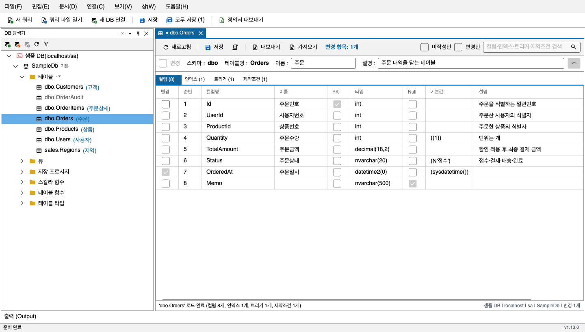

# SchemaForge

데이터베이스 객체에 **한글 업무 코멘트**(표시명 + 설명)를 붙이고 관리하는
크로스플랫폼 데스크톱 앱이다. MS SQL Server·MariaDB·MySQL·PostgreSQL·Oracle에 연결하고 Windows / macOS / Linux에서 똑같이 동작한다.

DB 객체를 트리와 그리드로 펼쳐 놓고 이름·설명을 훑어보며 고친 뒤 바뀐 것만 골라 저장한다.
붙인 코멘트는 제출용 엑셀 정의서로 내보내고 SQL 편집기로 직접 확인한다.

> 이 저장소는 **설치 파일 배포용**이다. 소스 코드는 공개하지 않는다. 사용법은 [사용 설명서](docs/README.md)에 있다.

---

## 내려받기

[최신 릴리스](https://github.com/almyeonseo/SchemaForge-releases/releases/latest)의 **Assets**에서
OS에 맞는 파일을 받는다. 모두 .NET 런타임이 들어 있어 따로 설치할 필요가 없다.
Assets 맨 아래의 "Source code" 압축은 이 안내문뿐이라 받지 않는다.

| OS | 받기 쉬운 형식 | zip |
|---|---|---|
| Windows (x64) | `SchemaForge-<버전>-win-x64-setup.exe` | `SchemaForge-<버전>-win-x64.zip` |
| macOS (Intel) | `SchemaForge-<버전>-osx-x64.dmg` | `SchemaForge-<버전>-osx-x64.zip` |
| macOS (Apple Silicon) | `SchemaForge-<버전>-osx-arm64.dmg` | `SchemaForge-<버전>-osx-arm64.zip` |
| Linux (x64) | `SchemaForge-<버전>-x86_64.AppImage` | `SchemaForge-<버전>-linux-x64.zip` |

- **Windows** — setup.exe를 실행하면 관리자 권한 없이 설치되고 시작 메뉴에 등록된다(제거는
  설정 > 앱). 설치 없이 쓰려면 zip을 받아 압축을 풀고 `SchemaForge.UI.exe`를 실행한다.
- **macOS** — dmg를 열어 앱을 Applications로 끌어 넣는다. zip은 Finder에서 더블클릭해
  푼다(터미널 `unzip`은 앱 서명을 깨뜨린다). 서명·공증을 하지 않은 앱이라 처음 실행이
  막히면 시스템 설정 > 개인정보 보호 및 보안에서 "그래도 열기"를 누른다.
- **Linux** — AppImage는 실행 권한을 주고(`chmod +x`) 실행한다. zip은 압축을 푼 자리에서 처음 한 번
  `sh install.sh`를 실행하면 실행 권한이 붙고 앱 메뉴에 등록된다.

새 버전이 나오면 앱 하단 상태바에 링크가 나타난다(**도움말 > 업데이트 확인**). 자동으로 적용하지는 않으니
링크에서 새 파일을 받는다. Windows 설치판은 새 setup.exe로 덮어 설치해도 연결 프로필과 저장된 비밀번호가 남는다.
각 릴리스의 "알려진 제약"도 함께 본다.

---

## DBMS별 지원 범위

코멘트는 DBMS가 원래 두는 자리에 `이름§설명` 형식으로 저장한다. MS SQL Server는 `MS_Description` 확장 속성,
MariaDB·MySQL은 개체의 `COMMENT`, PostgreSQL·Oracle은 `COMMENT ON`이다.

| | MS SQL Server | MariaDB·MySQL | PostgreSQL | Oracle |
|---|---|---|---|---|
| 코멘트를 저장하는 개체 | 테이블·컬럼·뷰·프로시저·함수·파라미터·인덱스·트리거·제약조건·테이블 타입 | 테이블·컬럼·프로시저·함수 | SQL Server와 같다(파라미터는 빼고 구체화 뷰를 더한다. 테이블 타입은 복합 타입) | 테이블·컬럼·뷰·구체화 뷰 |
| 읽기만 하는 것 | — | 뷰·인덱스·파라미터·STORED 계산 컬럼 | 파라미터 | 인덱스·프로시저·함수 |
| 저장 단위 | 한 트랜잭션 | 테이블마다, 실패하면 멈춤 | 한 트랜잭션 | 한 건씩, 실패하면 멈춤 |
| 코멘트 길이 한도 | 7,500바이트 | 테이블 2,048자·컬럼 1,024자 | 없음 | 4,000바이트 |
| 코드 복사 | 테이블·뷰·프로시저 | 테이블·뷰 | 테이블·뷰 | 테이블·뷰 |
| 테이블 `CREATE` 문 열기 | ✓ | ✓ | — | — |
| SQL 편집기 | 쓰기, 실패하면 롤백 | 조회 전용 | 조회 전용 | 조회 전용 |
| 확인한 버전 | — | MariaDB 12.0 이상, MySQL 8.4 | 17 | 23ai |

- 정의서 내보내기, 작성률, 저장 이력, 다른 DB·파일과 비교, 변경분 스크립트, CSV·Excel 주고받기는 다섯 DBMS에서 모두 된다.
- 조회 전용 편집기는 탭의 `쓰기 허용`을 켜면 쓴다. SQL Server만 실행 전에 `규모 확인`으로 예상 영향 규모를 본다.
- 연결 설정과 필요한 권한은 설명서에 DBMS마다 있다:
  [MariaDB](docs/getting-started-dbms.md#16-mariadb-연결) ·
  [MySQL](docs/getting-started-dbms.md#17-mysql-연결) ·
  [PostgreSQL](docs/getting-started-dbms.md#18-postgresql-연결) ·
  [Oracle](docs/getting-started-dbms.md#19-oracle-연결)

---

## 주요 기능

- **변경분만 저장** — 고친 행만 저장한다. `변경만` 보기로 확인하고 잘못 고친 행은 우클릭으로 되돌린다.
- **저장 충돌 발견** — 내가 불러온 뒤 다른 사람이 저장했으면 저장 직전에 알리고 항목별로 남길 값을 고르게 한다.
- **Excel에서 붙여넣기** — Excel에서 복사한 이름·설명 열을 그리드에 붙여 넣는다. 빈 셀은 있던 값을 지우지 않는다.
- **이름 제안과 맞추기** — 이름이 빈 컬럼에 같은 컬럼명에 쓰인 이름을 제안하고, 여러 테이블의 같은 컬럼명을 한 화면에서 맞춘다.
- **찾아 바꾸기·설명 편집** — 보이는 행의 이름·설명을 한꺼번에 바꾸고 긴 설명은 여러 줄 창에서 고친다.
- **작성률과 품질 점검** — DB마다 작성률, 미작성 개체, 이름이 갈린 컬럼을 보고 Excel 보고서로 저장한다. 날마다의 추이도 남는다.
- **다른 DB·파일과 비교** — 개발 DB나 내보내 둔 파일을 기준으로 다르거나 빈 항목만 모아 기준 값을 넣는다.
- **저장 이력** — 이 PC에서 저장한 이전 값과 새 값을 1년 동안 남기고 이전 값으로 되돌린다.
- **변경분 스크립트** — 고친 값을 DB에 쓰지 않고 SQL 스크립트로 내보내 DBA가 대신 넣게 한다.
- **엑셀 정의서** — 개체당 시트 하나와 표제부를 갖춘 제출용 문서를 만든다. Excel이 없어도 된다.
- **CSV·Excel 가져오기** — 가져온 값은 그리드에만 채워지고 확인한 뒤 저장해야 DB에 반영된다.
- **SQL 편집기** — 결과를 표로 보고 정렬·거르기 한 뒤 엑셀·CSV로 저장한다.
- **코드 복사** — 테이블·뷰를 컬럼마다 이름과 설명을 주석으로 단 C#·Java 클래스로 복사한다.
- **DB 탐색기** — 한 연결 아래 같은 서버의 DB가 모두 보이고 개체명·컬럼명·이름으로 찾는다.

기능마다 쓰는 법은 [사용 설명서](docs/README.md)에 있다.

---

## 사용 전에 알아 둘 것

- **비밀번호 보호 수준** — 연결 비밀번호는 AES-256-GCM으로 암호화해 저장하고 키는 설치별로
  무작위로 만들어 DB 파일 옆에 둔다. DB 파일이 실수로 노출됐을 때 평문 유출을 막는 수준이며
  OS 보안 저장소(Keychain 등) 연동은 아니다.
- **데이터 위치** — 연결 프로필, 설정, 저장 이력은 아래 폴더의 `SchemaForge.db`에, 예상하지 못한 오류는
  같은 폴더의 `logs/error.log`에 남는다(**도움말 > 오류 로그 폴더 열기**).

  | OS | 폴더 |
  |---|---|
  | Windows | 사용자 AppData(Roaming) 폴더 아래 `SchemaForge` |
  | macOS | `~/Library/Application Support/SchemaForge` |
  | Linux | `~/.config/SchemaForge` |

- **지원하지 않는 것** — 위 다섯 이외의 DBMS, Oracle 패키지 안의 프로시저·함수, DDL(스키마 자체) 관리, 편집 잠금,
  여러 사람의 변경 이력(감사 로그 — 저장 이력은 이 PC에서 저장한 것만 남긴다), 이름에 `§` 넣기.

---

## 문의·버그 제보

[Issues](https://github.com/almyeonseo/SchemaForge-releases/issues)에 남긴다. 오류가 났다면
`logs/error.log`를 함께 붙여 주면 원인을 찾기 쉽다(연결 문자열의 비밀번호는
지운 뒤 기록된다).
