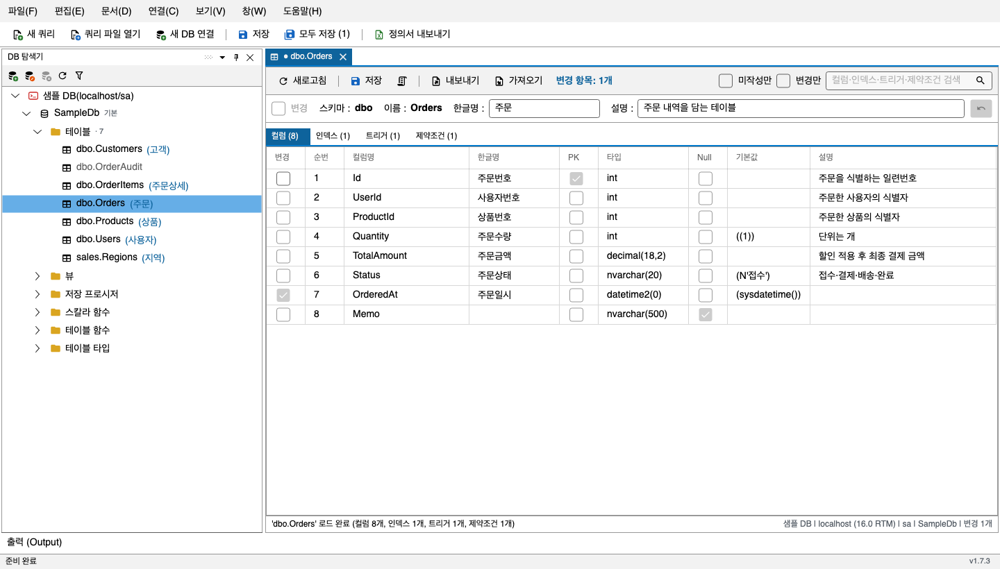

# SchemaForge

MS SQL Server 데이터베이스 객체에 **한글 업무 코멘트**(표시명 + 설명)를 붙이고 관리하는
크로스플랫폼 데스크톱 앱이다. Windows / macOS / Linux에서 똑같이 동작한다.
MariaDB에도 연결한다 — 테이블·컬럼·프로시저·함수 코멘트는 읽고 쓰고, 인덱스·파라미터와 STORED 계산 컬럼 코멘트는 읽기만 한다.

SSMS에서 객체마다 속성 창을 열거나 엑셀에 따로 적어 둘 필요가 없다. DB 객체를 트리와 그리드로
펼쳐 놓고 한글명·설명을 훑어보며 고친 뒤 바뀐 것만 골라 저장한다.

> 이 저장소는 **설치 파일 배포용**이다. 소스 코드는 공개하지 않는다.

사용법은 [사용 설명서](docs/README.md)에 있다.

---

## 내려받기

[최신 릴리스](https://github.com/almyeonseo/SchemaForge-releases/releases/latest)의 **Assets**에서
OS에 맞는 파일을 받는다. 모두 .NET 런타임이 들어 있어 따로 설치할 필요가 없다.
Assets 맨 아래의 "Source code" 압축은 이 안내문뿐이라 받지 않는다.

| OS | 받기 쉬운 형식 | zip |
|---|---|---|
| Windows (x64) | `SchemaForge-<버전>-win-x64-setup.exe` | `SchemaForge-<버전>-win-x64.zip` |
| macOS (Intel) | `SchemaForge-<버전>-osx-x64.dmg` | `SchemaForge-<버전>-osx-x64.zip` |
| macOS (Apple Silicon) | `SchemaForge-<버전>-osx-arm64.dmg` | `SchemaForge-<버전>-osx-arm64.zip` |
| Linux (x64) | `SchemaForge-<버전>-x86_64.AppImage` | `SchemaForge-<버전>-linux-x64.zip` |

- **Windows** — setup.exe를 실행하면 관리자 권한 없이 설치되고 시작 메뉴에 등록된다(제거는
  설정 > 앱). 설치 없이 쓰려면 zip을 받아 압축을 풀고 `SchemaForge.UI.exe`를 실행한다.
- **macOS** — dmg를 열어 앱을 Applications로 끌어 넣는다. zip은 Finder에서 더블클릭해 풀
  것(터미널 `unzip`은 앱 서명을 깨뜨린다). 서명·공증을 하지 않은 앱이라 처음 실행이
  막히면 시스템 설정 > 개인정보 보호 및 보안에서 "그래도 열기"를 누른다.
- **Linux** — AppImage는 `chmod +x` 후 실행한다. zip은 압축을 푼 자리에서 처음 한 번
  `sh install.sh`를 실행하면 실행 권한이 붙고 앱 메뉴에 등록된다.

새 버전이 나오면 앱 하단 상태바에 링크가 나타난다(**도움말 > 업데이트 확인**으로 직접 확인할
수도 있다). 자동으로 내려받아 적용하지는 않으니 링크에서 새 파일을 받는다.
Windows 설치판은 새 setup.exe를 실행하면 덮어 설치되고 연결 프로필과 저장된 비밀번호는
그대로 남는다.

각 릴리스의 "알려진 제약"을 함께 볼 것.

---

## 주요 기능

- **다루는 객체** — 테이블, 컬럼, 뷰, 뷰 컬럼, 저장 프로시저, 스칼라/테이블 함수,
  파라미터, 인덱스, 트리거, 사용자 정의 테이블 타입과 그 컬럼의 `MS_Description` 확장 속성을
  읽고 쓴다.
- **한글명과 설명을 한 값에** — 확장 속성 값 하나에 `한글명§설명` 형태로 함께 담는다.
- **변경분만 저장** — 고친 항목만 골라 한 트랜잭션으로 저장한다(MariaDB는 한 건씩 저장하고 실패하면 멈춘다). 저장 전에 `변경만` 보기로
  바뀐 행만 훑어보고 잘못 고친 행은 우클릭 `원래 값으로 되돌리기`로 돌린다.
- **Excel에서 붙여넣기** — Excel에서 복사한 한글명(과 설명) 열을 그리드의 고른 행부터 Windows `Ctrl+V` /
  macOS `Cmd+V`로 넣는다. 빈 셀은 있던 값을 지우지 않는다.
- **같은 이름 컬럼 한글명 맞추기** — `CUST_NO`처럼 여러 테이블에 되풀이되는 컬럼을 한 화면에 모아,
  지금 쓰이는 한글명을 보고 한꺼번에 맞춘다.
- **찾아 바꾸기·설명 편집** — 보이는 행의 한글명·설명에서 글자를 한꺼번에 바꾸고(`거래처` → `고객`), 긴 설명은 큰 창에서
  여러 줄로 고친다.
- **한글명 제안** — 빈 컬럼·파라미터에 같은 이름 컬럼에 가장 많이 쓰인 한글명(뷰는 원본 테이블 컬럼의 한글명)을 제안해 한 번에 채운다.
- **다른 DB와 비교** — 개발 DB 같은 기준 DB와 비교해 이 DB에서 값이 다르거나 빈 항목만 나란히 보고 기준 값을 넣어 맞춘다.
  저장은 이 DB에만 하고 기준 DB에는 쓰지 않는다. 기준 DB는 같은 종류의 연결(SQL Server끼리, MariaDB끼리)에서 고른다.
- **변경분 스크립트** — 고친 값을 DB에 쓰지 않고 확장 속성 SQL 스크립트로 내보낸다. 직접 저장할 권한이 없는 DB에
  DBA가 대신 넣을 때 쓴다.
- **저장 이력** — 이 PC에서 저장한 코멘트의 이전 값과 새 값을 1년 동안 남기고, 이전 값을 그 개체 문서의 그리드에 곧바로 넣어
  되돌린다. 대상 DB에는 아무것도 만들지 않는다.
- **저장 충돌 발견** — 내가 불러온 뒤 다른 사람이 같은 개체를 저장했으면, 저장 직전에 알려 주고
  항목별로 어느 값을 남길지 고르게 한다.
- **엑셀 정의서 내보내기** — 개체당 시트 하나 + 분류별 목록 시트, 표제부를 갖춘 제출용 문서를
  만든다. Excel이 설치되어 있지 않아도 된다.
- **CSV / Excel 가져오기·내보내기** — 전체나 보이는 행만 내보낸다. 가져온 값은 그리드에 채워질 뿐이고, 확인한 뒤 저장을
  눌러야 DB에 반영된다.
- **미작성만 보기·작성률** — 한글명이 비어 있는 항목만 걸러 보고, `F8`(이전은 `Shift+F8`)로 다음 미작성
  항목으로 이동한다. DB마다 작성률과 미작성 개체, 한글명이 갈린 같은 이름 컬럼을 보고 Excel 보고서로 저장한다.
- **DB 탐색기** — 한 연결 아래에 같은 서버의 DB가 모두 보여, 프로필을 따로 만들지 않고 여러 DB를 다룬다.
  개체 이름뿐 아니라 컬럼 이름·한글명으로도 찾는다.
- **글꼴·글자 크기 설정** — 화면 글꼴과 글자 크기(12~18), 코드 글꼴과 글자 크기를 고른다. 기본 코드 글꼴 D2Coding은 한글이 영문 두 칸
  폭이라 한글이 섞인 SQL도 세로 줄이 맞는다.
- **연결 정보 줄** — 문서마다 하단에 지금 탭이 붙은 서버(버전)·사용자·DB가 늘 보인다.
- **SQL 편집기** — 고른 DB에 SQL을 실행해 결과를 표로 보고, 엑셀·CSV로 저장한다. 실행 전에
  예상 영향 규모를 보여 주고 실패하면 전체를 롤백한다. 개체 이름에 마우스를 올리면 한글명이 보이고
  결과는 화면에서 정렬·거르기·열 고정을 할 수 있다.
- **정의 열기** — 뷰·프로시저·함수의 본문과 테이블의 `CREATE TABLE` 스크립트를 새 SQL 탭에 연다. 테이블 스크립트에는
  컬럼·기본값·계산 컬럼·키·제약·인덱스·코멘트가 담긴다. 그대로 실행하면 원래와 다른 테이블이 생기는 경우(시간 테이블 등)는 열지 않고 이유를 알린다.
- **MariaDB 연결** — MariaDB 12.0 이상에 붙어 테이블·컬럼·인덱스·프로시저·함수·파라미터 코멘트를 같은 `한글명§설명` 형식으로
  보고, 테이블·컬럼·프로시저·함수 코멘트를 저장한다. 작성률·컬럼 검색·CSV/Excel 내보내기와 가져오기·저장 이력·변경분 스크립트·다른 DB와 비교는
  SQL Server와 같다. SQL 편집기·정의 열기·정의서 내보내기는 SQL Server 연결에서만 쓴다
  ([설명서 1.5](docs/getting-started.md#15-mariadb-연결)).

---

## 사용 전에 알아 둘 것

- **비밀번호 보호 수준** — 연결 비밀번호는 AES-256-GCM으로 암호화해 저장하고 키는 설치별로
  무작위로 만들어 DB 파일 옆에 둔다. DB 파일이 실수로 노출됐을 때 평문 유출을 막는 수준이며
  OS 보안 저장소(Keychain 등) 연동은 아니다.
- **데이터 위치** — 연결 프로필, 설정, 저장 이력은 아래 폴더의 `SchemaForge.db`에, 예상하지 못한 오류는
  같은 폴더의 `logs/error.log`에 남는다(**도움말 > 오류 로그 폴더 열기**).

  | OS | 폴더 |
  |---|---|
  | Windows | 사용자 AppData(Roaming) 폴더 아래 `SchemaForge` |
  | macOS | `~/Library/Application Support/SchemaForge` |
  | Linux | `~/.config/SchemaForge` |

- **지원하지 않는 것** — MS SQL Server·MariaDB 이외의 DBMS, MariaDB 인덱스·STORED 계산 컬럼 코멘트 저장, DDL(스키마 자체) 관리, 편집 잠금,
  여러 사람의 변경 이력(감사 로그 — 저장 이력은 이 PC에서 저장한 것만 남긴다), 한글명에 `§` 넣기.

---

## 문의·버그 제보

[Issues](https://github.com/almyeonseo/SchemaForge-releases/issues)에 남긴다. 오류가 났다면
`logs/error.log`를 함께 붙여 주면 원인을 찾기 쉽다(연결 문자열의 비밀번호는
지운 뒤 기록된다).
