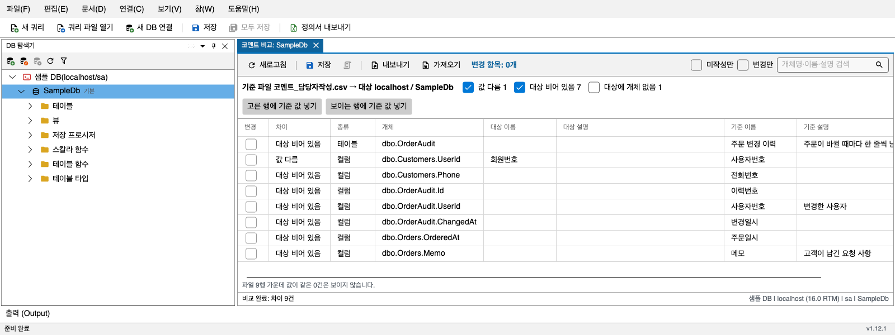

# 2. 코멘트 달기 — 다른 DB·파일과 비교

[목차](README.md) · 이전: [2. 작성률](comments-review.md) · 다음: [2. 저장 이력](comments-history.md)

이 장은 SchemaForge 1.13.0 기준이다. MariaDB·MySQL·PostgreSQL·Oracle 연결에서 달라지는 점은 [1.6](getting-started-dbms.md#16-mariadb-연결)~[1.9](getting-started-postgresql-oracle.md#19-oracle-연결)에 모아 두었다.

- **코멘트 저장 위치** ([comments.md](comments.md))
  - [2.1 코멘트는 어디에 저장되나](comments.md#21-코멘트는-어디에-저장되나)
- **편집 화면** ([comments-screen.md](comments-screen.md))
  - [2.2 편집 화면 열기](comments-screen.md#22-편집-화면-열기)
- **값 입력** ([comments-input.md](comments-input.md))
  - [2.3 값 입력하기](comments-input.md#23-값-입력하기)
- **채울 곳만 보기** ([comments-filter.md](comments-filter.md))
  - [2.4 채울 곳만 보기](comments-filter.md#24-채울-곳만-보기)
- **저장과 충돌** ([comments-save.md](comments-save.md))
  - [2.5 저장하기](comments-save.md#25-저장하기)
  - [2.6 저장 충돌](comments-save.md#26-저장-충돌)
- **행 되돌리기** ([comments-revert.md](comments-revert.md))
  - [2.7 행 되돌리기](comments-revert.md#27-행-되돌리기)
- **붙여넣기와 이름 제안** ([comments-fill.md](comments-fill.md))
  - [2.8 Excel에서 붙여넣기](comments-fill.md#28-excel에서-붙여넣기)
  - [2.9 이름 제안으로 채우기](comments-fill.md#29-이름-제안으로-채우기)
- **이름 맞추기와 찾아 바꾸기** ([comments-match.md](comments-match.md))
  - [2.10 같은 컬럼명 이름 맞추기](comments-match.md#210-같은-컬럼명-이름-맞추기)
  - [2.11 찾아 바꾸기와 설명 편집](comments-match.md#211-찾아-바꾸기와-설명-편집)
- **작성률** ([comments-review.md](comments-review.md))
  - [2.12 작성률 보기](comments-review.md#212-작성률-보기)
- **다른 DB·파일과 비교**
  - [2.13 다른 DB와 비교해 맞추기](#213-다른-db와-비교해-맞추기)
- **저장 이력** ([comments-history.md](comments-history.md))
  - [2.14 저장 이력](comments-history.md#214-저장-이력)
- **변경분 스크립트** ([comments-script.md](comments-script.md))
  - [2.15 변경분을 SQL 스크립트로 내보내기](comments-script.md#215-변경분을-sql-스크립트로-내보내기)

## 2.13 다른 DB와 비교해 맞추기

개발 DB에서 다듬은 코멘트를 운영 DB에 맞출 때처럼, 다른 DB(기준)와 비교해 **이 DB(대상)에서 값이 다르거나 빈 항목만** 모아 맞춘다.

### 여는 법

1. DB 탐색기에서 **맞출 DB(대상)** 노드를 오른쪽 클릭 > `다른 DB 코멘트와 비교...`. 오른쪽 클릭한 DB가 저장할 곳이다.
2. 창에서 기준 연결과 기준 DB를 고른다. 처음에는 대상과 같은 연결이 골라져 있고, 다른 연결을 고르면 대상과 이름이 같은 DB를 먼저 고른다.
   대상과 같은 연결의 같은 DB는 고를 수 없다. 기준 연결 목록에는 대상과 같은 종류의 연결(SQL Server끼리, MariaDB끼리)만 나온다.
3. `비교`를 누르면 `코멘트 비교: {DB}` 탭이 열린다. 같은 대상·같은 기준으로 다시 열면 열린 탭으로 간다.

### 화면

그리드 위에 `기준 {서버} / {DB} → 대상 {서버} / {DB}`와 차이 종류별 체크가 보인다.

| 차이 | 뜻 | 처음 | 행 |
|---|---|---|---|
| `값 다름` | 두 DB 모두 값이 있는데 이름이나 설명이 다르다 | 켬 | 대상 값을 고칠 수 있다 |
| `대상 비어 있음` | 기준에는 값이 있고 대상은 비었다 | 켬 | 대상 값을 고칠 수 있다 |
| `대상에 개체 없음` | 기준에만 있는 개체다(아직 배포하지 않은 컬럼 등) | 끔 | 흐리게 보이고 고칠 수 없다 |

- 그리드 칸은 `변경 · 차이 · 종류 · 개체 · 대상 이름 · 대상 설명 · 기준 이름 · 기준 설명`이다. 대상 두 칸만 고칠 수 있다.
- **열었을 때 대상 칸에는 대상 DB의 지금 값이 들어 있고, `변경 항목: 0개`다.** 기준 값은 직접 넣어야 들어간다.
- 값이 같은 항목과 **대상에만 값이 있는 항목은 행으로 보이지 않고** 그리드 아래에 건수만 적는다. 이 화면은 대상 값을 지우지 않는다.
- 비교는 앞뒤 공백을 무시한다. 다루는 종류는 테이블·컬럼·뷰·뷰 컬럼·프로시저·함수·파라미터·테이블 타입·타입 컬럼이다(인덱스·트리거·제약조건은 빼고).
  MariaDB는 테이블·컬럼·프로시저·함수다.

### 맞추는 순서

1. 차이 체크와 검색으로 볼 행을 좁힌다.
2. `보이는 행에 기준 값 넣기`로 보이는 행 전부에, `고른 행에 기준 값 넣기`로 그리드에서 고른 행에만 기준 값을 넣는다.
   기준이 빈 칸은 넣지 않는다(기준 설명이 비었으면 대상 설명은 그대로다).
   MariaDB의 `STORED` 계산 컬럼 행은 코멘트를 저장할 수 없어 건너뛰고, 상태바에
   `기준 값을 N개 행에 넣었습니다. 쓸 수 없는 M개 행은 건너뛰었습니다. 저장해야 DB에 반영됩니다.`가 나온다.
3. 필요하면 대상 칸을 손으로 고친다. 붙여넣기·찾아 바꾸기·설명 편집·행 되돌리기도 다른 코멘트 문서와 같다.
4. `변경만`을 켜서 확인하고 `저장`을 누른다. **대상 DB에만 저장한다.** 저장 전 검사, 저장 충돌 확인, 저장 로그와 저장 이력은 다른 문서와 같다.
   기준 DB에는 어떤 경우에도 쓰지 않는다. MariaDB는 차례로 저장하고 실패한 곳에서 멈춘다([MariaDB 저장](getting-started-dbms.md#mariadb-저장)).
5. 저장해도 행은 그 자리에 남는다. `새로고침`을 누르면 두 DB를 다시 읽고, 같아진 행이 빠진다.

- 운영 DB에 직접 저장할 권한이 없으면 4번에서 `저장` 대신 [변경분 스크립트](comments-script.md#215-변경분을-sql-스크립트로-내보내기)를 만들어 DBA에게 넘긴다.
- 어느 한쪽 DB를 읽지 못하면 행을 하나도 보이지 않고 상태줄에 기준·대상 중 어느 쪽인지 알려 준다.

### 파일과 비교하기

기준을 다른 DB 대신 **파일**로 둔다. 담당자가 채워 보낸 엑셀처럼 여러 테이블의 값이 든 파일 하나를 DB 전체에 맞출 때 쓴다.
문서의 `가져오기`는 열려 있는 문서의 항목에만 넣으므로, 테이블이 많으면 이쪽이 빠르다.

1. DB 탐색기에서 **맞출 DB(대상)** 노드를 오른쪽 클릭 > `파일의 코멘트와 비교...`.
2. 파일을 고른다. 문서 툴바 `내보내기`로 만든 CSV·Excel 형식이어야 한다([3.1](import-export.md)).
3. 비교 문서가 열린다. 머리글 줄이 `기준 파일 {파일명} → 대상 {서버} / {DB}`인 것만 다르고 화면과 맞추는 순서는 위와 같다.

- **열기만 해서는 아무것도 바뀌지 않는다.** `기준 값 넣기`를 눌러야 그리드에 들어가고 `저장`을 눌러야 DB에 들어간다.
- **파일의 빈 칸은 차이로 보지 않는다.** 이름만 채운 파일이면 대상의 설명은 그대로 남는다. 빈 칸으로 값을 지울 수는 없다.
- 파일에만 있는 개체(이름이 맞지 않는 행)는 `대상에 개체 없음`을 켜면 보인다.
- 인덱스·제약조건·트리거 행은 다루지 않고, 그 행 수를 머리글 아래에 알린다. 그 행은 테이블 문서의 `가져오기`로 넣는다.
- 같은 항목의 행이 파일에 겹치면 뒤의 행을 쓰고 그 수를 알린다.
- 파일을 읽지 못하면 행을 하나도 보이지 않고 상태줄에 `기준 파일을 읽지 못했습니다: …`가 나온다.
- 파일을 고친 뒤에는 그 탭에서 `새로고침`한다. 같은 DB에 같은 파일을 다시 고르면 열린 탭으로 간다.
