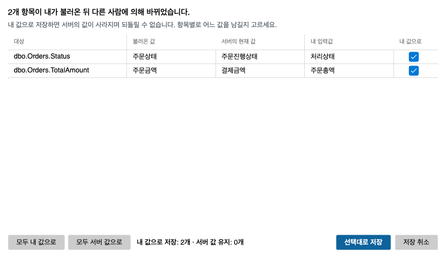

# 2. 코멘트 달기 — 저장 충돌

[목차](README.md) · 이전: [2.5 저장하기](comments-save.md) · 다음: [2.7 행 되돌리기](comments-revert.md)

이 장은 SchemaForge 1.13.0 기준이다. MariaDB·MySQL·PostgreSQL·Oracle 연결에서 달라지는 점은 [1.6](getting-started-dbms.md#16-mariadb-연결)~[1.9](getting-started-oracle.md#19-oracle-연결)에 모아 두었다.

- [2.1 코멘트는 어디에 저장되나](comments.md#21-코멘트는-어디에-저장되나)
- [2.2 편집 화면 열기](comments-screen.md#22-편집-화면-열기)
- [2.3 값 입력하기](comments-input.md#23-값-입력하기)
- [2.4 채울 곳만 보기](comments-filter.md#24-채울-곳만-보기)
- [2.5 저장하기](comments-save.md#25-저장하기)
- [2.6 저장 충돌](#26-저장-충돌)
- [2.7 행 되돌리기](comments-revert.md#27-행-되돌리기)
- [2.8 Excel에서 붙여넣기](comments-fill.md#28-excel에서-붙여넣기)
- [2.9 이름 제안으로 채우기](comments-suggest.md#29-이름-제안으로-채우기)
- [2.10 같은 컬럼명 이름 맞추기](comments-match.md#210-같은-컬럼명-이름-맞추기)
- [2.11 찾아 바꾸기와 설명 편집](comments-replace.md#211-찾아-바꾸기와-설명-편집)
- [2.12 작성률 보기](comments-review.md#212-작성률-보기)
- [2.13 다른 DB와 비교해 맞추기](comments-compare.md#213-다른-db와-비교해-맞추기)
- [2.14 저장 이력](comments-history.md#214-저장-이력)
- [2.15 변경분을 SQL 스크립트로 내보내기](comments-script.md#215-변경분을-sql-스크립트로-내보내기)

## 2.6 저장 충돌

내가 문서를 연 뒤 다른 사람이 같은 항목을 저장했으면, 모르고 남의 값을 덮어쓰지 않도록 저장 직전에 그 사실을
알려 준다. 충돌이 없으면 이 창은 뜨지 않는다.

| 칸 | 뜻 |
|---|---|
| 대상 | 충돌한 항목 |
| 불러온 값 | 내가 문서를 열었을 때의 값 |
| 서버의 현재 값 | 다른 사람이 저장한 값 |
| 내 입력값 | 내가 지금 저장하려는 값 |
| 내 값으로 | 체크하면 내 값으로 덮어쓰고, 끄면 서버 값을 그대로 둔다 |

- 처음에는 모든 행이 `내 값으로`에 체크되어 있다. 체크는 한 번 누르면 바뀐다.
- **모두 내 값으로**와 **모두 서버 값으로**로 한꺼번에 바꿀 수 있다.
- **선택대로 저장**을 누르면 체크한 행만 저장한다. 체크를 끈 행은 화면 값이 서버 값으로 바뀌고 내 입력값은 버려진다. 출력 창에 `N개 항목을 서버 값으로 되돌렸습니다(저장하지 않음).`이 남는다.
- **저장 취소**(또는 `Esc`, 창 닫기)를 누르면 아무것도 저장하지 않고 편집한 값은 그대로 남는다. 상태줄에 `저장을 취소했습니다. 편집한 내용은 그대로 남아 있습니다.`가 보인다.
- **내 값으로 덮어쓴 항목은 덮인 서버 값이 이전 값으로 남는다.** [저장 로그](comments-save.md#저장-로그)와 [저장 이력](comments-history.md#214-저장-이력)의 이전 값은 처음 불러온 값이 아니라 다른 사람이 넣었던 서버 값이다. 필요하면 그 값으로 되돌릴 수 있다.

다른 사람이 나와 같은 값으로 바꿨거나 공백만 다르면 충돌로 보지 않는다.

서버 값을 다시 읽지 못하면 충돌 여부를 알 수 없으므로 저장하지 않는다. 상태줄에
`저장 충돌을 확인할 수 없어 저장하지 않았습니다. 연결 상태를 확인한 뒤 다시 시도하세요.`가 나온다.

이 기능은 덮어쓰기 전에 알려 줄 뿐, 다른 사람의 편집을 막지는 않는다.
