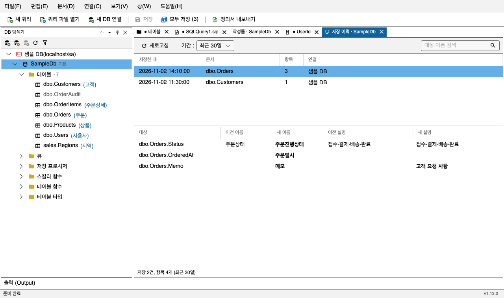

# 2. 코멘트 달기 — 저장 이력

[목차](README.md) · 이전: [2.13 다른 DB와 비교해 맞추기](comments-compare.md) · 다음: [2.15 변경분을 SQL 스크립트로 내보내기](comments-script.md)

이 장은 SchemaForge 1.13.0 기준이다. MariaDB·MySQL·PostgreSQL·Oracle 연결에서 달라지는 점은 [1.6](getting-started-dbms.md#16-mariadb-연결)~[1.9](getting-started-oracle.md#19-oracle-연결)에 모아 두었다.

- [2.1 코멘트는 어디에 저장되나](comments.md#21-코멘트는-어디에-저장되나)
- [2.2 편집 화면 열기](comments-screen.md#22-편집-화면-열기)
- [2.3 값 입력하기](comments-input.md#23-값-입력하기)
- [2.4 채울 곳만 보기](comments-filter.md#24-채울-곳만-보기)
- [2.5 저장하기](comments-save.md#25-저장하기)
- [2.6 저장 충돌](comments-conflict.md#26-저장-충돌)
- [2.7 행 되돌리기](comments-revert.md#27-행-되돌리기)
- [2.8 Excel에서 붙여넣기](comments-fill.md#28-excel에서-붙여넣기)
- [2.9 이름 제안으로 채우기](comments-suggest.md#29-이름-제안으로-채우기)
- [2.10 같은 컬럼명 이름 맞추기](comments-match.md#210-같은-컬럼명-이름-맞추기)
- [2.11 찾아 바꾸기와 설명 편집](comments-replace.md#211-찾아-바꾸기와-설명-편집)
- [2.12 작성률 보기](comments-review.md#212-작성률-보기)
- [2.13 다른 DB와 비교해 맞추기](comments-compare.md#213-다른-db와-비교해-맞추기)
- [2.14 저장 이력](#214-저장-이력)
- [2.15 변경분을 SQL 스크립트로 내보내기](comments-script.md#215-변경분을-sql-스크립트로-내보내기)

## 2.14 저장 이력

이 앱으로 저장한 코멘트의 이전 값과 새 값을 **이 PC에** 남겨 두고 다시 볼 수 있게 한다. 잘못 저장했을 때 원래 값을 찾는 데 쓴다.

### 무엇이 남나

- 코멘트 저장이 성공할 때마다 한 묶음이 남는다. 묶음에는 저장한 때, 문서(`dbo.Orders`, `'CUST_NO' 컬럼` 등), 항목 수, 연결이 있고, 그 아래 항목마다 이전·새 이름과 설명이 있다. 이전 값의 기준은 [저장 로그](comments-save.md#저장-로그)와 같다.
- 저장이 실패하면 DB에서 바뀐 것이 없으므로 남지 않는다.
- **이력을 남기지 못해도 저장은 성공으로 끝난다.** DB에는 이미 들어갔으므로 출력 창에 `[경고] … 저장 이력을 남기지 못했습니다: …`만 남는다.
- **1년이 지난 묶음은 지운다.**
- **이 PC에서 이 앱으로 저장한 것만 있다.** 다른 사람이 저장한 것, SSMS나 다른 프로그램으로 바꾼 것은 없다. 다른 PC로 옮겨지지도 않는다.
- 연결 이름·서버·DB만 적고 계정과 비밀번호는 남기지 않는다. 대상 DB에는 아무것도 만들지 않는다.

### 여는 법

DB 탐색기에서 DB 노드 오른쪽 클릭 > `저장 이력 보기`. 탭 이름은 `저장 이력 · {DB}`이고 그 연결·DB의 이력만 보인다. 같은 DB를 다시 열면 열린 탭으로 간다.

### 화면

| 위치 | 내용 |
|---|---|
| 툴바 | `새로고침`, `기간`(`오늘` · `최근 7일` · `최근 30일` · `전체`, 처음은 `최근 30일`), 검색 칸(`대상·이름 검색`) |
| 위 목록 | 저장 묶음. `저장한 때 · 문서 · 항목 · 연결`, 최근 것부터 |
| 아래 목록 | 위에서 고른 묶음의 항목. `대상 · 이전 이름 · 새 이름 · 이전 설명 · 새 설명` |
| 상태줄 | 예: `저장 2건, 항목 21개 (최근 30일)` |

- 아래 목록에서 **바뀐 칸의 새 값은 굵게** 보인다.
- 검색어는 대상 이름과 이전·새 이름을 본다. 대상 이름은 목록에 보이는 그대로(`dbo.Orders`, `dbo.Orders.CUST_NO`) 넣으면 된다. `Enter`나 돋보기로 찾고 `✕`로 지운다.
- 이 탭을 열어 둔 채 그 DB에 저장하면, 탭을 다시 볼 때 목록을 다시 읽는다.
- 읽기 전용 화면이다. 이 화면에서 DB에 곧바로 쓰는 길은 없다.

### 개체 문서 열기

아래 목록의 항목을 더블클릭하거나 `Enter`를 누르면 그 개체의 코멘트 문서가 열린다. 컬럼 항목이면 컬럼 탭에서 그 행이 골라진다.
DB의 지금 값을 보고 판단하도록 이력의 값은 넣지 않는다.

### 이전 값으로 되돌리기

1. 아래 목록에서 되돌릴 항목을 고른다(여러 개면 `Shift`+클릭 등으로).
2. 오른쪽 클릭 > `이전 값 복사`. 이전 이름·설명이 Excel에서 복사한 모양(줄마다 한 항목, 이름·설명 두 칸)으로 클립보드에 들어간다. 상태줄에 `이전 값 N개를 복사했습니다. 코멘트 문서의 같은 행부터 붙여넣고 저장하면 되돌아갑니다.`가 나온다.
3. 되돌릴 행이 있는 코멘트 문서를 연다. 컬럼 항목은 이력에서 더블클릭하면 그 행이 골라진 채 열린다.
4. 그 행의 `이름` 칸을 고른 채 `Ctrl+V`(macOS는 `Cmd+V`)로 붙여넣는다([2.8절](comments-fill.md#28-excel에서-붙여넣기)).
5. 들어간 값을 확인하고 `저장`을 누른다.

- 붙여넣기는 고른 행부터 **그리드의 화면 순서대로** 넣는다. 여러 항목을 한 번에 붙여넣을 때는 이력의 항목 순서와 그리드의 행 순서가 같은지 확인한다. 다르면 한 항목씩 복사해 붙여넣는다.
- 테이블·뷰 같은 개체 자신의 항목은 개체 문서에서는 머리글(입력칸)에 있어 그리드 붙여넣기를 쓸 수 없다. 분류 목록 문서(`테이블 코멘트 관리` 등)에서 그 행을 골라 붙여넣거나 머리글에 직접 입력한다.
- **이전 값이 빈 칸이면 붙여넣기로 지워지지 않는다**(빈 셀은 넣지 않는다). 복사할 때 그런 칸이 있으면 상태줄에 그 수를 함께 알려 준다.
  처음 채운 이름을 비우려면 아래 `그리드에 이전 값 넣기`를 쓰거나 셀에서 직접 지운다.

### 그리드에 이전 값 넣기

붙여넣기 없이 이전 값을 곧바로 그리드에 넣는다. 빈 이전 값도 그대로 넣으므로, 새로 단 이름을 되돌릴 때 편하다.

1. 아래 목록에서 되돌릴 항목을 고른다(여러 개 가능).
2. 오른쪽 클릭 > `그리드에 이전 값 넣기`.
3. 그 개체의 코멘트 문서가 열리고(열려 있으면 그 탭) 이전 이름·설명이 그리드에 들어간다. 여러 개체에 걸치면 문서를 여럿 연다.
4. 각 문서에서 `변경`으로 표시된 행을 확인하고 `저장`을 누른다.

다음 항목은 넣지 않고 이력 탭 상태줄에 사유별로 센다.

| 넣지 않는 항목 | 이유 |
|---|---|
| 그 문서에 저장하지 않은 편집이 있는 항목 | 덮으면 고치던 값이 사라진다 |
| DB의 지금 값이 이력의 새 값과 다른 항목 | 그 저장 뒤에 누가 다시 바꾼 것이라, 되돌리면 그 뒤의 변경까지 지운다 |
| 문서에서 찾지 못한 항목 | 개체가 지워졌거나 이름이 바뀌었다 |
