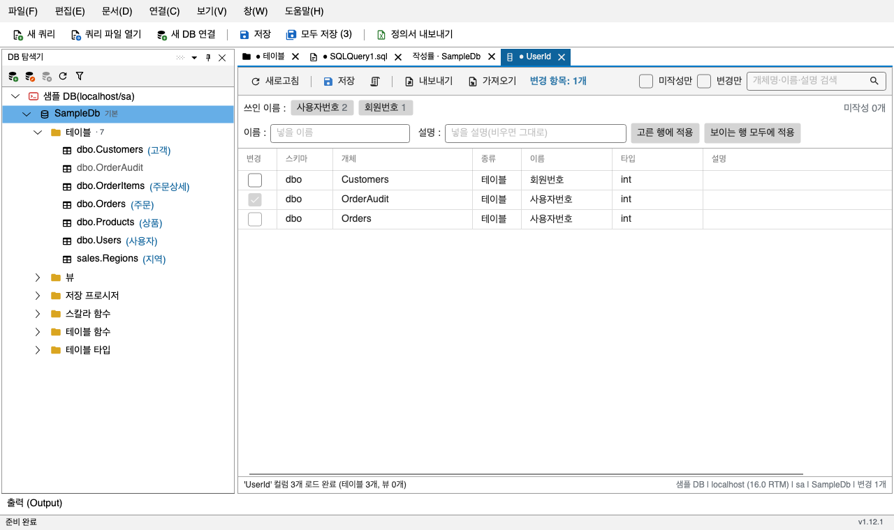

# 2. 코멘트 달기 — 이름 맞추기와 찾아 바꾸기

[목차](README.md) · 이전: [2. 이름 제안](comments-suggest.md) · 다음: [2. 작성률](comments-review.md)

이 장은 SchemaForge 1.13.0 기준이다. MariaDB·MySQL·PostgreSQL·Oracle 연결에서 달라지는 점은 [1.6](getting-started-dbms.md#16-mariadb-연결)~[1.9](getting-started-postgresql-oracle.md#19-oracle-연결)에 모아 두었다.

- **코멘트 저장 위치** ([comments.md](comments.md))
  - [2.1 코멘트는 어디에 저장되나](comments.md#21-코멘트는-어디에-저장되나)
- **편집 화면** ([comments-screen.md](comments-screen.md))
  - [2.2 편집 화면 열기](comments-screen.md#22-편집-화면-열기)
- **값 입력** ([comments-input.md](comments-input.md))
  - [2.3 값 입력하기](comments-input.md#23-값-입력하기)
- **채울 곳만 보기** ([comments-filter.md](comments-filter.md))
  - [2.4 채울 곳만 보기](comments-filter.md#24-채울-곳만-보기)
- **저장과 충돌** ([comments-save.md](comments-save.md))
  - [2.5 저장하기](comments-save.md#25-저장하기)
  - [2.6 저장 충돌](comments-save.md#26-저장-충돌)
- **행 되돌리기** ([comments-revert.md](comments-revert.md))
  - [2.7 행 되돌리기](comments-revert.md#27-행-되돌리기)
- **Excel에서 붙여넣기** ([comments-fill.md](comments-fill.md))
  - [2.8 Excel에서 붙여넣기](comments-fill.md#28-excel에서-붙여넣기)
- **이름 제안** ([comments-suggest.md](comments-suggest.md))
  - [2.9 이름 제안으로 채우기](comments-suggest.md#29-이름-제안으로-채우기)
- **이름 맞추기와 찾아 바꾸기**
  - [2.10 같은 컬럼명 이름 맞추기](#210-같은-컬럼명-이름-맞추기)
  - [2.11 찾아 바꾸기와 설명 편집](#211-찾아-바꾸기와-설명-편집)
- **작성률** ([comments-review.md](comments-review.md))
  - [2.12 작성률 보기](comments-review.md#212-작성률-보기)
- **다른 DB·파일과 비교** ([comments-compare.md](comments-compare.md))
  - [2.13 다른 DB와 비교해 맞추기](comments-compare.md#213-다른-db와-비교해-맞추기)
- **저장 이력** ([comments-history.md](comments-history.md))
  - [2.14 저장 이력](comments-history.md#214-저장-이력)
- **변경분 스크립트** ([comments-script.md](comments-script.md))
  - [2.15 변경분을 SQL 스크립트로 내보내기](comments-script.md#215-변경분을-sql-스크립트로-내보내기)

## 2.10 같은 컬럼명 이름 맞추기

`REG_DT`·`CUST_NO`처럼 여러 테이블에 되풀이되는 컬럼의 이름을 한 화면에서 맞춘다. 테이블 문서를 하나씩 열지 않아도 된다.

### 여는 법

1. DB 탐색기 검색에서 찾을 대상을 `컬럼`으로 바꾸고 컬럼명을 찾는다(검색 쓰는 법은 [1장](getting-started.md)).
2. 결과 목록의 줄을 오른쪽 클릭 > `이 컬럼명의 이름 맞추기 (CUST_NO)`.
3. 그 DB에서 이름이 같은 컬럼을 모은 문서가 열린다. 탭 제목은 컬럼 이름(`CUST_NO`)이다.

- 이름이 **정확히 같은**(대소문자 무시) **테이블 컬럼과 뷰 컬럼**을 모두 읽는다. `CUST_NO_OLD` 같은 부분 일치는 넣지 않는다. 테이블 타입 컬럼은 넣지 않는다.
- 같은 이름으로 다시 열면 새로 읽지 않고 열려 있는 탭으로 간다.
- 상태줄에 `'CUST_NO' 컬럼 20개 로드 완료 (테이블 18개, 뷰 2개)`처럼 보인다.

### 화면

- 그리드 칸: `변경 · 스키마 · 개체 · 종류 · 이름 · 타입 · 설명`. `종류`가 `테이블`/`뷰`를 가른다.
- **쓰인 이름** 줄: 지금 그리드에 쓰인 이름을 많이 쓴 순으로 개수와 함께 보이고, 이름이 빈 행은 `미작성 N개`로 따로 적는다. 값을 고치면 개수가 곧바로 바뀐다.
- `넣을 이름` · `넣을 설명(비우면 그대로)` 칸과 `고른 행에 적용` · `보이는 행 모두에 적용` 버튼. 두 칸 중 값을 넣은 칸만 바꾼다.
- 툴바의 저장·내보내기·가져오기·`미작성만`·`변경만`과 행 되돌리기·붙여넣기는 다른 코멘트 문서와 같다.
- **검색어는 컬럼명 대신 개체(테이블·뷰)의 개체명과 이름·설명을 본다**(검색 칸 안내는 `개체명·이름·설명 검색`). 컬럼명은 모두 같아서다.

### 이름 맞추는 순서

1. **쓰인 이름**에서 맞출 값(예: `고객번호 12`)을 누른다. 아래 `넣을 이름` 칸에 그 값이 들어간다. 직접 입력해도 된다.
2. 바꿀 범위를 정한다.
   - 몇 행만 바꾸려면 그리드에서 그 행들을 고르고 `고른 행에 적용`.
   - 보이는 행 전부를 바꾸려면 `보이는 행 모두에 적용`. 검색이나 `미작성만`으로 좁혀 두었으면 **보이는 행만** 바뀐다. 숨은 행은 바뀌지 않는다.
3. 상태줄에 `N개 행에 '고객번호'을(를) 넣었습니다. 저장해야 DB에 반영됩니다.`가 뜬다. 이미 같은 값인 행은 변경으로 잡히지 않는다.
4. `변경만`을 켜서 바뀐 행을 확인하고 아니다 싶은 행은 되돌린다.
5. `저장`을 누른다. 다른 문서와 같은 저장 흐름(저장 전 검사, 충돌 확인, 한 트랜잭션, 저장 로그)을 거친다.

- `REG_DT`의 `레코드를 등록한 일시`처럼 여러 테이블에 같은 설명을 넣으려면 `설명` 칸에 적고 적용한다. 테이블마다 다른 설명은 `설명` 칸을 비워 두면 그대로 남는다.
- 두 칸이 모두 비어 있으면 아무것도 바꾸지 않고 `넣을 이름이나 설명을 입력하세요.`가 보인다. 빈 값으로 여러 테이블의 값을 한꺼번에 지우는 일을 막으려고 이렇게 했다. 지우는 것은 셀에서 직접 한다.
- 이름과 설명을 합쳐 길이 한도를 넘게 되는 행은 건너뛰고 그 수를 알린다. 이름에 `§`(그 연결의 구분자)가 있으면 아무것도 바꾸지 않는다.
- 같은 컬럼을 테이블 문서에서도 열어 고친 채로 이 문서를 먼저 저장하면, 테이블 문서를 저장할 때 [저장 충돌](comments-save.md#26-저장-충돌) 창이 뜬다.

## 2.11 찾아 바꾸기와 설명 편집

### 찾아 바꾸기

용어를 바꿀 때(`거래처` → `고객`) 행을 하나씩 고치지 않는다.

1. 코멘트 그리드에서 오른쪽 클릭 > `찾아 바꾸기...`(Windows `Ctrl+H` / macOS `Cmd+Option+F`).
2. 창 위에 `이 그리드에 보이는 N개 행에서 바꿉니다.`가 나온다. **바꾸는 범위는 그 그리드에 지금 보이는 행이다.** 검색·필터로 숨은 행은 바꾸지 않는다.
3. 찾을 글자와 바꿀 글자를 쓰고, 대상 칸(`이름`·`설명`)을 고른 뒤 `바꾸기`. 바꿀 글자를 비우면 찾은 글자를 지운다.
4. 상태줄에 `'거래처'을(를) 바꾼 행 N개. 저장해야 DB에 반영됩니다.`가 보인다. 확인한 뒤 `저장`을 누른다.

- 영문 약어(`ID`·`Id`)를 뜻하지 않게 바꾸지 않도록 대소문자를 가린다.
- 바꾸면 이름에 `§`가 생기거나 길이 한도를 넘는 행은 바꾸지 않고 사유별로 알린다.
- 잘못 바꾼 행은 [행 되돌리기](comments-revert.md#27-행-되돌리기)로 되돌린다.

### 설명 편집

그리드 칸은 한 줄이라 긴 설명은 보고 고치기 어렵다. 그래서 큰 창에서 여러 줄로 고친다.

1. 코멘트 그리드에서 행 **하나**를 고르고 오른쪽 클릭 > `설명 편집...`(`Shift+F2`). 여럿을 골랐으면 메뉴가 꺼져 있다.
2. 창 위에 그 행의 이름이, 아래 입력칸에 지금 설명이 들어 있다. `Enter`로 줄을 바꾼다.
3. `확인`을 누르면 그 행의 설명만 바뀐다. 이름과 합친 길이가 한도를 넘으면 `확인`이 꺼지고 지금 길이와 한도가 보인다. 한도는 연결 종류를 따른다(MariaDB는 글자 수).
4. 그리드에만 들어가 `변경`으로 표시된다. `저장`을 눌러야 DB에 반영된다.

- 여러 줄 설명은 그리드에서도 줄 수만큼 행이 높아져 보인다.
- 줄바꿈은 Windows 방식(CRLF)으로 저장하므로 같은 DB를 쓰는 기존 프로그램에서도 줄이 바뀌어 보인다.
