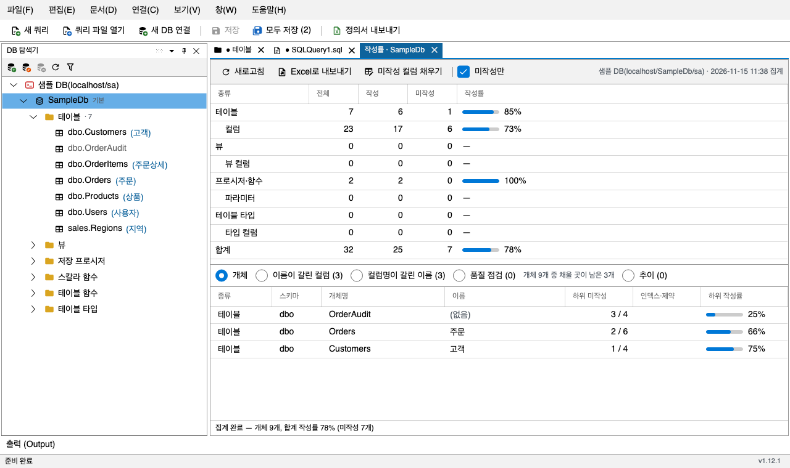

# 2. 코멘트 달기 — 작성률

[목차](README.md) · 이전: [2. 여러 행 한꺼번에 채우기](comments-fill.md) · 다음: [2. 다른 DB·파일과 비교](comments-compare.md)

이 장은 SchemaForge 1.13.0 기준이다. MariaDB·MySQL·PostgreSQL·Oracle 연결에서 달라지는 점은 [1.6](getting-started-dbms.md#16-mariadb-연결)~[1.9](getting-started-dbms.md#19-oracle-연결)에 모아 두었다.

- **저장 위치와 편집 화면** ([comments.md](comments.md))
  - [2.1 코멘트는 어디에 저장되나](comments.md#21-코멘트는-어디에-저장되나)
  - [2.2 편집 화면 열기](comments.md#22-편집-화면-열기)
- **값 입력과 보기** ([comments-input.md](comments-input.md))
  - [2.3 값 입력하기](comments-input.md#23-값-입력하기)
  - [2.4 채울 곳만 보기](comments-input.md#24-채울-곳만-보기)
- **저장과 되돌리기** ([comments-save.md](comments-save.md))
  - [2.5 저장하기](comments-save.md#25-저장하기)
  - [2.6 저장 충돌](comments-save.md#26-저장-충돌)
  - [2.7 행 되돌리기](comments-save.md#27-행-되돌리기)
- **여러 행 한꺼번에 채우기** ([comments-fill.md](comments-fill.md))
  - [2.8 Excel에서 붙여넣기](comments-fill.md#28-excel에서-붙여넣기)
  - [2.9 이름 제안으로 채우기](comments-fill.md#29-이름-제안으로-채우기)
  - [2.10 같은 컬럼명 이름 맞추기](comments-fill.md#210-같은-컬럼명-이름-맞추기)
  - [2.11 찾아 바꾸기와 설명 편집](comments-fill.md#211-찾아-바꾸기와-설명-편집)
- **작성률**
  - [2.12 작성률 보기](#212-작성률-보기)
- **다른 DB·파일과 비교** ([comments-compare.md](comments-compare.md))
  - [2.13 다른 DB와 비교해 맞추기](comments-compare.md#213-다른-db와-비교해-맞추기)
- **이력·스크립트** ([comments-history.md](comments-history.md))
  - [2.14 저장 이력](comments-history.md#214-저장-이력)
  - [2.15 변경분을 SQL 스크립트로 내보내기](comments-history.md#215-변경분을-sql-스크립트로-내보내기)

## 2.12 작성률 보기

DB 하나에서 이름을 얼마나 채웠는지 집계하고 채울 곳을 미작성이 많은 순으로 보인다. 진행 상황을 보고할 때 쓴다.

### 여는 법

DB 탐색기에서 DB 노드 오른쪽 클릭 > `작성률 보기`. 탭 이름은 `작성률 · {DB}`이다. 대상은 그 DB 하나다. 읽는 동안 상태줄에 `집계하는 중...`이 보인다.

### 세는 기준

- **작성은 이름이 비어 있지 않은 것이다.** 설명은 따지지 않는다. 코멘트 문서의 `미작성만`과 같은 기준이다.
- 세는 것: 테이블·뷰·프로시저·함수·테이블 타입과 그 하위 항목(컬럼·뷰 컬럼·파라미터·타입 컬럼).
- 트리거는 세지 않는다.
- **인덱스와 제약조건은 합계와 따로 센다.** 요약 표의 `합계` 줄 아래에 `인덱스`·`제약조건` 줄이 흐린 `합계 제외`와 함께 보이고, 합계 작성률에는 들어가지 않는다. 부차적인 항목 때문에 작성률이 낮게 나와 보고에서 오해를 부르지 않게 하려는 것이다. MariaDB 연결에는 이 두 줄이 없다.

### 화면

**위: 요약 표** — 종류마다 `전체 · 작성 · 미작성 · 작성률`이 한 줄이다.

- 하위 항목 줄은 상위 종류 바로 아래에 들여 쓴다(`테이블` 아래 `컬럼`). 프로시저와 함수는 한 줄로 센다. 맨 아래는 합계다.
- 작성률은 소수점 아래를 버린다. 미작성이 하나라도 있으면 100%로 보이지 않는다. 전체가 0이면 `—`다.

**아래: 개체 목록** — `종류 · 스키마 · 개체명 · 이름 · 하위 미작성 · 하위 작성률 · 인덱스·제약`.

- 하위 미작성은 `미작성 / 전체`로 적는다(예: `48 / 52`). 이름이 없는 개체는 이름 칸에 흐린 `(없음)`이 보인다.
- 처음에는 하위 미작성이 많은 순이다. 같으면 이름 없는 개체가 먼저 온다. 칸 머리글을 눌러 다시 정렬할 수 있다.
- `미작성만`(처음에 켜져 있다)은 이름이 없거나 하위 미작성이 남은 개체만 남긴다. 목록 위에 `개체 N개 중 채울 곳이 남은 M개`가 보인다.
- `인덱스·제약` 칸은 그 테이블·뷰의 인덱스·제약조건 미작성을 `미작성 / 전체`로 적는다. `미작성만`과 하위 미작성·하위 작성률의 기준에는 들어가지 않는다. 칸 머리글로 정렬해 남은 곳을 찾는다.
- **개체를 더블클릭하거나 `Enter`를 누르면 그 개체의 코멘트 문서가 열린다.** 이미 열려 있으면 그 탭으로만 간다.

**이름이 갈린 컬럼** — 목록 위 줄에서 `개체` 대신 `이름이 갈린 컬럼 (N)`을 고르면, 이름이 같은 테이블 컬럼인데 이름이 두 가지
이상인 곳(예: `CUST_NO`가 `고객번호`와 `거래처번호`로 갈림)을 컬럼 이름마다 한 줄로 보인다.

- 칸은 `컬럼명 · 테이블 수 · 갈래 · 이름(많은 순) · 미작성`이다. 갈래가 많은 순으로 보인다.
- 뷰 컬럼은 세지 않는다. 뷰 컬럼이 테이블 값을 그대로 내보내면 같은 이름을 겹쳐 세게 되기 때문이다.
- 줄을 더블클릭하거나 `Enter`를 누르면 그 이름의 [같은 컬럼명 문서](comments-fill.md#210-같은-컬럼명-이름-맞추기)가 열린다. 거기서 맞추고 저장하면
  이 목록에서 그 줄이 빠진다.

**컬럼명이 갈린 이름** — 목록 위 줄에서 `컬럼명이 갈린 이름 (N)`을 고르면, 같은 이름이 서로 다른 컬럼 이름에 붙은 곳(예: `등록일시`가
`REG_DT`와 `CRT_DT`에 붙음)을 이름마다 한 줄로 보인다.

- 칸은 `이름 · 컬럼 수 · 갈래 · 컬럼명`이다. 갈래가 많은 순으로 보인다.
- 이 목록은 점검용이다. 맞추려면 컬럼 이름 자체(테이블 정의)를 바꿔야 하는데 이 앱은 그 일을 하지 않는다. 그래서 줄을 더블클릭해도 아무것도 열리지 않는다.

**품질 점검** — 목록 위 줄에서 `품질 점검 (N)`을 고르면, 이름을 채웠지만 틀렸을 가능성이 높은 항목이 한 줄씩 보인다. 미작성 숫자만으로는 "채웠지만 잘못 채운" 값이 드러나지 않아서다.

- 점검은 넷이다. 한 항목이 둘 이상에 걸리면 줄도 그만큼이다.

  | `점검` | 걸리는 항목 |
  |---|---|
  | `같은 개체 안 이름 겹침` | 한 개체의 하위 항목 둘 이상이 같은 이름을 쓴다. `내용`에 겹친 다른 항목을 적는다 |
  | `이름이 개체명 그대로` | 이름이 개체명(컬럼명 등)과 같다. 채운 것으로 세지만 아무것도 알려 주지 않는다 |
  | `이름에 줄바꿈·탭` | 이름 안에 줄바꿈이나 탭이 있다. 이름 칸에는 줄바꿈이 `↵`, 탭이 `→`로 보인다 |
  | `설명만 있음` | 이름은 비었고 설명만 있다. 미작성으로도 센다 |

- 칸은 `점검 · 종류 · 위치 · 개체명 · 이름 · 내용`이다. 처음에는 점검 순서이고 칸 머리글로 다시 정렬할 수 있다.
- 줄을 더블클릭하거나 `Enter`를 누르면 그 항목의 코멘트 문서가 열린다. 컬럼이면 컬럼 탭에서 그 행이 골라진다. 거기서 고치고 저장하면 이 목록에서 그 줄이 빠진다.
- 이 목록을 보는 동안 `미작성만`은 꺼진다. 작성률 숫자에는 영향이 없다.

**추이** — 목록 위 줄에서 `추이 (N)`을 고르면 날마다 남긴 합계 작성률이 보인다. N은 기록한 날 수다.

- 집계에 성공할 때마다 그날의 숫자를 **이 PC에** 남긴다. 대상 DB에는 아무것도 쓰지 않는다. 하루에 한 번만 남고, 같은 날 다시 집계하면 그날 기록을 마지막 숫자로 바꾼다.
- 칸은 `날짜 · 전체 · 작성 · 미작성 · 작성률 · 지난번보다`다. `지난번보다`는 바로 앞 기록과의 작성률 차이(`+3%p`, `-1%p`)이고 같으면 `-`다. 최근 날짜가 위다.
- 숫자는 합계 줄이다. 인덱스·제약조건은 들어가지 않는다.
- 기록을 읽거나 쓰지 못해도 작성률 화면은 그대로 열리고, 추이 목록만 비며 출력 창에 경고가 남는다.

툴바 오른쪽에 연결과 집계 시각(`… · 2026-10-15 14:32 집계`)이 보인다.

### 다시 집계

- `새로고침`을 누르면 다시 집계한다.
- 다른 문서에서 그 DB에 저장하면 저절로 다시 집계한다. 작성률 탭이 뒤에 숨어 있으면 그 탭을 다시 볼 때 한 번 집계한다.
- 다시 집계해도 `미작성만`과 정렬은 그대로다.
- 집계에 실패하면 이전 숫자를 지우지 않고 상태줄과 출력 창에 이유를 남긴다.

### Excel 보고서

1. 툴바의 `Excel로 내보내기`를 누른다.
2. 저장할 위치를 고른다. 기본 파일 이름은 `작성률_{DB}_{집계 시각}`이다.
3. 시트 여섯 장이 만들어진다. 모든 시트의 첫 행에 연결과 집계 시각이 들어간다.

| 시트 | 내용 |
|---|---|
| `요약` | 요약 표 그대로 |
| `미작성 개체` | 채울 곳이 남은 개체 목록. 화면에서 정렬을 바꿨어도 처음 순서(미작성이 많은 순)로 들어간다 |
| `이름이 갈린 컬럼` | 위 갈린 컬럼 목록. 보고서만 받은 사람도 맞출 곳을 볼 수 있다 |
| `컬럼명이 갈린 이름` | 위 컬럼명이 갈린 이름 목록 |
| `품질 점검` | 위 품질 점검 목록 |
| `추이` | 위 추이 목록 |

작성률 문서는 읽기 전용이다. 이름은 개체 목록에서 연 코멘트 문서에서 고치고 저장한다.

### 미작성 컬럼 채우기

툴바의 `미작성 컬럼 채우기`는 그 DB에서 **이름이 빈 테이블 컬럼을 한 그리드에 모아** 채우게 한다. 테이블 문서를 하나씩 열고 저장하는 왕복을 줄이려는 것이다. SQL Server 연결이고 미작성 컬럼이 하나라도 있을 때만 켜진다.

1. 작성률 문서 툴바에서 `미작성 컬럼 채우기`를 누른다. `미작성 컬럼 · {DB}` 탭이 열린다. 같은 DB면 그 탭으로 간다.
2. 그리드는 `변경 · 스키마 · 테이블 · 테이블 이름 · 컬럼 · 이름 · 설명`이다. `테이블 이름`은 어느 업무 테이블의 컬럼인지 읽는 데 쓰는 읽기 전용 칸이다.
3. `제안으로 채우기`(같은 컬럼명이 이미 쓰는 이름), 붙여넣기, 직접 입력으로 채운다.
4. `변경만`으로 훑어본 뒤 `저장`한다. 여러 테이블에 걸친 변경이 한 번에 저장된다.

- 뷰 컬럼은 넣지 않는다. 뷰 문서에서 채운다.
- 이 문서의 제안은 같은 컬럼명의 이름뿐이다. 외래키가 가리키는 컬럼의 이름 제안은 테이블 문서에서 나온다.
- 검색·`미작성만`·`변경만`·행 되돌리기·내보내기·가져오기는 다른 코멘트 문서와 같다. 검색 칸 안내는 `테이블명·컬럼명·이름 검색`이다.
- 채운 행은 저장해도 목록에 남는다. `새로고침`해야 빠진다. 저장하면 작성률 문서가 다시 집계한다.
- MariaDB 연결에서도 연다. `STORED` 계산 컬럼은 목록에 넣지 않는다. 저장은 테이블마다 `ALTER` 하나로 묶어 보낸다([MariaDB 저장](getting-started-dbms.md#mariadb-저장)).
