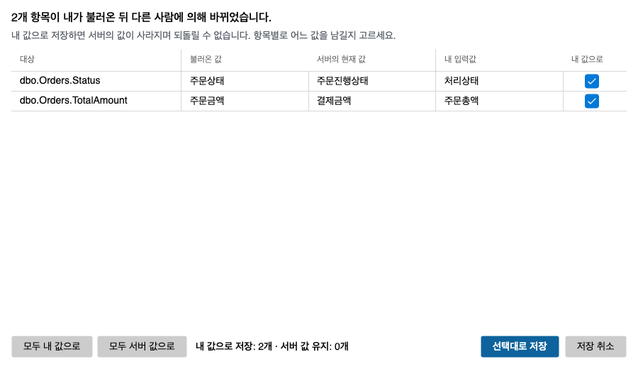

# 2. 코멘트 달기 — 저장과 충돌

[목차](README.md) · 이전: [2. 채울 곳만 보기](comments-filter.md) · 다음: [2. 행 되돌리기](comments-revert.md)

이 장은 SchemaForge 1.13.0 기준이다. MariaDB·MySQL·PostgreSQL·Oracle 연결에서 달라지는 점은 [1.6](getting-started-dbms.md#16-mariadb-연결)~[1.9](getting-started-postgresql-oracle.md#19-oracle-연결)에 모아 두었다.

- **코멘트 저장 위치** ([comments.md](comments.md))
  - [2.1 코멘트는 어디에 저장되나](comments.md#21-코멘트는-어디에-저장되나)
- **편집 화면** ([comments-screen.md](comments-screen.md))
  - [2.2 편집 화면 열기](comments-screen.md#22-편집-화면-열기)
- **값 입력** ([comments-input.md](comments-input.md))
  - [2.3 값 입력하기](comments-input.md#23-값-입력하기)
- **채울 곳만 보기** ([comments-filter.md](comments-filter.md))
  - [2.4 채울 곳만 보기](comments-filter.md#24-채울-곳만-보기)
- **저장과 충돌**
  - [2.5 저장하기](#25-저장하기)
  - [2.6 저장 충돌](#26-저장-충돌)
- **행 되돌리기** ([comments-revert.md](comments-revert.md))
  - [2.7 행 되돌리기](comments-revert.md#27-행-되돌리기)
- **붙여넣기와 이름 제안** ([comments-fill.md](comments-fill.md))
  - [2.8 Excel에서 붙여넣기](comments-fill.md#28-excel에서-붙여넣기)
  - [2.9 이름 제안으로 채우기](comments-fill.md#29-이름-제안으로-채우기)
- **이름 맞추기와 찾아 바꾸기** ([comments-match.md](comments-match.md))
  - [2.10 같은 컬럼명 이름 맞추기](comments-match.md#210-같은-컬럼명-이름-맞추기)
  - [2.11 찾아 바꾸기와 설명 편집](comments-match.md#211-찾아-바꾸기와-설명-편집)
- **작성률** ([comments-review.md](comments-review.md))
  - [2.12 작성률 보기](comments-review.md#212-작성률-보기)
- **다른 DB·파일과 비교** ([comments-compare.md](comments-compare.md))
  - [2.13 다른 DB와 비교해 맞추기](comments-compare.md#213-다른-db와-비교해-맞추기)
- **저장 이력** ([comments-history.md](comments-history.md))
  - [2.14 저장 이력](comments-history.md#214-저장-이력)
- **변경분 스크립트** ([comments-script.md](comments-script.md))
  - [2.15 변경분을 SQL 스크립트로 내보내기](comments-script.md#215-변경분을-sql-스크립트로-내보내기)

## 2.5 저장하기

| 방법 | 저장하는 것 |
|---|---|
| **저장** `Ctrl+S`(macOS는 `Cmd+S`) — 문서 툴바, 파일 메뉴, 메인 툴바 | 지금 탭의 변경된 항목만 |
| **모두 저장** `Ctrl+Shift+S`(macOS는 `Cmd+Shift+S`) | 열려 있는 탭 중 변경이 있는 것 전부. DB 전체가 아니다 |

변경된 항목만 하나의 트랜잭션으로 저장한다. 하나가 실패하면 그 문서의 저장은 모두 취소된다(MariaDB는 다르다 — [1.6](getting-started-dbms.md#mariadb-저장)). 저장이
끝나면 상태줄에 `성공적으로 N개 코멘트가 저장되었습니다.`가 보이고 DB 탐색기의 이름도 바뀐다. 저장에 실패하면 상태줄 문구가 빨간 글자로
바뀌고 다른 문구가 들어오면 원래 색으로 돌아온다. `§`나 길이 때문에 저장을 시작하지 않은 안내는 빨갛지 않다.

앞뒤 공백만 바꾼 편집은 변경으로 잡지 않는다. 저장할 때 앞뒤 공백을 떼고 보내 DB에서 바뀌는 것이 없기 때문이다.

모두 저장은 탭을 하나씩 차례로 저장한다. 탭마다 저장 전 검사와 충돌 확인을 그대로 거친다. 한 탭이 막혀도 나머지는
계속 저장하고 상태바에 `저장 N개 · 건너뜀 M개 · 변경 없음 K개`가 보인다. 건너뛴 탭과 그 이유는 출력 창에 남는다.

### 저장 로그

저장이 성공하면 출력 창에 저장 완료 줄이 남고, 그 바로 아래에 **저장한 항목마다 한 줄씩** 이전 값과 새 값이 남는다.

```
[14:02:11] [ERP_DEV] … 코멘트 저장 완료 (2개 항목)
[14:02:11]   dbo.Orders.Status: 이름 '주문상태' → '처리상태'
[14:02:11]   dbo.Orders.Memo: 이름 '' → '메모', 설명 '' → '주문 메모'
```

- 바뀐 칸만 적는다. 이름과 설명이 둘 다 바뀌면 한 줄에 `, `로 잇는다. 빈 값은 `''`로 적는다.
- 이전 값은 DB에 있던 값, 새 값은 DB에 보낸 값(앞뒤 공백을 뺀 값)이다.
- 저장이 실패하면 롤백되어 DB에서 바뀐 것이 없으므로 항목 줄을 남기지 않는다.
- 출력 창은 앱을 끄면 비워진다. 앱을 다시 켠 뒤에 이전 값을 찾으려면 [2.14절](comments-history.md#214-저장-이력)의 저장 이력을 본다.

### 저장하지 않은 편집을 지키는 장치

- 변경이 남은 탭이나 앱을 닫으면 `저장 / 저장 안 함 / 취소`를 묻는다. 여러 탭을 한꺼번에 닫아도 한 번만 묻는다.
- 탭을 밖으로 끌어 창으로 분리한 문서도 같다. 분리한 창의 `×`를 누르면 창을 닫기 전에 묻고, `취소`하면 창과 문서가 그대로 남는다.
- 변경이 남은 문서에서 **새로고침**을 누르면, 편집을 버리고 다시 읽을지 먼저 묻는다.

## 2.6 저장 충돌

내가 문서를 연 뒤 다른 사람이 같은 항목을 저장했으면, 모르고 남의 값을 덮어쓰지 않도록 저장 직전에 그 사실을
알려 준다. 충돌이 없으면 이 창은 뜨지 않는다.



| 칸 | 뜻 |
|---|---|
| 대상 | 충돌한 항목 |
| 불러온 값 | 내가 문서를 열었을 때의 값 |
| 서버의 현재 값 | 다른 사람이 저장한 값 |
| 내 입력값 | 내가 지금 저장하려는 값 |
| 내 값으로 | 체크하면 내 값으로 덮어쓰고, 끄면 서버 값을 그대로 둔다 |

- 처음에는 모든 행이 `내 값으로`에 체크되어 있다. 체크는 한 번 누르면 바뀐다.
- **모두 내 값으로**와 **모두 서버 값으로**로 한꺼번에 바꿀 수 있다.
- **선택대로 저장**을 누르면 체크한 행만 저장한다. 체크를 끈 행은 화면 값이 서버 값으로 바뀌고 내 입력값은 버려진다. 출력 창에 `N개 항목을 서버 값으로 되돌렸습니다(저장하지 않음).`이 남는다.
- **저장 취소**(또는 `Esc`, 창 닫기)를 누르면 아무것도 저장하지 않고 편집한 값은 그대로 남는다. 상태줄에 `저장을 취소했습니다. 편집한 내용은 그대로 남아 있습니다.`가 보인다.
- **내 값으로 덮어쓴 항목은 덮인 서버 값이 이전 값으로 남는다.** [저장 로그](#저장-로그)와 [저장 이력](comments-history.md#214-저장-이력)의 이전 값은 처음 불러온 값이 아니라 다른 사람이 넣었던 서버 값이다. 필요하면 그 값으로 되돌릴 수 있다.

다른 사람이 나와 같은 값으로 바꿨거나 공백만 다르면 충돌로 보지 않는다.

서버 값을 다시 읽지 못하면 충돌 여부를 알 수 없으므로 저장하지 않는다. 상태줄에
`저장 충돌을 확인할 수 없어 저장하지 않았습니다. 연결 상태를 확인한 뒤 다시 시도하세요.`가 나온다.

이 기능은 덮어쓰기 전에 알려 줄 뿐, 다른 사람의 편집을 막지는 않는다.
