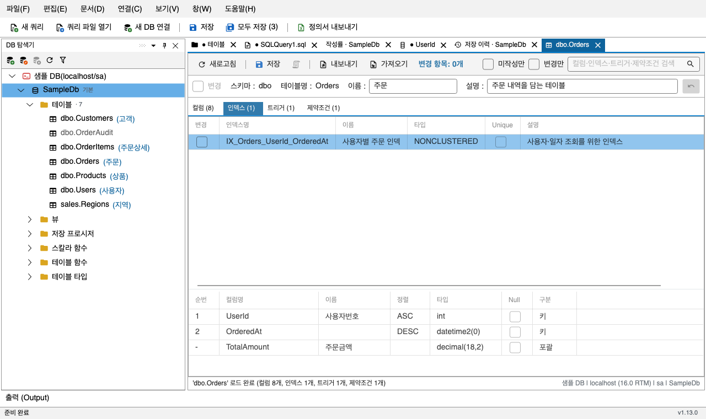

# 2. 코멘트 달기

[목차](README.md) · 이전: [1. DBMS별 연결](getting-started-dbms.md) · 다음: [2. 값 입력과 보기](comments-input.md)

이 장은 SchemaForge 1.13.0 기준이다. MariaDB·MySQL·PostgreSQL·Oracle 연결에서 달라지는 점은 [1.5](getting-started-dbms.md#15-mariadb-연결)~[1.8](getting-started-dbms.md#18-oracle-연결)에 모아 두었다.

- **저장 위치와 편집 화면**
  - [2.1 코멘트는 어디에 저장되나](#21-코멘트는-어디에-저장되나)
  - [2.2 편집 화면 열기](#22-편집-화면-열기)
- **값 입력과 보기** ([comments-input.md](comments-input.md))
  - [2.3 값 입력하기](comments-input.md#23-값-입력하기)
  - [2.4 채울 곳만 보기](comments-input.md#24-채울-곳만-보기)
- **저장과 되돌리기** ([comments-save.md](comments-save.md))
  - [2.5 저장하기](comments-save.md#25-저장하기)
  - [2.6 저장 충돌](comments-save.md#26-저장-충돌)
  - [2.7 행 되돌리기](comments-save.md#27-행-되돌리기)
- **여러 행 한꺼번에 채우기** ([comments-fill.md](comments-fill.md))
  - [2.8 Excel에서 붙여넣기](comments-fill.md#28-excel에서-붙여넣기)
  - [2.9 이름 제안으로 채우기](comments-fill.md#29-이름-제안으로-채우기)
  - [2.10 같은 컬럼명 이름 맞추기](comments-fill.md#210-같은-컬럼명-이름-맞추기)
  - [2.11 찾아 바꾸기와 설명 편집](comments-fill.md#211-찾아-바꾸기와-설명-편집)
- **점검·비교** ([comments-review.md](comments-review.md))
  - [2.12 작성률 보기](comments-review.md#212-작성률-보기)
  - [2.13 다른 DB와 비교해 맞추기](comments-review.md#213-다른-db와-비교해-맞추기)
- **이력·스크립트** ([comments-history.md](comments-history.md))
  - [2.14 저장 이력](comments-history.md#214-저장-이력)
  - [2.15 변경분을 SQL 스크립트로 내보내기](comments-history.md#215-변경분을-sql-스크립트로-내보내기)

## 2.1 코멘트는 어디에 저장되나

SchemaForge는 개체마다 **이름**과 **설명**을 받아 코멘트 값 하나에 `§`로 이어 붙여 저장한다.
저장하는 자리는 DBMS가 원래 코멘트를 두는 곳이다. MS SQL Server는 `MS_Description` 확장 속성이고 MariaDB·MySQL은 개체의 `COMMENT`, PostgreSQL·Oracle은 `COMMENT ON`이다.

```
주문내역§고객이 주문한 상품의 내역을 보관하는 테이블
└ 이름 ┘└──────────── 설명 ────────────────────┘
```

다른 DB 도구에서 그 개체의 코멘트를 보면 이 모양 그대로 보인다. 같은 DB를 쓰는 기존 프로그램과 맞추려고 정한 형식이다.

### 구분자 바꾸기

`§`는 기본값이다. 이 DB가 `|`·`::` 같은 다른 구분자로 코멘트를 관리해 왔으면, 연결 편집에서 `코멘트 구분자`를 그 글자로 바꾼다.
그 연결로 여는 모든 화면(트리, 코멘트 문서, 작성률, 같은 컬럼명 문서, 정의서, SQL 편집기)이 그 구분자로 읽고 저장한다.

- 1~3글자이고 공백·글자·숫자는 쓸 수 없다. 쓸 수 없는 값이면 연결 창의 `저장`이 꺼지고 이유가 보인다.
- 연결마다 따로 정한다. `§` DB와 `|` DB를 오가도 다시 바꿀 필요가 없다.
- 이미 저장된 값을 새 구분자로 바꿔 주지는 않는다. 구분자 설정은 읽고 쓰는 방식만 바꾼다.
- [다른 DB와 비교](comments-review.md#213-다른-db와-비교해-맞추기)는 두 DB를 각자 연결의 구분자로 읽는다. `§` DB의 값을 `|` DB에 맞춰 넣을 수 있다.

**구분자가 맞지 않아 보이면 알린다.** 코멘트 문서를 열었는데 설명이 있는 값이 하나도 없고 이름 안에 다른 구분자가 자주 보이면,
문서 맨 위에 `이 DB의 코멘트는 '|'로 나뉜 것으로 보입니다. 연결 설정의 구분자('§')를 확인하세요.`가 나온다.
그 상태로 저장하면 `이 DB는 '|' 형식으로 보입니다. '§'로 나눠 저장할까요?`를 한 번 더 묻는다. 취소하면 아무것도 쓰지 않고 편집은 남는다.
잘못된 구분자로 저장하면 값이 다른 형식으로 굳기 때문이다.

다룰 수 있는 개체는 DBMS마다 다르다.

- **MS SQL Server** — 테이블, 컬럼, 뷰, 뷰 컬럼, 저장 프로시저, 스칼라·테이블 함수, 파라미터, 인덱스,
  트리거, 제약조건(CHECK·DEFAULT·FK), 사용자 정의 테이블 타입과 그 컬럼.
- **MariaDB** — 테이블, 컬럼, 프로시저, 함수. 인덱스·파라미터와 `STORED` 계산 컬럼의 코멘트는 읽기만 한다.

형식(`이름§설명`)과 구분자를 바꾸는 법은 두 DBMS가 같다.

## 2.2 편집 화면 열기

DB 탐색기 트리는 `연결 > DB > 분류 폴더(테이블·뷰 등) > 개체` 순으로 펼쳐진다. 편집 화면은 이 트리에서 연다.

| 하려는 일 | 여는 법 | 화면 |
|---|---|---|
| 한 분류의 개체 이름을 죽 훑으며 이름 채우기 | DB 아래 분류 폴더 오른쪽 클릭 > `테이블 코멘트 관리` 등(폴더 이름 + `코멘트 관리`) | **분류 목록 문서** — 탭 제목이 `테이블` |
| 개체 하나의 컬럼·파라미터까지 채우기 | 개체 더블클릭 (또는 오른쪽 클릭 > `코멘트 관리`) | **개체 문서** — 탭 제목이 `dbo.Orders` |
| 여러 테이블에 되풀이되는 컬럼의 이름 맞추기 | DB 탐색기 컬럼 검색 결과 오른쪽 클릭 | **같은 컬럼명 문서** — [2.10절](comments-fill.md#210-같은-컬럼명-이름-맞추기) |
| 다른 DB(예: 개발)와 값이 다르거나 빈 곳 맞추기 | DB 노드 오른쪽 클릭 > `다른 DB 코멘트와 비교...` | **비교 문서** — [2.13절](comments-review.md#213-다른-db와-비교해-맞추기) |
| 내보내 둔 파일의 값을 DB 전체에 맞추기 | DB 노드 오른쪽 클릭 > `파일의 코멘트와 비교...` | **비교 문서** — [파일과 비교하기](comments-review.md#파일과-비교하기) |

같은 개체를 다시 더블클릭하면 새로 읽지 않고 이미 열린 탭으로 가므로 편집 중이던 값은 그대로 남는다.

### 분류 목록 문서


그리드 한 장에 `변경 · 스키마 · 개체명 · 이름 · 설명`이 있다. 개체명 칸의 머리글은 분류를 따라 `테이블명`·`뷰명`·`프로시저명`·`함수명`·`타입명`으로 바뀐다(여러 분류가 섞인 목록은 `개체명`). 그리드 위에는 `데이터베이스 : {DB명}`이 보이고
그 오른쪽에 `· 미작성: N개`가 함께 보여 남은 분량을 알 수 있다. 테이블·뷰·저장 프로시저·스칼라 함수·테이블 함수·
테이블 타입 폴더가 모두 이 화면을 쓴다.

### 개체 문서


맨 위 머리글에서 개체 자신의 이름·설명을 고치고 그 아래에서 하위 항목을 고친다. 머리글의 입력 줄은 `스키마 :` · `테이블명 :`(개체 종류에 따라 `뷰명 :`·`타입명 :` 등) · `이름 :` · `설명 :`이다.

| 개체 | 머리글 아래 | 그리드 칸 |
|---|---|---|
| 테이블 | `컬럼` · `인덱스` · `트리거` · `제약조건` 탭 | 컬럼 탭: 변경 / 순번 / 컬럼명 / 이름 / PK / 타입 / Null / 기본값 / 설명 |
| 뷰 | `컬럼` · `인덱스` · `트리거` 탭 | 컬럼 탭: 변경 / 순번 / 컬럼명 / 이름 / 타입 / Null / 설명 |
| 저장 프로시저 · 함수 | 파라미터 그리드 하나 | 변경 / 순번 / 파라미터명 / 이름 / 타입 / 입·출력 / 설명 |
| 테이블 타입 | 컬럼 그리드 하나 | 변경 / 순번 / 컬럼명 / 이름 / 타입 / Null / 설명 |

탭 머리글의 숫자(`컬럼 (12)`)는 지금 보이는 항목 수라서 필터를 걸면 걸러진 뒤의 수로 바뀐다.

### 인덱스 탭 — 인덱스에 든 컬럼 보기



인덱스 탭은 위아래로 나뉜다. 위 그리드(`인덱스명` · `이름` · `설명` 등)에서 인덱스의 이름·설명을 고치고, 인덱스를 하나 고르면 아래 표에 그 인덱스에 든 컬럼이 보인다.

| 칸 | 뜻 |
|---|---|
| 순번 | 키 순서. 포괄 열은 `-` |
| 컬럼명 · 이름 · 타입 · Null | 컬럼 탭과 같은 값. 컬럼 탭에서 이름을 고치면 저장하기 전에도 곧바로 바뀐다 |
| 정렬 | 키 컬럼의 `ASC`(오름차순) / `DESC`(내림차순) |
| 구분 | `키`(정렬·검색 기준), `포괄`(`INCLUDE`로 값만 실은 열), `컬럼스토어` |

- 아래 표는 읽기만 한다. 행을 더블클릭하면 컬럼 탭으로 가서 그 컬럼을 고른다.
- 두 영역 사이의 선을 끌어 높이를 바꾼다.
- MariaDB에서 앞부분만 거는 인덱스는 컬럼명 뒤에 `(10)`처럼 길이가 붙는다. MariaDB에는 포괄 열이 없다.

### 제약조건 탭

SQL Server 테이블 문서에는 `제약조건` 탭이 있다. CHECK·DEFAULT·FK 제약조건에 이름·설명을 단다.

| 칸 | 뜻 |
|---|---|
| 종류 | `CHECK` · `DEFAULT` · `FK` |
| 제약조건명 · 대상 컬럼 | 테이블 수준 CHECK는 대상 컬럼이 비어 있다 |
| 정의 | CHECK·DEFAULT는 식, FK는 참조 대상(`dbo.Users(Id)`) |

- PK·UNIQUE는 인덱스 탭에서 다룬다. 같은 대상을 두 곳에서 고치지 않게 하려는 것이다.
- 저장·가져오기·내보내기·변경분 스크립트는 다른 탭과 같다.
- 뷰 문서와 MariaDB 연결에는 이 탭이 없다.

### 툴바

모든 코멘트 문서의 툴바는 같은 모양이다.

| 위치 | 항목 | 하는 일 |
|---|---|---|
| 왼쪽 | `새로고침` | DB에서 다시 읽는다 |
| | `저장` | 이 탭의 변경된 항목만 저장한다([2.5절](comments-save.md#25-저장하기)) |
| | 스크립트 아이콘(`변경분 스크립트`) | 변경된 항목을 DB에 쓰지 않고 SQL 스크립트 파일로 내보낸다([2.15절](comments-history.md#215-변경분을-sql-스크립트로-내보내기)) |
| | `내보내기` · `가져오기` | 파일로 주고받는다([3장](import-export.md)) |
| | `변경 항목: N개` | 저장하지 않은 변경 수 |
| 오른쪽 | `미작성만` · `변경만` · 검색 칸 | 보이는 행을 거른다([2.4절](comments-input.md#24-채울-곳만-보기)) |

맨 아래 상태줄에는 방금 한 일의 결과(불러온 개수, 저장 결과, 붙여넣기 결과 등)가 보인다.
