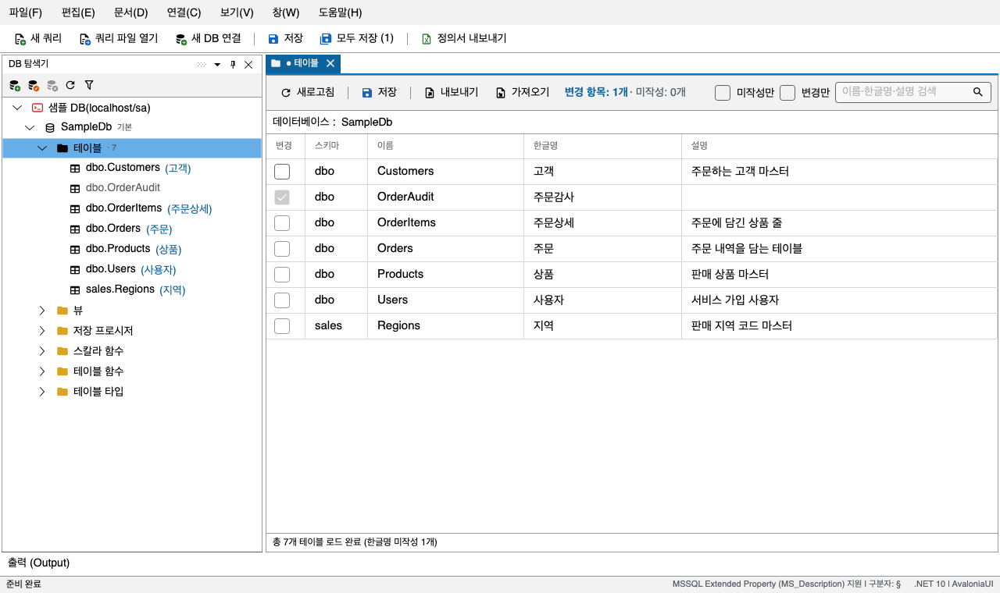
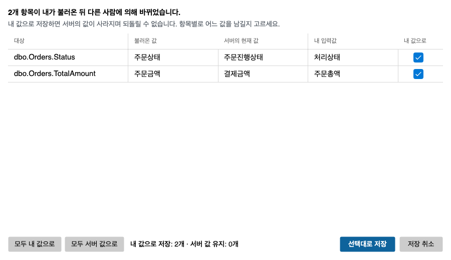

# 2. 코멘트 달기

[목차](README.md) · 이전: [1. 시작하기](getting-started.md) · 다음: [3. 파일로 주고받기](import-export.md)

이 장은 SchemaForge 1.3.0 기준이다.

- [2.1 코멘트는 어디에 저장되나](#21-코멘트는-어디에-저장되나)
- [2.2 편집 화면 열기](#22-편집-화면-열기)
- [2.3 값 입력하기](#23-값-입력하기)
- [2.4 채울 곳만 보기](#24-채울-곳만-보기)
- [2.5 저장하기](#25-저장하기)
- [2.6 저장 충돌](#26-저장-충돌)
- [2.7 행 되돌리기](#27-행-되돌리기)
- [2.8 Excel에서 붙여넣기](#28-excel에서-붙여넣기)
- [2.9 같은 이름 컬럼 한글명 맞추기](#29-같은-이름-컬럼-한글명-맞추기)
- [2.10 저장 이력](#210-저장-이력)
- [2.11 작성률 보기](#211-작성률-보기)
- [2.12 한글명 제안으로 채우기](#212-한글명-제안으로-채우기)
- [2.13 찾아 바꾸기와 설명 편집](#213-찾아-바꾸기와-설명-편집)
- [2.14 다른 DB와 비교해 맞추기](#214-다른-db와-비교해-맞추기)
- [2.15 변경분을 SQL 스크립트로 내보내기](#215-변경분을-sql-스크립트로-내보내기)

## 2.1 코멘트는 어디에 저장되나

SchemaForge는 개체마다 **한글명**과 **설명**을 받아, SQL Server의 `MS_Description` 확장 속성 하나에
`§`로 이어 붙여 저장한다.

```
주문내역§고객이 주문한 상품의 내역을 보관하는 테이블
└ 한글명 ┘└──────────── 설명 ────────────────────┘
```

SSMS 속성 창에서 보면 이 모양 그대로 보인다. 같은 DB를 쓰는 기존 프로그램과 맞추려고 정한 형식이다.

다룰 수 있는 개체는 테이블, 컬럼, 뷰, 뷰 컬럼, 저장 프로시저, 스칼라·테이블 함수, 파라미터, 인덱스,
트리거, 사용자 정의 테이블 타입과 그 컬럼이다.

## 2.2 편집 화면 열기

DB 탐색기 트리는 `연결 > DB > 분류 폴더(테이블·뷰 등) > 개체` 순으로 펼쳐진다. 편집 화면은 이 트리에서 연다.

| 하려는 일 | 여는 법 | 화면 |
|---|---|---|
| 한 분류의 개체 이름을 죽 훑으며 한글명 채우기 | DB 아래 분류 폴더 오른쪽 클릭 > `테이블 코멘트 관리` 등(폴더 이름 + `코멘트 관리`) | **분류 목록 문서** — 탭 제목이 `테이블` |
| 개체 하나의 컬럼·파라미터까지 채우기 | 개체 더블클릭 (또는 오른쪽 클릭 > `코멘트 관리`) | **개체 문서** — 탭 제목이 `dbo.Orders` |
| 여러 테이블에 되풀이되는 컬럼의 한글명 맞추기 | DB 탐색기 컬럼 검색 결과 오른쪽 클릭 | **같은 이름 컬럼 문서** — [2.9절](#29-같은-이름-컬럼-한글명-맞추기) |
| 다른 DB(예: 개발)와 값이 다르거나 빈 곳 맞추기 | DB 노드 오른쪽 클릭 > `다른 DB 코멘트와 비교...` | **비교 문서** — [2.14절](#214-다른-db와-비교해-맞추기) |

같은 개체를 다시 더블클릭하면 새로 읽지 않고 이미 열린 탭으로 간다. 편집 중이던 값은 그대로 남는다.

### 분류 목록 문서



그리드 한 장에 `변경 · 스키마 · 이름 · 한글명 · 설명`이 있다. 그리드 위에는 `데이터베이스 : {DB명}`이 보이고,
그 오른쪽에 `· 미작성: N개`가 함께 보여 남은 분량을 알 수 있다. 테이블·뷰·저장 프로시저·스칼라 함수·테이블 함수·
테이블 타입 폴더가 모두 이 화면을 쓴다.

### 개체 문서


맨 위 머리글에서 개체 자신의 한글명·설명을 고치고, 그 아래에서 하위 항목을 고친다.

| 개체 | 머리글 아래 | 그리드 칸 |
|---|---|---|
| 테이블 | `컬럼` · `인덱스` · `트리거` 탭 | 컬럼 탭: 변경 / 순번 / 컬럼명 / 한글명 / PK / 타입 / Null / 기본값 / 설명 |
| 뷰 | `컬럼` · `인덱스` · `트리거` 탭 | 컬럼 탭: 변경 / 순번 / 컬럼명 / 한글명 / 타입 / Null / 설명 |
| 저장 프로시저 · 함수 | 파라미터 그리드 하나 | 변경 / 순번 / 파라미터명 / 한글명 / 타입 / 입·출력 / 설명 |
| 테이블 타입 | 컬럼 그리드 하나 | 변경 / 순번 / 컬럼명 / 한글명 / 타입 / Null / 설명 |

탭 머리글의 숫자(`컬럼 (12)`)는 지금 보이는 항목 수다. 필터를 걸면 걸러진 뒤의 수로 바뀐다.

### 툴바

모든 코멘트 문서의 툴바는 같은 모양이다.

| 위치 | 항목 | 하는 일 |
|---|---|---|
| 왼쪽 | `새로고침` | DB에서 다시 읽는다 |
| | `저장` | 이 탭의 변경된 항목만 저장한다([2.5절](#25-저장하기)) |
| | 스크립트 아이콘(`변경분 스크립트`) | 변경된 항목을 DB에 쓰지 않고 SQL 스크립트 파일로 내보낸다([2.15절](#215-변경분을-sql-스크립트로-내보내기)) |
| | `내보내기` · `가져오기` | 파일로 주고받는다([3장](import-export.md)) |
| | `변경 항목: N개` | 저장하지 않은 변경 수 |
| 오른쪽 | `미작성만` · `변경만` · 검색 칸 | 보이는 행을 거른다([2.4절](#24-채울-곳만-보기)) |

맨 아래 상태줄에는 방금 한 일의 결과(불러온 개수, 저장 결과, 붙여넣기 결과 등)가 보인다.

## 2.3 값 입력하기

1. 고칠 칸을 한 번 클릭해 고른다.
2. **같은 칸을 한 번 더 클릭하거나 `F2`**를 누르면 입력 상태가 된다. 칸을 고른 채 바로 타이핑해서는 입력이 시작되지 않는다.
3. 입력한 뒤 `Tab`을 누르면 값이 들어가고 옆 칸도 입력 상태로 이어진다. `Enter`는 입력을 끝내고 아래 행으로 내려간다. 아래 행을 고치려면 다시 `F2`를 누른다.

편집하면 이렇게 표시된다.

- 그 행의 `변경` 칸에 체크가 생긴다.
- 툴바에 `변경 항목: N개`가 보인다.
- 탭 제목 앞에 `●`가 붙는다.
- 메인 툴바의 **모두 저장** 버튼에 변경이 남은 문서 수가 붙는다. 예: `모두 저장 (2)`

값을 원래대로 고치면 표시도 사라진다. 한 번에 원래 값으로 돌리려면 [2.7절](#27-행-되돌리기)의 행 되돌리기를 쓴다.

### 지킬 것

- **한글명에는 `§`를 넣을 수 없다.** 한글명과 설명을 가르는 문자라서다. 설명에는 넣어도 된다.
- 한글명과 설명을 합쳐 **7,500바이트(한글 약 3,750자)**를 넘으면 저장하지 않는다.
- 한글명과 설명을 모두 비우고 저장하면 그 개체의 확장 속성을 지운다.

위반한 값이 있으면 저장을 시작하지 않고 상태줄에 `저장 취소: …`로 어느 항목이 문제인지 알려 준다. 하나라도 걸리면 아무것도 저장하지 않는다.

## 2.4 채울 곳만 보기

툴바 오른쪽의 세 가지로 보이는 행을 좁힌다.

| 기능 | 쓰는 법 | 남기는 행 |
|---|---|---|
| `미작성만` | 체크를 켜고 끈다 | 한글명이 빈 행 |
| `변경만` | 체크를 켜고 끈다 | `변경`이 체크된 행(저장하지 않은 변경이 있는 행) |
| 검색 | 검색 칸에 쓰고 `Enter` 또는 돋보기. `✕`로 지운다 | 검색어가 든 행 |

따로 `F8`을 누르면 거르지 않고 한글명이 빈 다음 칸으로 간다(이전은 `Shift+F8`). 탭이 여럿이면 지금 탭 안에서만 움직인다.

- **함께 켜면 모두 만족하는 행만 남는다(AND).** 예: 검색어 `주문` + `미작성만` + `변경만`이면 "`주문`이 들어 있고, 한글명이 비었고, 고친 행"만 남는다.
- 검색어는 분류 목록 문서에서는 개체를, 개체 문서에서는 컬럼·파라미터 같은 하위 항목을 거른다. `미작성만`과 `변경만`은 개체와 하위 항목 모두에 걸린다.
- 개체 문서의 머리글(개체 자신)은 거르지 않고 늘 보인다.
- 거르기는 DB를 다시 읽지 않는다. 편집하던 값은 사라지지 않는다.
- 거른 뒤 상태줄에 보이는 수와 전체 수가 나온다. 예: `'주문' 검색 + 미작성만 + 변경만: 3개 / 전체 120개.`
- 걸러져 안 보이는 변경이 있으면 상태줄에 `화면에 보이지 않는 변경 항목 N개도 저장 대상입니다.`가 붙는다. 저장은 화면이 아니라 문서 전체의 변경을 저장한다.

### 행이 바로 사라지지 않는 이유

`미작성만`을 켠 뒤 한글명을 채워도, `변경만`을 켠 뒤 값을 되돌리거나 저장해도 그 행은 바로 사라지지 않는다.
방금 넣은 값을 확인할 수 있게 하려는 것이다. 토글이나 검색을 다시 누르면 그때 빠진다.

### 저장 전에 바뀐 것만 확인하기

1. 툴바의 `변경만`을 켠다. 고친 행만 남는다.
2. 행마다 한글명·설명을 훑어본다. 잘못 고친 행은 오른쪽 클릭 > `원래 값으로 되돌리기`로 되돌린다([2.7절](#27-행-되돌리기)).
3. `저장`을 누른다.
4. `변경만`을 다시 눌러 끄면 전체 목록으로 돌아온다.

## 2.5 저장하기

| 방법 | 저장하는 것 |
|---|---|
| **저장** `Ctrl+S`(macOS는 `Cmd+S`) — 문서 툴바, 파일 메뉴, 메인 툴바 | 지금 탭의 변경된 항목만 |
| **모두 저장** `Ctrl+Shift+S`(macOS는 `Cmd+Shift+S`) | 열려 있는 탭 중 변경이 있는 것 전부. DB 전체가 아니다 |

변경된 항목만 하나의 트랜잭션으로 저장한다. 하나가 실패하면 그 문서의 저장은 모두 취소된다. 저장이
끝나면 상태줄에 `성공적으로 N개 코멘트가 저장되었습니다.`가 보이고, DB 탐색기의 한글명도 바뀐다.

모두 저장은 탭을 하나씩 차례로 저장한다. 탭마다 저장 전 검사와 충돌 확인을 그대로 거친다. 한 탭이 막혀도 나머지는
계속 저장하고, 상태바에 `저장 N개 · 건너뜀 M개 · 변경 없음 K개`가 보인다. 건너뛴 탭과 그 이유는 출력 창에 남는다.

### 저장 로그

저장이 성공하면 출력 창에 저장 완료 줄이 남고, 그 바로 아래에 **저장한 항목마다 한 줄씩** 이전 값과 새 값이 남는다.

```
[14:02:11] [ERP_DEV] … 코멘트 저장 완료 (2개 항목)
[14:02:11]   dbo.Orders.Status: 한글명 '주문상태' → '처리상태'
[14:02:11]   dbo.Orders.Memo: 한글명 '' → '메모', 설명 '' → '주문 메모'
```

- 바뀐 칸만 적는다. 한글명과 설명이 둘 다 바뀌면 한 줄에 `, `로 잇는다. 빈 값은 `''`로 적는다.
- 이전 값은 DB에 있던 값, 새 값은 DB에 보낸 값(앞뒤 공백을 뺀 값)이다.
- 저장이 실패하면 항목 줄을 남기지 않는다. 롤백되어 DB에서 바뀐 것이 없다.
- 출력 창은 앱을 끄면 비워진다. 앱을 다시 켠 뒤에 이전 값을 찾으려면 [2.10절](#210-저장-이력)의 저장 이력을 본다.

### 저장하지 않은 편집을 지키는 장치

- 변경이 남은 탭이나 앱을 닫으면 `저장 / 저장 안 함 / 취소`를 묻는다. 여러 탭을 한꺼번에 닫아도 한 번만 묻는다.
- 변경이 남은 문서에서 **새로고침**을 누르면, 편집을 버리고 다시 읽을지 먼저 묻는다.

## 2.6 저장 충돌

내가 문서를 연 뒤 다른 사람이 같은 항목을 저장했으면, 저장 직전에 그 사실을 알려 준다. 모르고
남의 값을 덮어쓰지 않게 하려는 것이다. 충돌이 없으면 이 창은 뜨지 않는다.



| 칸 | 뜻 |
|---|---|
| 대상 | 충돌한 항목 |
| 불러온 값 | 내가 문서를 열었을 때의 값 |
| 서버의 현재 값 | 다른 사람이 저장한 값 |
| 내 입력값 | 내가 지금 저장하려는 값 |
| 내 값으로 | 체크하면 내 값으로 덮어쓰고, 끄면 서버 값을 그대로 둔다 |

- 처음에는 모든 행이 `내 값으로`에 체크되어 있다. 체크는 한 번 누르면 바뀐다.
- **모두 내 값으로**와 **모두 서버 값으로**로 한꺼번에 바꿀 수 있다.
- **선택대로 저장**을 누르면 체크한 행만 저장한다. 체크를 끈 행은 화면 값이 서버 값으로 바뀌고, 내 입력값은 버려진다. 출력 창에 `N개 항목을 서버 값으로 되돌렸습니다(저장하지 않음).`이 남는다.
- **저장 취소**(또는 `Esc`, 창 닫기)를 누르면 아무것도 저장하지 않고, 편집한 값은 그대로 남는다. 상태줄에 `저장을 취소했습니다. 편집한 내용은 그대로 남아 있습니다.`가 보인다.
- **내 값으로 덮어쓴 항목은 덮인 서버 값이 이전 값으로 남는다.** [저장 로그](#저장-로그)와 [저장 이력](#210-저장-이력)의 이전 값은 처음 불러온 값이 아니라 다른 사람이 넣었던 서버 값이다. 필요하면 그 값으로 되돌릴 수 있다.

다른 사람이 나와 같은 값으로 바꿨으면 충돌로 보지 않는다. 공백만 다른 경우도 같다.

서버 값을 다시 읽지 못하면 충돌 여부를 알 수 없으므로 저장하지 않는다. 상태줄에
`저장 충돌을 확인할 수 없어 저장하지 않았습니다. 연결 상태를 확인한 뒤 다시 시도하세요.`가 보인다.

이 기능은 덮어쓰기 전에 알려 줄 뿐, 다른 사람의 편집을 막지는 않는다.

## 2.7 행 되돌리기

잘못 고친 행을 원래 값으로 되돌린다. 다른 행의 편집은 그대로 둔다.

**원래 값**은 그 문서가 **마지막으로 DB에서 읽었거나 저장한 값**이다. 되돌릴 때 DB를 다시 읽지 않는다.
이미 저장한 값을 그 전 값으로 돌리는 기능이 아니다. 그때는 [2.10절](#210-저장-이력)의 저장 이력을 쓴다.

### 그리드의 행

1. 되돌릴 행을 고른다. 여러 행이면 `Shift`+클릭 등으로 함께 고른다.
2. 고른 행 위에서 오른쪽 클릭 > `원래 값으로 되돌리기`.
3. 고른 행 중 변경된 행이 모두 원래 값으로 돌아간다. 상태줄에 `N개 항목을 원래 값으로 되돌렸습니다.`가 보인다.

- 고르지 않은 행을 오른쪽 클릭하면 그 행을 먼저 고른 뒤 메뉴가 뜬다.
- 고른 행 중 변경된 것이 없으면 메뉴 항목이 꺼져 있다.
- 되돌리면 `변경` 체크가 풀리고 `변경 항목: N개`와 탭의 `●`도 따라 줄어든다.
- 확인 창은 뜨지 않는다. 화면 안의 값만 바꾸고 DB나 파일에는 쓰지 않는다.
- 분류 목록, 컬럼·인덱스·트리거, 파라미터, 타입 컬럼, 같은 이름 컬럼 그리드에서 모두 같다.

### 머리글(개체 자신)

개체 문서의 머리글은 **설명 입력칸 오른쪽의 되돌리기 아이콘 버튼**으로 되돌린다. 머리글이 바뀌지 않았으면 버튼이 꺼져 있다.

셀을 입력하는 중에 오른쪽 클릭하면 입력칸 메뉴(잘라내기·복사·붙여넣기)가 뜬다. 되돌리려면 먼저 `Enter`로 입력을 끝낸다.

## 2.8 Excel에서 붙여넣기

Excel에서 복사한 한글명(과 설명) 열을 코멘트 그리드에 한 번에 넣는다. **넣는 것은 그리드 값뿐이다. `저장`을 눌러야 DB에 반영된다.**

### 기본 순서

1. Excel에서 넣을 범위를 고르고 복사한다(`Ctrl+C`, macOS는 `Cmd+C`).
2. SchemaForge 그리드에서 **넣기 시작할 행의 칸**을 한 번 클릭해 고른다. 입력 상태로 들어가지 않는다.
3. `Ctrl+V`(macOS는 `Cmd+V`)를 누르거나, 오른쪽 클릭 > `붙여넣기`.
4. 값이 들어간 행에 `변경` 체크가 생기고, 상태줄에 `N개 행에 붙여넣었습니다. 저장해야 DB에 반영됩니다.`가 보인다.
5. 확인한 뒤 `저장`을 누른다. 잘못 들어간 행은 [행 되돌리기](#27-행-되돌리기)로 되돌린다.

### 예: 두 열(한글명·설명)을 붙여넣기

Excel에 이렇게 있다.

| | A | B |
|---|---|---|
| 1 | 주문번호 | 주문을 구분하는 번호 |
| 2 | 주문일자 | |
| 3 | 고객번호 | 주문한 고객 |

A1:B3을 복사하고, 테이블 문서 컬럼 탭에서 `ORDER_NO` 행의 `한글명` 칸을 고른 뒤 `Ctrl+V`(macOS `Cmd+V`)를 누르면 이렇게 된다.

| 그리드 행 | 한글명 | 설명 |
|---|---|---|
| `ORDER_NO` (고른 행) | 주문번호 | 주문을 구분하는 번호 |
| 바로 아래 행 | 주문일자 | (원래 값 그대로) |
| 그 아래 행 | 고객번호 | 주문한 고객 |

상태줄: `3개 행에 붙여넣었습니다. 저장해야 DB에 반영됩니다. 빈 칸 1개는 넣지 않았습니다.`

같은 범위를 `설명` 칸을 고른 채 붙여넣으면 A열이 설명에 들어가고 B열은 버려진다. 설명만 넣으려면 Excel에서 설명 열만 복사해 `설명` 칸에 붙여넣는다.

### 넣는 규칙

| 상황 | 동작 |
|---|---|
| 시작 행 | 고른 행부터 아래로 한 줄씩 넣는다. 여러 행을 골랐으면 화면에서 가장 위의 행부터 |
| 행 순서 | **화면에 보이는 순서**를 따른다. 검색·`미작성만`·`변경만`으로 숨은 행은 건너뛴다 |
| 고른 칸이 `설명`이 아님(한글명·이름·타입 등) | 첫 칸은 한글명, 둘째 칸은 설명에 넣는다. 셋째 칸부터는 넣지 않고 `셋째 칸부터는 넣지 않았습니다.`로 알린다 |
| 고른 칸이 `설명` | 첫 칸을 설명에 넣는다. 한글명은 건드리지 않는다. 둘째 칸부터는 넣지 않고 `둘째 칸부터는 넣지 않았습니다.`로 알린다 |
| 빈 셀 | 넣지 않는다. 있던 값을 지우지 않는다. 지우려면 셀에서 직접 지운다 |
| 아래 행이 모자람 | 들어가는 만큼만 넣고 `N줄 중 M줄만 넣었습니다(아래 행이 모자랍니다).`로 알린다 |
| 셀 하나를 복사하고 행을 여럿 골랐음 | 고른 행 모두에 그 값을 넣는다(Excel과 같다) |
| 셀 안에 줄바꿈·탭이 든 셀 | Excel이 따옴표로 감싸 복사한 셀은 한 칸으로 넣는다. 여러 행으로 흩어지지 않는다 |
| 한글명에 `§`가 든 줄 | 그 줄은 넣지 않고 `N줄 건너뜀 - 한글명에 § 포함(…)`으로 알린다 |
| 한글명+설명이 7,500바이트를 넘는 줄 | 그 줄은 넣지 않고 `N줄 건너뜀 - 길이 한도 초과(…)`로 알린다 |

- 고른 행이 없으면 `붙여넣을 행을 먼저 고르세요.`, 클립보드에 글자가 없으면 `클립보드에 붙여넣을 글자가 없습니다.`가 보인다.
- **셀을 입력하는 중의 `Ctrl+V`(macOS는 `Cmd+V`)는 그 칸에 글자를 넣는다.** 여러 행에 넣으려면 먼저 입력을 끝내고 칸만 고른 상태에서 누른다.
- 개체 문서 머리글의 한글명·설명 입력칸은 그리드가 아니라 보통 입력칸처럼 붙여넣는다.
- 붙여넣은 뒤 목록을 다시 거르지 않는다. `미작성만`이나 `변경만`을 켠 채 붙여넣어도 그 행이 바로 사라지지 않는다.

## 2.9 같은 이름 컬럼 한글명 맞추기

`REG_DT`·`CUST_NO`처럼 여러 테이블에 되풀이되는 컬럼의 한글명을 한 화면에서 맞춘다. 테이블 문서를 하나씩 열지 않아도 된다.

### 여는 법

1. DB 탐색기 검색에서 찾을 대상을 `컬럼`으로 바꾸고 컬럼 이름을 찾는다(검색 쓰는 법은 [1장](getting-started.md)).
2. 결과 목록의 줄을 오른쪽 클릭 > `이 이름의 컬럼 한글명 맞추기 (CUST_NO)`.
3. 그 DB에서 이름이 같은 컬럼을 모은 문서가 열린다. 탭 제목은 컬럼 이름(`CUST_NO`)이다.

- 이름이 **정확히 같은**(대소문자 무시) **테이블 컬럼과 뷰 컬럼**을 모두 읽는다. `CUST_NO_OLD` 같은 부분 일치는 넣지 않는다. 테이블 타입 컬럼은 넣지 않는다.
- 같은 이름으로 다시 열면 새로 읽지 않고 열려 있는 탭으로 간다.
- 상태줄에 `'CUST_NO' 컬럼 20개 로드 완료 (테이블 18개, 뷰 2개)`처럼 보인다.

### 화면

- 그리드 칸: `변경 · 스키마 · 개체 · 종류 · 한글명 · 타입 · 설명`. `종류`가 `테이블`/`뷰`를 가른다.
- **쓰인 한글명** 줄: 지금 그리드에 쓰인 한글명을 많이 쓴 순으로 개수와 함께 보이고, 한글명이 빈 행은 `미작성 N개`로 따로 적는다. 값을 고치면 개수가 곧바로 바뀐다.
- **한글명** 칸과 `고른 행에 적용` · `보이는 행 모두에 적용` 버튼.
- 툴바의 저장·내보내기·가져오기·`미작성만`·`변경만`과 행 되돌리기·붙여넣기는 다른 코멘트 문서와 같다.
- **검색어는 컬럼 이름 대신 개체(테이블·뷰) 이름과 한글명·설명을 본다.** 컬럼 이름은 모두 같기 때문이다.

### 한글명 맞추는 순서

1. **쓰인 한글명**에서 맞출 값(예: `고객번호 12`)을 누른다. 아래 `한글명` 칸에 그 값이 들어간다. 직접 입력해도 된다.
2. 바꿀 범위를 정한다.
   - 몇 행만 바꾸려면 그리드에서 그 행들을 고르고 `고른 행에 적용`.
   - 보이는 행 전부를 바꾸려면 `보이는 행 모두에 적용`. 검색이나 `미작성만`으로 좁혀 두었으면 **보이는 행만** 바뀐다. 숨은 행은 바뀌지 않는다.
3. 상태줄에 `N개 행에 '고객번호'를 넣었습니다. 저장해야 DB에 반영됩니다.`가 보인다. 이미 같은 값인 행은 변경으로 잡히지 않는다.
4. `변경만`을 켜서 바뀐 행을 확인하고, 아니다 싶은 행은 되돌린다.
5. `저장`을 누른다. 다른 문서와 같은 저장 흐름(저장 전 검사, 충돌 확인, 한 트랜잭션, 저장 로그)을 거친다.

- `한글명` 칸이 비어 있으면 아무것도 바꾸지 않고 `넣을 한글명을 입력하세요.`가 보인다. 빈 값으로 여러 테이블의 한글명을 한꺼번에 지우지 않게 하려는 것이다.
- 설명은 바꾸지 않는다. 같은 컬럼이라도 테이블마다 설명이 다르기 때문이다. 설명은 셀에서 직접 고치거나 붙여넣는다.
- 같은 컬럼을 테이블 문서에서도 열어 고친 채로 이 문서를 먼저 저장하면, 테이블 문서를 저장할 때 [저장 충돌](#26-저장-충돌) 창이 뜬다.

## 2.10 저장 이력

이 앱으로 저장한 코멘트의 이전 값과 새 값을 **이 PC에** 남기고 다시 본다. 잘못 저장한 뒤 원래 값을 찾을 때 쓴다.

### 무엇이 남나

- 코멘트 저장이 성공할 때마다 한 묶음이 남는다. 묶음에는 저장한 때, 문서(`dbo.Orders`, `'CUST_NO' 컬럼` 등), 항목 수, 연결이 있고, 그 아래 항목마다 이전·새 한글명과 설명이 있다. 이전 값의 기준은 [저장 로그](#저장-로그)와 같다.
- 저장이 실패하면 남지 않는다. DB에서 바뀐 것이 없기 때문이다.
- **이력을 남기지 못해도 저장은 성공으로 끝난다.** DB에는 이미 들어갔으므로 출력 창에 `[경고] … 저장 이력을 남기지 못했습니다: …`만 남는다.
- **1년이 지난 묶음은 지운다.**
- **이 PC에서 이 앱으로 저장한 것만 있다.** 다른 사람이 저장한 것, SSMS나 다른 프로그램으로 바꾼 것은 없다. 다른 PC로 옮겨지지도 않는다.
- 연결 이름·서버·DB만 적고, 계정과 비밀번호는 남기지 않는다. 대상 DB에는 아무것도 만들지 않는다.

### 여는 법

DB 탐색기에서 DB 노드 오른쪽 클릭 > `저장 이력 보기`. 탭 이름은 `저장 이력 · {DB}`이고, 그 연결·DB의 이력만 보인다. 같은 DB를 다시 열면 열린 탭으로 간다.

### 화면

| 위치 | 내용 |
|---|---|
| 툴바 | `새로고침`, `기간`(`오늘` · `최근 7일` · `최근 30일` · `전체`, 처음은 `최근 30일`), 검색 칸(`대상·한글명 검색`) |
| 위 목록 | 저장 묶음. `저장한 때 · 문서 · 항목 · 연결`, 최근 것부터 |
| 아래 목록 | 위에서 고른 묶음의 항목. `대상 · 이전 한글명 · 새 한글명 · 이전 설명 · 새 설명` |
| 상태줄 | 예: `저장 2건, 항목 21개 (최근 30일)` |

- 아래 목록에서 **바뀐 칸의 새 값은 굵게** 보인다.
- 검색어는 대상 이름과 이전·새 한글명을 본다. `Enter`나 돋보기로 찾고 `✕`로 지운다.
- 이 탭을 열어 둔 채 그 DB에 저장하면, 탭을 다시 볼 때 목록을 다시 읽는다.
- 읽기 전용 화면이다. 이 화면에서 DB에 곧바로 쓰는 길은 없다.

### 개체 문서 열기

아래 목록의 항목을 더블클릭하거나 `Enter`를 누르면 그 개체의 코멘트 문서가 열린다. 컬럼 항목이면 컬럼 탭에서 그 행이 골라진다.
이력의 값을 넣지는 않는다. DB의 지금 값을 보고 판단하게 하려는 것이다.

### 이전 값으로 되돌리기

1. 아래 목록에서 되돌릴 항목을 고른다(여러 개면 `Shift`+클릭 등으로).
2. 오른쪽 클릭 > `이전 값 복사`. 이전 한글명·설명이 Excel에서 복사한 모양(줄마다 한 항목, 한글명·설명 두 칸)으로 클립보드에 들어간다. 상태줄에 `이전 값 N개를 복사했습니다. 코멘트 문서의 같은 행부터 붙여넣고 저장하면 되돌아갑니다.`가 보인다.
3. 되돌릴 행이 있는 코멘트 문서를 연다. 컬럼 항목은 이력에서 더블클릭하면 그 행이 골라진 채 열린다.
4. 그 행의 `한글명` 칸을 고른 채 `Ctrl+V`(macOS는 `Cmd+V`)로 붙여넣는다([2.8절](#28-excel에서-붙여넣기)).
5. 들어간 값을 확인하고 `저장`을 누른다.

- 붙여넣기는 고른 행부터 **그리드의 화면 순서대로** 넣는다. 여러 항목을 한 번에 붙여넣을 때는 이력의 항목 순서와 그리드의 행 순서가 같은지 확인할 것. 다르면 한 항목씩 복사해 붙여넣는다.
- 테이블·뷰 같은 개체 자신의 항목은 개체 문서에서는 머리글(입력칸)에 있어 그리드 붙여넣기를 쓸 수 없다. 분류 목록 문서(`테이블 코멘트 관리` 등)에서 그 행을 골라 붙여넣거나 머리글에 직접 입력한다.
- **이전 값이 빈 칸이면 붙여넣기로 지워지지 않는다**(빈 셀은 넣지 않는다). 복사할 때 그런 칸이 있으면 상태줄에 그 수를 함께 알려 준다.
  처음 채운 한글명을 비우려면 아래 `그리드에 이전 값 넣기`를 쓰거나 셀에서 직접 지운다.

### 그리드에 이전 값 넣기

붙여넣기 없이 이전 값을 곧바로 그리드에 넣는다. 빈 이전 값도 그대로 넣으므로, 새로 단 한글명을 되돌릴 때 편하다.

1. 아래 목록에서 되돌릴 항목을 고른다(여러 개 가능).
2. 오른쪽 클릭 > `그리드에 이전 값 넣기`.
3. 그 개체의 코멘트 문서가 열리고(열려 있으면 그 탭) 이전 한글명·설명이 그리드에 들어간다. 여러 개체에 걸치면 문서를 여럿 연다.
4. 각 문서에서 `변경`으로 표시된 행을 확인하고 `저장`을 누른다.

다음 항목은 넣지 않고 이력 탭 상태줄에 사유별로 센다.

| 넣지 않는 항목 | 이유 |
|---|---|
| 그 문서에 저장하지 않은 편집이 있는 항목 | 덮으면 고치던 값이 사라진다 |
| DB의 지금 값이 이력의 새 값과 다른 항목 | 그 저장 뒤에 누가 다시 바꾼 것이라, 되돌리면 그 뒤의 변경까지 지운다 |
| 문서에서 찾지 못한 항목 | 개체가 지워졌거나 이름이 바뀌었다 |

## 2.11 작성률 보기

DB 하나에서 한글명을 얼마나 채웠는지 집계하고, 채울 곳을 미작성이 많은 순으로 보인다. 진행 상황을 보고할 때 쓴다.

### 여는 법

DB 탐색기에서 DB 노드 오른쪽 클릭 > `작성률 보기`. 탭 이름은 `작성률 · {DB}`이다. 대상은 그 DB 하나다. 읽는 동안 상태줄에 `집계하는 중...`이 보인다.

### 세는 기준

- **작성은 한글명이 비어 있지 않은 것이다.** 설명은 따지지 않는다. 코멘트 문서의 `미작성만`과 같은 기준이다.
- 세는 것: 테이블·뷰·프로시저·함수·테이블 타입과 그 하위 항목(컬럼·뷰 컬럼·파라미터·타입 컬럼).
- 인덱스와 트리거는 세지 않는다.

### 화면

**위: 요약 표** — 종류마다 `전체 · 작성 · 미작성 · 작성률`이 한 줄이다.

- 하위 항목 줄은 상위 종류 바로 아래에 들여 쓴다(`테이블` 아래 `컬럼`). 프로시저와 함수는 한 줄로 센다. 맨 아래는 합계다.
- 작성률은 소수점 아래를 버린다. 미작성이 하나라도 있으면 100%로 보이지 않는다. 전체가 0이면 `—`다.

**아래: 개체 목록** — `종류 · 스키마 · 이름 · 한글명 · 하위 미작성 · 하위 작성률`.

- 하위 미작성은 `미작성 / 전체`로 적는다(예: `48 / 52`). 한글명이 없는 개체는 한글명 칸에 흐린 `(없음)`이 보인다.
- 처음에는 하위 미작성이 많은 순이다. 같으면 한글명 없는 개체가 먼저 온다. 칸 머리글을 눌러 다시 정렬할 수 있다.
- `미작성만`(처음에 켜져 있다)은 한글명이 없거나 하위 미작성이 남은 개체만 남긴다. 목록 위에 `개체 N개 중 채울 곳이 남은 M개`가 보인다.
- **개체를 더블클릭하거나 `Enter`를 누르면 그 개체의 코멘트 문서가 열린다.** 이미 열려 있으면 그 탭으로만 간다.

**한글명이 갈린 컬럼** — 목록 위 줄에서 `개체` 대신 `한글명이 갈린 컬럼 (N)`을 고르면, 이름이 같은 테이블 컬럼인데 한글명이 두 가지
이상인 곳(예: `CUST_NO`가 `고객번호`와 `거래처번호`로 갈림)을 컬럼 이름마다 한 줄로 보인다.

- 칸은 `컬럼명 · 테이블 수 · 갈래 · 한글명(많은 순) · 미작성`이다. 갈래가 많은 순으로 보인다.
- 뷰 컬럼은 세지 않는다. 테이블 값을 그대로 내보낸 뷰 컬럼이 같은 한글명을 겹쳐 세기 때문이다.
- 줄을 더블클릭하거나 `Enter`를 누르면 그 이름의 [같은 이름 컬럼 문서](#29-같은-이름-컬럼-한글명-맞추기)가 열린다. 거기서 맞추고 저장하면
  이 목록에서 그 줄이 빠진다.

툴바 오른쪽에 연결과 집계 시각(`… · 2026-10-15 14:32 집계`)이 보인다.

### 다시 집계

- `새로고침`을 누르면 다시 집계한다.
- 다른 문서에서 그 DB에 저장하면 저절로 다시 집계한다. 작성률 탭이 뒤에 숨어 있으면 그 탭을 다시 볼 때 한 번 집계한다.
- 다시 집계해도 `미작성만`과 정렬은 그대로다.
- 집계에 실패하면 이전 숫자를 지우지 않고, 상태줄과 출력 창에 이유를 남긴다.

### Excel 보고서

1. 툴바의 `Excel로 내보내기`를 누른다.
2. 저장할 위치를 고른다. 기본 파일 이름은 `작성률_{DB}_{집계 시각}`이다.
3. 시트 세 장이 만들어진다. 모든 시트의 첫 행에 연결과 집계 시각이 들어간다.

| 시트 | 내용 |
|---|---|
| `요약` | 요약 표 그대로 |
| `미작성 개체` | 채울 곳이 남은 개체 목록. 화면에서 정렬을 바꿨어도 처음 순서(미작성이 많은 순)로 들어간다 |
| `한글명이 갈린 컬럼` | 위 갈린 컬럼 목록. 보고서만 받은 사람도 맞출 곳을 볼 수 있다 |

작성률 문서는 읽기 전용이다. 한글명은 개체 목록에서 연 코멘트 문서에서 고치고 저장한다.

## 2.12 한글명 제안으로 채우기

빈 컬럼을 채울 때, 다른 테이블에서 같은 이름 컬럼이 이미 쓰는 한글명(`CUST_NO` = `고객번호`)을 다시 치지 않게 제안한다.
테이블·뷰 문서의 컬럼 탭과 프로시저·함수 문서의 파라미터 그리드에서 된다.

1. 제안이 있는 빈 행이 보이면 그리드 위에 `빈 한글명 N개에 같은 이름 컬럼의 한글명 제안이 있습니다.`와 `제안으로 채우기` 버튼이 나온다.
2. `제안으로 채우기`를 누르면 **보이는 행 중 한글명이 빈 행에만** 제안이 들어간다. 검색·필터로 숨은 행은 바꾸지 않는다.
3. 들어간 행은 `변경`으로 표시된다. `변경만`을 켜서 확인하고, 아니다 싶은 행은 [되돌린다](#27-행-되돌리기).
4. `저장`을 눌러야 DB에 반영된다.

어떤 값을 제안하나:

- 그 DB의 다른 테이블에서 이름이 같은 컬럼에 **가장 많이 쓰인 한글명**이다. 같은 수면 가나다순으로 앞의 것이다. 뷰 컬럼과 이 개체 자신의 컬럼은 세지 않는다.
- **뷰 문서는 그 뷰 컬럼이 실제로 가져오는 원본 테이블 컬럼의 한글명을 먼저 제안한다.** 이름을 바꾼 컬럼(`o.Id AS OrderId`)도 원본을 따라간다.
  원본이 없거나(식으로 만든 컬럼) 원본에 한글명이 없으면 같은 이름 제안을 쓴다.
- **프로시저·함수의 파라미터는 앞의 `@`를 뺀 이름으로 맞춘다**(`@CUST_NO` ↔ `CUST_NO`). 맞는 테이블 컬럼이 없으면 다른 프로시저·함수의
  같은 이름 파라미터에 가장 많이 쓰인 한글명을 제안한다.
- 설명은 제안하지 않는다.
- 제안은 문서를 열 때 한 번 읽는다. 다른 문서에서 저장한 한글명은 `새로고침`해야 제안에 반영된다.

## 2.13 찾아 바꾸기와 설명 편집

### 찾아 바꾸기

용어를 바꿀 때(`거래처` → `고객`) 행을 하나씩 고치지 않는다.

1. 코멘트 그리드에서 오른쪽 클릭 > `찾아 바꾸기...`(Windows `Ctrl+H` / macOS `Cmd+Option+F`).
2. 창 위에 `이 그리드에 보이는 N개 행에서 바꿉니다.`가 보인다. **바꾸는 범위는 그 그리드에 지금 보이는 행이다.** 검색·필터로 숨은 행은 바꾸지 않는다.
3. 찾을 글자와 바꿀 글자를 쓰고, 대상 칸(`한글명`·`설명`)을 고른 뒤 `바꾸기`. 바꿀 글자를 비우면 찾은 글자를 지운다.
4. 상태줄에 `'거래처'을(를) 바꾼 행 N개. 저장해야 DB에 반영됩니다.`가 보인다. 확인한 뒤 `저장`을 누른다.

- 대소문자를 가린다. 영문 약어(`ID`·`Id`)를 뜻하지 않게 바꾸지 않게 하려는 것이다.
- 바꾸면 한글명에 `§`가 생기거나 길이 한도를 넘는 행은 바꾸지 않고 사유별로 알린다.
- 잘못 바꾼 행은 [행 되돌리기](#27-행-되돌리기)로 되돌린다.

### 설명 편집

그리드 칸은 한 줄이라 긴 설명을 보고 고치기 어렵다. 큰 창에서 여러 줄로 고친다.

1. 코멘트 그리드에서 행 **하나**를 고르고 오른쪽 클릭 > `설명 편집...`(`Shift+F2`). 여럿을 골랐으면 메뉴가 꺼져 있다.
2. 창 위에 그 행의 한글명이, 아래 입력칸에 지금 설명이 들어 있다. `Enter`로 줄을 바꾼다.
3. `확인`을 누르면 그 행의 설명만 바뀐다. 한글명과 합친 길이가 한도를 넘으면 `확인`이 꺼진다.
4. 그리드에만 들어가 `변경`으로 표시된다. `저장`을 눌러야 DB에 반영된다.

- 여러 줄 설명은 그리드에서도 줄 수만큼 행이 높아져 보인다.
- 줄바꿈은 Windows 방식(CRLF)으로 저장한다. 같은 DB를 쓰는 기존 프로그램에서도 줄이 바뀌어 보인다.

## 2.14 다른 DB와 비교해 맞추기

개발 DB에서 다듬은 코멘트를 운영 DB에 맞출 때처럼, 다른 DB(기준)와 비교해 **이 DB(대상)에서 값이 다르거나 빈 항목만** 모아 맞춘다.

### 여는 법

1. DB 탐색기에서 **맞출 DB(대상)** 노드를 오른쪽 클릭 > `다른 DB 코멘트와 비교...`. 오른쪽 클릭한 DB가 저장할 곳이다.
2. 창에서 기준 연결과 기준 DB를 고른다. 처음에는 대상과 같은 연결이 골라져 있고, 다른 연결을 고르면 대상과 이름이 같은 DB를 먼저 고른다.
   대상과 같은 연결의 같은 DB는 고를 수 없다.
3. `비교`를 누르면 `코멘트 비교: {DB}` 탭이 열린다. 같은 대상·같은 기준으로 다시 열면 열린 탭으로 간다.

### 화면

그리드 위에 `기준 {서버} / {DB} → 대상 {서버} / {DB}`와 차이 종류별 체크가 보인다.

| 차이 | 뜻 | 처음 | 행 |
|---|---|---|---|
| `값 다름` | 두 DB 모두 값이 있는데 한글명이나 설명이 다르다 | 켬 | 대상 값을 고칠 수 있다 |
| `대상 비어 있음` | 기준에는 값이 있고 대상은 비었다 | 켬 | 대상 값을 고칠 수 있다 |
| `대상에 개체 없음` | 기준에만 있는 개체다(아직 배포하지 않은 컬럼 등) | 끔 | 흐리게 보이고 고칠 수 없다 |

- 그리드 칸은 `변경 · 차이 · 종류 · 개체 · 대상 한글명 · 대상 설명 · 기준 한글명 · 기준 설명`이다. 대상 두 칸만 고칠 수 있다.
- **열었을 때 대상 칸에는 대상 DB의 지금 값이 들어 있고, `변경 항목: 0개`다.** 기준 값은 직접 넣어야 들어간다.
- 값이 같은 항목과 **대상에만 값이 있는 항목은 행으로 보이지 않고** 그리드 아래에 건수만 적는다. 이 화면은 대상 값을 지우지 않는다.
- 비교는 앞뒤 공백을 무시한다. 다루는 종류는 테이블·컬럼·뷰·뷰 컬럼·프로시저·함수·파라미터·테이블 타입·타입 컬럼이다(인덱스·트리거는 빼고).

### 맞추는 순서

1. 차이 체크와 검색으로 볼 행을 좁힌다.
2. `보이는 행에 기준 값 넣기`로 보이는 행 전부에, `고른 행에 기준 값 넣기`로 그리드에서 고른 행에만 기준 값을 넣는다.
   기준이 빈 칸은 넣지 않는다(기준 설명이 비었으면 대상 설명은 그대로다).
3. 필요하면 대상 칸을 손으로 고친다. 붙여넣기·찾아 바꾸기·설명 편집·행 되돌리기도 다른 코멘트 문서와 같다.
4. `변경만`을 켜서 확인하고 `저장`을 누른다. **대상 DB에만 저장한다.** 저장 전 검사, 저장 충돌 확인, 저장 로그와 저장 이력은 다른 문서와 같다.
   기준 DB에는 어떤 경우에도 쓰지 않는다.
5. 저장해도 행은 그 자리에 남는다. `새로고침`을 누르면 두 DB를 다시 읽고, 같아진 행이 빠진다.

- 운영 DB에 직접 저장할 권한이 없으면 4번에서 `저장` 대신 [변경분 스크립트](#215-변경분을-sql-스크립트로-내보내기)를 만들어 DBA에게 넘긴다.
- 어느 한쪽 DB를 읽지 못하면 행을 하나도 보이지 않고, 상태줄에 기준·대상 중 어느 쪽인지 알려 준다.

## 2.15 변경분을 SQL 스크립트로 내보내기

저장하지 않은 변경을 DB에 쓰지 않고, 확장 속성을 바꾸는 SQL 스크립트(`.sql`)로 내보낸다. 운영 DB처럼 직접 저장할 권한이 없는 곳에
DBA가 대신 넣거나, 반영 절차에 스크립트를 첨부할 때 쓴다.

1. 코멘트 문서에서 값을 고친다. 변경이 없으면 버튼이 꺼져 있다.
2. 툴바 `저장` 오른쪽의 스크립트 아이콘(`변경분 스크립트`)을 누르거나 **문서 > 변경분 스크립트...**.
3. 저장 창에서 파일을 고른다. 기본 이름은 `{DB}_{탭 제목}_코멘트변경_{날짜_시각}`이다.
4. 상태줄에 `N건을 스크립트로 내보냈습니다. DB에는 반영하지 않았습니다: {경로}`가 보인다.

- **DB에는 아무것도 쓰지 않고, 그리드의 변경 표시도 그대로 남는다.** 이 DB에도 넣으려면 따로 `저장`을 누른다.
- 담기는 항목과 값은 그 순간 `저장`을 눌렀을 때 보낼 것과 같다. 걸러져 안 보이는 변경도 들어간다.
- 한글명의 `§`·길이 한도 검사는 저장과 같다. 걸리면 파일을 만들지 않는다.

스크립트는 이렇게 생겼다.

```sql
-- SchemaForge 코멘트 변경 스크립트
-- 원본: {서버} / {DB}   만든 시각: 2026-10-17 14:30   항목: 1건
-- 대상 DB에서 실행할 것(USE 문을 넣지 않았다). 이전 값은 원본 DB 기준이다.
SET XACT_ABORT ON;
BEGIN TRANSACTION;

-- dbo.CUSTOMER.CUST_NO : 고객번호 → 고객 번호
IF EXISTS (SELECT 1 FROM sys.fn_listextendedproperty(N'MS_Description', N'SCHEMA', N'dbo', N'TABLE', N'CUSTOMER', N'COLUMN', N'CUST_NO'))
    EXEC sys.sp_updateextendedproperty @name = N'MS_Description', @value = N'고객 번호', ...;
ELSE
    EXEC sys.sp_addextendedproperty @name = N'MS_Description', @value = N'고객 번호', ...;

COMMIT TRANSACTION;
```

- **`USE` 문이 없다.** SSMS 등에서 대상 DB를 고른 뒤 실행한다.
- 실행하는 DB에 속성이 있든 없든 끝까지 돈다. 같은 스크립트를 두 번 돌려도 된다.
- 한 트랜잭션이라 하나라도 실패하면 아무것도 반영되지 않는다.
- 항목마다 위에 `이전 값 → 새 값` 주석이 붙는다. 이전 값은 이 앱이 읽은 DB 기준이다.
- 연결 문자열과 계정은 파일에 남기지 않는다. 파일은 UTF-8(BOM)이라 SSMS에서 한글이 깨지지 않는다.
- 스크립트 실행은 저장 충돌 확인과 저장 이력을 거치지 않는다. 받는 쪽은 주석의 이전 값과 대상 DB의 지금 값을 견주어 본 뒤 실행할 것.
