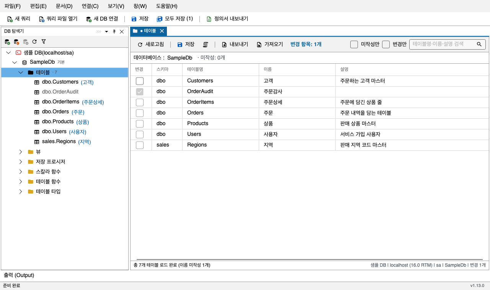
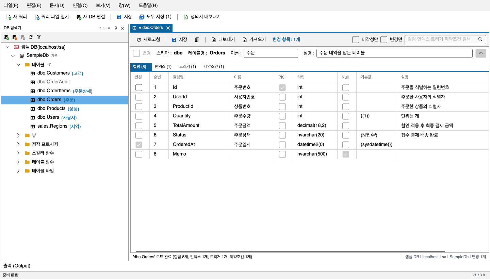
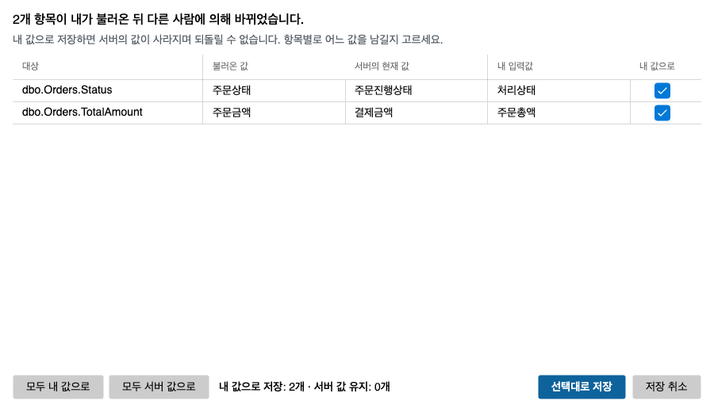

# 2. 코멘트 달기

[목차](README.md) · 이전: [1. DBMS별 연결](getting-started-dbms.md) · 다음: [2. 여러 행 한꺼번에 채우기](comments-fill.md)

이 장은 SchemaForge 1.13.0 기준이다. MariaDB·MySQL·PostgreSQL·Oracle 연결에서 달라지는 점은 [1.5](getting-started-dbms.md#15-mariadb-연결)~[1.8](getting-started-dbms.md#18-oracle-연결)에 모아 두었다.

- **기본**
  - [2.1 코멘트는 어디에 저장되나](#21-코멘트는-어디에-저장되나)
  - [2.2 편집 화면 열기](#22-편집-화면-열기)
  - [2.3 값 입력하기](#23-값-입력하기)
  - [2.4 채울 곳만 보기](#24-채울-곳만-보기)
  - [2.5 저장하기](#25-저장하기)
  - [2.6 저장 충돌](#26-저장-충돌)
  - [2.7 행 되돌리기](#27-행-되돌리기)
- **여러 행 한꺼번에 채우기** ([comments-fill.md](comments-fill.md))
  - [2.8 Excel에서 붙여넣기](comments-fill.md#28-excel에서-붙여넣기)
  - [2.9 이름 제안으로 채우기](comments-fill.md#29-이름-제안으로-채우기)
  - [2.10 같은 컬럼명 이름 맞추기](comments-fill.md#210-같은-컬럼명-이름-맞추기)
  - [2.11 찾아 바꾸기와 설명 편집](comments-fill.md#211-찾아-바꾸기와-설명-편집)
- **점검·비교** ([comments-review.md](comments-review.md))
  - [2.12 작성률 보기](comments-review.md#212-작성률-보기)
  - [2.13 다른 DB와 비교해 맞추기](comments-review.md#213-다른-db와-비교해-맞추기)
- **이력·스크립트** ([comments-history.md](comments-history.md))
  - [2.14 저장 이력](comments-history.md#214-저장-이력)
  - [2.15 변경분을 SQL 스크립트로 내보내기](comments-history.md#215-변경분을-sql-스크립트로-내보내기)

## 2.1 코멘트는 어디에 저장되나

SchemaForge는 개체마다 **이름**과 **설명**을 받아 코멘트 값 하나에 `§`로 이어 붙여 저장한다.
저장하는 자리는 DBMS가 원래 코멘트를 두는 곳이다. MS SQL Server는 `MS_Description` 확장 속성이고 MariaDB·MySQL은 개체의 `COMMENT`, PostgreSQL·Oracle은 `COMMENT ON`이다.

```
주문내역§고객이 주문한 상품의 내역을 보관하는 테이블
└ 이름 ┘└──────────── 설명 ────────────────────┘
```

다른 DB 도구에서 그 개체의 코멘트를 보면 이 모양 그대로 보인다. 같은 DB를 쓰는 기존 프로그램과 맞추려고 정한 형식이다.

### 구분자 바꾸기

`§`는 기본값이다. 이 DB가 `|`·`::` 같은 다른 구분자로 코멘트를 관리해 왔으면, 연결 편집에서 `코멘트 구분자`를 그 글자로 바꾼다.
그 연결로 여는 모든 화면(트리, 코멘트 문서, 작성률, 같은 컬럼명 문서, 정의서, SQL 편집기)이 그 구분자로 읽고 저장한다.

- 1~3글자이고 공백·글자·숫자는 쓸 수 없다. 쓸 수 없는 값이면 연결 창의 `저장`이 꺼지고 이유가 보인다.
- 연결마다 따로 정한다. `§` DB와 `|` DB를 오가도 다시 바꿀 필요가 없다.
- 이미 저장된 값을 새 구분자로 바꿔 주지는 않는다. 구분자 설정은 읽고 쓰는 방식만 바꾼다.
- [다른 DB와 비교](comments-review.md#213-다른-db와-비교해-맞추기)는 두 DB를 각자 연결의 구분자로 읽는다. `§` DB의 값을 `|` DB에 맞춰 넣을 수 있다.

**구분자가 맞지 않아 보이면 알린다.** 코멘트 문서를 열었는데 설명이 있는 값이 하나도 없고 이름 안에 다른 구분자가 자주 보이면,
문서 맨 위에 `이 DB의 코멘트는 '|'로 나뉜 것으로 보입니다. 연결 설정의 구분자('§')를 확인하세요.`가 나온다.
그 상태로 저장하면 `이 DB는 '|' 형식으로 보입니다. '§'로 나눠 저장할까요?`를 한 번 더 묻는다. 취소하면 아무것도 쓰지 않고 편집은 남는다.
잘못된 구분자로 저장하면 값이 다른 형식으로 굳기 때문이다.

다룰 수 있는 개체는 DBMS마다 다르다.

- **MS SQL Server** — 테이블, 컬럼, 뷰, 뷰 컬럼, 저장 프로시저, 스칼라·테이블 함수, 파라미터, 인덱스,
  트리거, 제약조건(CHECK·DEFAULT·FK), 사용자 정의 테이블 타입과 그 컬럼.
- **MariaDB** — 테이블, 컬럼, 프로시저, 함수. 인덱스·파라미터와 `STORED` 계산 컬럼의 코멘트는 읽기만 한다.

형식(`이름§설명`)과 구분자를 바꾸는 법은 두 DBMS가 같다.

## 2.2 편집 화면 열기

DB 탐색기 트리는 `연결 > DB > 분류 폴더(테이블·뷰 등) > 개체` 순으로 펼쳐진다. 편집 화면은 이 트리에서 연다.

| 하려는 일 | 여는 법 | 화면 |
|---|---|---|
| 한 분류의 개체 이름을 죽 훑으며 이름 채우기 | DB 아래 분류 폴더 오른쪽 클릭 > `테이블 코멘트 관리` 등(폴더 이름 + `코멘트 관리`) | **분류 목록 문서** — 탭 제목이 `테이블` |
| 개체 하나의 컬럼·파라미터까지 채우기 | 개체 더블클릭 (또는 오른쪽 클릭 > `코멘트 관리`) | **개체 문서** — 탭 제목이 `dbo.Orders` |
| 여러 테이블에 되풀이되는 컬럼의 이름 맞추기 | DB 탐색기 컬럼 검색 결과 오른쪽 클릭 | **같은 컬럼명 문서** — [2.10절](comments-fill.md#210-같은-컬럼명-이름-맞추기) |
| 다른 DB(예: 개발)와 값이 다르거나 빈 곳 맞추기 | DB 노드 오른쪽 클릭 > `다른 DB 코멘트와 비교...` | **비교 문서** — [2.13절](comments-review.md#213-다른-db와-비교해-맞추기) |
| 내보내 둔 파일의 값을 DB 전체에 맞추기 | DB 노드 오른쪽 클릭 > `파일의 코멘트와 비교...` | **비교 문서** — [파일과 비교하기](comments-review.md#파일과-비교하기) |

같은 개체를 다시 더블클릭하면 새로 읽지 않고 이미 열린 탭으로 가므로 편집 중이던 값은 그대로 남는다.

### 분류 목록 문서



그리드 한 장에 `변경 · 스키마 · 개체명 · 이름 · 설명`이 있다. 개체명 칸의 머리글은 분류를 따라 `테이블명`·`뷰명`·`프로시저명`·`함수명`·`타입명`으로 바뀐다(여러 분류가 섞인 목록은 `개체명`). 그리드 위에는 `데이터베이스 : {DB명}`이 보이고
그 오른쪽에 `· 미작성: N개`가 함께 보여 남은 분량을 알 수 있다. 테이블·뷰·저장 프로시저·스칼라 함수·테이블 함수·
테이블 타입 폴더가 모두 이 화면을 쓴다.

### 개체 문서



맨 위 머리글에서 개체 자신의 이름·설명을 고치고 그 아래에서 하위 항목을 고친다. 머리글의 입력 줄은 `스키마 :` · `테이블명 :`(개체 종류에 따라 `뷰명 :`·`타입명 :` 등) · `이름 :` · `설명 :`이다.

| 개체 | 머리글 아래 | 그리드 칸 |
|---|---|---|
| 테이블 | `컬럼` · `인덱스` · `트리거` · `제약조건` 탭 | 컬럼 탭: 변경 / 순번 / 컬럼명 / 이름 / PK / 타입 / Null / 기본값 / 설명 |
| 뷰 | `컬럼` · `인덱스` · `트리거` 탭 | 컬럼 탭: 변경 / 순번 / 컬럼명 / 이름 / 타입 / Null / 설명 |
| 저장 프로시저 · 함수 | 파라미터 그리드 하나 | 변경 / 순번 / 파라미터명 / 이름 / 타입 / 입·출력 / 설명 |
| 테이블 타입 | 컬럼 그리드 하나 | 변경 / 순번 / 컬럼명 / 이름 / 타입 / Null / 설명 |

탭 머리글의 숫자(`컬럼 (12)`)는 지금 보이는 항목 수라서 필터를 걸면 걸러진 뒤의 수로 바뀐다.

### 인덱스 탭 — 인덱스에 든 컬럼 보기


인덱스 탭은 위아래로 나뉜다. 위 그리드(`인덱스명` · `이름` · `설명` 등)에서 인덱스의 이름·설명을 고치고, 인덱스를 하나 고르면 아래 표에 그 인덱스에 든 컬럼이 보인다.

| 칸 | 뜻 |
|---|---|
| 순번 | 키 순서. 포괄 열은 `-` |
| 컬럼명 · 이름 · 타입 · Null | 컬럼 탭과 같은 값. 컬럼 탭에서 이름을 고치면 저장하기 전에도 곧바로 바뀐다 |
| 정렬 | 키 컬럼의 `ASC`(오름차순) / `DESC`(내림차순) |
| 구분 | `키`(정렬·검색 기준), `포괄`(`INCLUDE`로 값만 실은 열), `컬럼스토어` |

- 아래 표는 읽기만 한다. 행을 더블클릭하면 컬럼 탭으로 가서 그 컬럼을 고른다.
- 두 영역 사이의 선을 끌어 높이를 바꾼다.
- MariaDB에서 앞부분만 거는 인덱스는 컬럼명 뒤에 `(10)`처럼 길이가 붙는다. MariaDB에는 포괄 열이 없다.

### 제약조건 탭

SQL Server 테이블 문서에는 `제약조건` 탭이 있다. CHECK·DEFAULT·FK 제약조건에 이름·설명을 단다.

| 칸 | 뜻 |
|---|---|
| 종류 | `CHECK` · `DEFAULT` · `FK` |
| 제약조건명 · 대상 컬럼 | 테이블 수준 CHECK는 대상 컬럼이 비어 있다 |
| 정의 | CHECK·DEFAULT는 식, FK는 참조 대상(`dbo.Users(Id)`) |

- PK·UNIQUE는 인덱스 탭에서 다룬다. 같은 대상을 두 곳에서 고치지 않게 하려는 것이다.
- 저장·가져오기·내보내기·변경분 스크립트는 다른 탭과 같다.
- 뷰 문서와 MariaDB 연결에는 이 탭이 없다.

### 툴바

모든 코멘트 문서의 툴바는 같은 모양이다.

| 위치 | 항목 | 하는 일 |
|---|---|---|
| 왼쪽 | `새로고침` | DB에서 다시 읽는다 |
| | `저장` | 이 탭의 변경된 항목만 저장한다([2.5절](#25-저장하기)) |
| | 스크립트 아이콘(`변경분 스크립트`) | 변경된 항목을 DB에 쓰지 않고 SQL 스크립트 파일로 내보낸다([2.15절](comments-history.md#215-변경분을-sql-스크립트로-내보내기)) |
| | `내보내기` · `가져오기` | 파일로 주고받는다([3장](import-export.md)) |
| | `변경 항목: N개` | 저장하지 않은 변경 수 |
| 오른쪽 | `미작성만` · `변경만` · 검색 칸 | 보이는 행을 거른다([2.4절](#24-채울-곳만-보기)) |

맨 아래 상태줄에는 방금 한 일의 결과(불러온 개수, 저장 결과, 붙여넣기 결과 등)가 보인다.

## 2.3 값 입력하기

1. 고칠 칸을 한 번 클릭해 고른다.
2. **같은 칸을 한 번 더 클릭하거나 `F2`**를 누르면 입력 상태가 된다. 칸을 고른 채 바로 타이핑해서는 입력이 시작되지 않는다.
3. 입력한 뒤 `Tab`을 누르면 값이 들어가고 옆 칸도 입력 상태로 이어진다. `Enter`는 값을 넣고 아래 행의 같은 칸을 입력 상태로 연다. 이름을 위에서 아래로 이어 채울 때 `F2`를 다시 누르지 않아도 된다. 마지막 행에서는 입력이 끝난다. `Esc`는 편집을 취소하고 편집 전 값으로 돌아간다.

입력하는 중에 `Ctrl+Z`(macOS `Cmd+Z`)를 누르면 **한 글자(음절)씩** 되돌리고 `Ctrl+Y`(macOS `Cmd+Shift+Z`)로 다시 넣는다. 그리드 셀뿐 아니라 검색 칸, 문서 머리글의 입력칸도 같다. macOS에서도 한글이 자모 단위로 되돌아가지 않는다.

**칸 폭은 끌어서 바꾼다.** 칸 머리글 사이의 선을 끌어 처음보다 좁히거나 넓힌다. 칸 폭의 합이 창보다 넓어지면 가로 스크롤바가 생긴다.

편집하면 이렇게 표시된다.

- 그 행의 `변경` 칸에 체크가 생긴다.
- 툴바에 `변경 항목: N개`가 보인다.
- 탭 제목 앞에 `●`가 붙는다.
- 메인 툴바의 **모두 저장** 버튼에 변경이 남은 문서 수가 붙는다. 예: `모두 저장 (2)`

값을 원래대로 고치면 표시도 사라진다. 한 번에 원래 값으로 돌리려면 [2.7절](#27-행-되돌리기)의 행 되돌리기를 쓴다.

### 지킬 것

- **이름에는 `§`(그 연결의 코멘트 구분자)를 넣을 수 없다.** 이름과 설명을 가르는 문자라서다. 설명에는 넣어도 된다.
- 이름과 설명을 합쳐 **7,500바이트(한글 약 3,750자)**를 넘으면 저장하지 않는다. MariaDB는 한도가 다르고 글자 수로 센다([1.5 MariaDB 연결](getting-started-dbms.md#15-mariadb-연결)).
- 이름과 설명을 모두 비우고 저장하면 그 개체의 코멘트를 지운다.

위반한 값이 있으면 저장을 시작하지 않고 상태줄에 `저장 취소: …`로 어느 항목이 문제인지 알려 준다. 하나라도 걸리면 아무것도 저장하지 않는다.

## 2.4 채울 곳만 보기

툴바 오른쪽의 세 가지로 보이는 행을 좁힌다.

| 기능 | 쓰는 법 | 남기는 행 |
|---|---|---|
| `미작성만` | 체크를 켜고 끈다 | 이름이 빈 행 |
| `변경만` | 체크를 켜고 끈다 | `변경`이 체크된 행(저장하지 않은 변경이 있는 행) |
| 검색 | 검색 칸에 쓰고 `Enter` 또는 돋보기. `✕`로 지운다 | 검색어가 든 행 |

따로 `F8`을 누르면 거르지 않고 이름이 빈 다음 칸으로 간다(이전은 `Shift+F8`). 탭이 여럿이면 지금 탭 안에서만 움직인다.

- **함께 켜면 모두 만족하는 행만 남는다(AND).** 예: 검색어 `주문` + `미작성만` + `변경만`이면 "`주문`이 들어 있고, 이름이 비었고, 고친 행"만 남는다.
- 검색어는 분류 목록 문서에서는 개체를, 개체 문서에서는 컬럼·파라미터 같은 하위 항목을 거른다. `미작성만`과 `변경만`은 개체와 하위 항목 모두에 걸린다.
- 개체 문서의 머리글(개체 자신)은 거르지 않고 늘 보인다.
- 거르기는 DB를 다시 읽지 않으므로 편집하던 값은 사라지지 않는다.
- 거른 뒤 상태줄에 보이는 수와 전체 수가 나온다. 예: `'주문' 검색 + 미작성만 + 변경만: 3개 / 전체 120개.`
- 걸러져 안 보이는 변경이 있으면 상태줄에 `화면에 보이지 않는 변경 항목 N개도 저장 대상입니다.`가 붙는다. 저장은 화면에 보이는 것과 상관없이 문서 전체의 변경을 저장한다.

### 행이 바로 사라지지 않는 이유

`미작성만`을 켠 뒤 이름을 채워도, `변경만`을 켠 뒤 값을 되돌리거나 저장해도 그 행은 바로 사라지지 않는다.
방금 넣은 값을 확인할 수 있게 하려고 이렇게 했다. 토글이나 검색을 다시 누르면 그때 빠진다.

### 저장 전에 바뀐 것만 확인하기

1. 툴바의 `변경만`을 켠다. 고친 행만 남는다.
2. 행마다 이름·설명을 훑어본다. 잘못 고친 행은 오른쪽 클릭 > `원래 값으로 되돌리기`로 되돌린다([2.7절](#27-행-되돌리기)).
3. `저장`을 누른다.
4. `변경만`을 다시 눌러 끄면 전체 목록으로 돌아온다.

## 2.5 저장하기

| 방법 | 저장하는 것 |
|---|---|
| **저장** `Ctrl+S`(macOS는 `Cmd+S`) — 문서 툴바, 파일 메뉴, 메인 툴바 | 지금 탭의 변경된 항목만 |
| **모두 저장** `Ctrl+Shift+S`(macOS는 `Cmd+Shift+S`) | 열려 있는 탭 중 변경이 있는 것 전부. DB 전체가 아니다 |

변경된 항목만 하나의 트랜잭션으로 저장한다. 하나가 실패하면 그 문서의 저장은 모두 취소된다(MariaDB는 다르다 — [1.5](getting-started-dbms.md#mariadb-저장)). 저장이
끝나면 상태줄에 `성공적으로 N개 코멘트가 저장되었습니다.`가 보이고 DB 탐색기의 이름도 바뀐다. 저장에 실패하면 상태줄 문구가 빨간 글자로
바뀌고 다른 문구가 들어오면 원래 색으로 돌아온다. `§`나 길이 때문에 저장을 시작하지 않은 안내는 빨갛지 않다.

앞뒤 공백만 바꾼 편집은 변경으로 잡지 않는다. 저장할 때 앞뒤 공백을 떼고 보내 DB에서 바뀌는 것이 없기 때문이다.

모두 저장은 탭을 하나씩 차례로 저장한다. 탭마다 저장 전 검사와 충돌 확인을 그대로 거친다. 한 탭이 막혀도 나머지는
계속 저장하고 상태바에 `저장 N개 · 건너뜀 M개 · 변경 없음 K개`가 보인다. 건너뛴 탭과 그 이유는 출력 창에 남는다.

### 저장 로그

저장이 성공하면 출력 창에 저장 완료 줄이 남고, 그 바로 아래에 **저장한 항목마다 한 줄씩** 이전 값과 새 값이 남는다.

```
[14:02:11] [ERP_DEV] … 코멘트 저장 완료 (2개 항목)
[14:02:11]   dbo.Orders.Status: 이름 '주문상태' → '처리상태'
[14:02:11]   dbo.Orders.Memo: 이름 '' → '메모', 설명 '' → '주문 메모'
```

- 바뀐 칸만 적는다. 이름과 설명이 둘 다 바뀌면 한 줄에 `, `로 잇는다. 빈 값은 `''`로 적는다.
- 이전 값은 DB에 있던 값, 새 값은 DB에 보낸 값(앞뒤 공백을 뺀 값)이다.
- 저장이 실패하면 롤백되어 DB에서 바뀐 것이 없으므로 항목 줄을 남기지 않는다.
- 출력 창은 앱을 끄면 비워진다. 앱을 다시 켠 뒤에 이전 값을 찾으려면 [2.14절](comments-history.md#214-저장-이력)의 저장 이력을 본다.

### 저장하지 않은 편집을 지키는 장치

- 변경이 남은 탭이나 앱을 닫으면 `저장 / 저장 안 함 / 취소`를 묻는다. 여러 탭을 한꺼번에 닫아도 한 번만 묻는다.
- 탭을 밖으로 끌어 창으로 분리한 문서도 같다. 분리한 창의 `×`를 누르면 창을 닫기 전에 묻고, `취소`하면 창과 문서가 그대로 남는다.
- 변경이 남은 문서에서 **새로고침**을 누르면, 편집을 버리고 다시 읽을지 먼저 묻는다.

## 2.6 저장 충돌

내가 문서를 연 뒤 다른 사람이 같은 항목을 저장했으면, 모르고 남의 값을 덮어쓰지 않도록 저장 직전에 그 사실을
알려 준다. 충돌이 없으면 이 창은 뜨지 않는다.



| 칸 | 뜻 |
|---|---|
| 대상 | 충돌한 항목 |
| 불러온 값 | 내가 문서를 열었을 때의 값 |
| 서버의 현재 값 | 다른 사람이 저장한 값 |
| 내 입력값 | 내가 지금 저장하려는 값 |
| 내 값으로 | 체크하면 내 값으로 덮어쓰고, 끄면 서버 값을 그대로 둔다 |

- 처음에는 모든 행이 `내 값으로`에 체크되어 있다. 체크는 한 번 누르면 바뀐다.
- **모두 내 값으로**와 **모두 서버 값으로**로 한꺼번에 바꿀 수 있다.
- **선택대로 저장**을 누르면 체크한 행만 저장한다. 체크를 끈 행은 화면 값이 서버 값으로 바뀌고 내 입력값은 버려진다. 출력 창에 `N개 항목을 서버 값으로 되돌렸습니다(저장하지 않음).`이 남는다.
- **저장 취소**(또는 `Esc`, 창 닫기)를 누르면 아무것도 저장하지 않고 편집한 값은 그대로 남는다. 상태줄에 `저장을 취소했습니다. 편집한 내용은 그대로 남아 있습니다.`가 보인다.
- **내 값으로 덮어쓴 항목은 덮인 서버 값이 이전 값으로 남는다.** [저장 로그](#저장-로그)와 [저장 이력](comments-history.md#214-저장-이력)의 이전 값은 처음 불러온 값이 아니라 다른 사람이 넣었던 서버 값이다. 필요하면 그 값으로 되돌릴 수 있다.

다른 사람이 나와 같은 값으로 바꿨거나 공백만 다르면 충돌로 보지 않는다.

서버 값을 다시 읽지 못하면 충돌 여부를 알 수 없으므로 저장하지 않는다. 상태줄에
`저장 충돌을 확인할 수 없어 저장하지 않았습니다. 연결 상태를 확인한 뒤 다시 시도하세요.`가 나온다.

이 기능은 덮어쓰기 전에 알려 줄 뿐, 다른 사람의 편집을 막지는 않는다.

## 2.7 행 되돌리기

잘못 고친 행을 원래 값으로 되돌린다. 다른 행의 편집은 그대로 둔다.

**원래 값**은 그 문서가 **마지막으로 DB에서 읽었거나 저장한 값**이다. 되돌릴 때 DB를 다시 읽지 않는다.
이미 저장한 값을 그 전 값으로 돌릴 때는 이 기능 대신 [2.14절](comments-history.md#214-저장-이력)의 저장 이력을 쓴다.

### 그리드의 행

1. 되돌릴 행을 고른다. 여러 행이면 `Shift`+클릭 등으로 함께 고른다.
2. 고른 행 위에서 오른쪽 클릭 > `원래 값으로 되돌리기`.
3. 고른 행 중 변경된 행이 모두 원래 값으로 돌아간다. 상태줄에 `N개 항목을 원래 값으로 되돌렸습니다.`가 보인다.

- 고르지 않은 행을 오른쪽 클릭하면 그 행을 먼저 고른 뒤 메뉴가 뜬다.
- 고른 행 중 변경된 것이 없으면 메뉴 항목이 꺼져 있다.
- 되돌리면 `변경` 체크가 풀리고 `변경 항목: N개`와 탭의 `●`도 따라 줄어든다.
- 확인 창 없이 화면 안의 값만 바꿀 뿐 DB나 파일에는 쓰지 않는다.
- 분류 목록, 컬럼·인덱스·트리거, 파라미터, 타입 컬럼, 같은 컬럼명 문서 그리드에서 모두 같다.

### 머리글(개체 자신)

개체 문서의 머리글은 **설명 입력칸 오른쪽의 되돌리기 아이콘 버튼**으로 되돌린다. 머리글이 바뀌지 않았으면 버튼이 꺼져 있다.

셀을 입력하는 중에 오른쪽 클릭하면 입력칸 메뉴(잘라내기·복사·붙여넣기)가 뜬다. 되돌리려면 먼저 `Enter`로 입력을 끝낸다.
