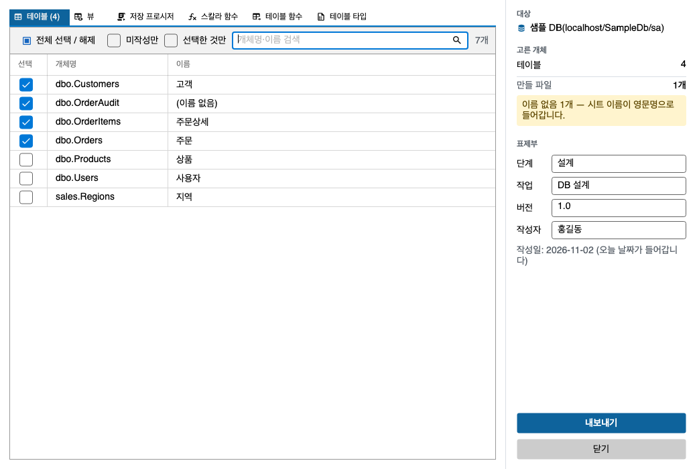

# 3. 파일로 주고받기 — 정의서 내보내기

[목차](README.md) · 이전: [3.2 가져오기](import.md) · 다음: [4.1 열기](sql-editor.md)

- [3.1 내보내기](import-export.md#31-내보내기)
- [3.2 가져오기](import.md#32-가져오기)
- [3.3 정의서 내보내기](#33-정의서-내보내기)

## 3.3 정의서 내보내기

외부에 제출하는 엑셀 정의서를 만든다. Excel이 설치되어 있지 않아도 된다.

**여는 법** — 트리에서 연결·DB·폴더·개체 중 하나를 고르고 툴바의 **정의서 내보내기**, **파일 > 정의서 내보내기...**,
또는 오른쪽 클릭 메뉴의 **정의서 내보내기...**를 누른다. 대상 DB는 고른 노드의 DB다(연결이면 기본 DB). 아무것도 고르지 않으면 꺼진다.

| 고른 노드 | 처음 모습 |
|---|---|
| 연결 · DB | `테이블` 탭, 체크 없음 |
| 분류 폴더 | 그 분류 탭, 체크 없음 |
| 개체 | 그 분류 탭, 그 개체만 체크 |

MariaDB 연결도 같은 양식으로 내보낸다. 탭은 `테이블`·`뷰`·`저장 프로시저`·`함수` 넷이고, 목록 시트와 개체 시트에서 `스키마` 칸이 빠져 그만큼 이름 칸이 넓다.
뷰 컬럼의 `이름`은 테이블 컬럼을 그대로 가져온 칸에만 나오고, 파라미터는 코멘트 자리가 없어 `이름`·`설명` 칸이 비어 있다. MySQL 연결도 같다.

PostgreSQL 연결은 SQL Server와 같은 양식이고 타입 탭 이름이 `복합 타입`이다. Oracle 연결은 탭이 `테이블`·`뷰`·`저장 프로시저`·`함수` 넷이고 스키마 칸을 둔다.
Oracle 루틴은 코멘트 자리가 없어 루틴 시트의 `이름`·`설명` 칸이 비어 있다.

### 1단계: 개체 고르기

- 분류마다 탭이 있고 탭 머리글에 고른 개수가 붙는다. 예: `테이블 (12)`
- 줄의 체크박스를 눌러 고른다. **전체 선택 / 해제**는 지금 보이는 줄에만 적용된다.
- 거르기: 검색 칸(`개체명·이름 검색`), `미작성만`(이름이 없는 것), `선택한 것만`(체크한 것만 다시 훑어보기). 걸러도 체크는 그대로 남는다.
- 키보드: 줄을 고르고 `Space`로 체크, `Ctrl+Tab`·`Ctrl+Shift+Tab`으로 분류 탭 이동. macOS에서도 이 두 키는 `Control`이다.
- 오른쪽 패널의 **고른 개체**에 분류별 개수와 **만들 파일 N개**가 보인다.

### 2단계: 표제부

`단계 · 작업 · 버전 · 작성자`를 적는다. 마지막에 쓴 값을 기억하므로 대개 다시 적을 일이 없다.
**작성일**은 오늘 날짜가 자동으로 들어가고 바꿀 수 없다. 페이지 번호도 자동이다.
빈 칸이 있어도 만들 수는 있다. 어느 칸이 비었는지 표제부 아래에 적힌다.

### 3단계: 내보내기

**내보내기**를 누르고 저장할 곳을 고른다. 기본 파일 이름은 `DB명_정의서_YYYYMMDD.xlsx`다.

- **분류를 여러 개 고르면 분류마다 파일을 따로 만든다.** 예: `x_테이블.xlsx`, `x_뷰.xlsx`
- 만들 파일 중 이미 있는 것이 있으면 실제로 덮어쓸 파일 이름을 모두 보여 주고 묻는다.
- **중단**을 누르면 멈춘다. 만들던 파일은 남기지 않고 원래 있던 파일도 건드리지 않는다.
- 끝나면 **폴더 열기**로 저장한 폴더를 연다.

### 만들어지는 파일

| 시트 | 내용 |
|---|---|
| 개체마다 한 장 | 표제부, 개체 정보, 컬럼·파라미터 등 하위 항목 표. 시트 이름은 개체의 이름이다 |
| `목록` | 고른 개체의 목록. 칸은 `스키마 · {개체명} · 이름 · 설명`이고 개체명 칸의 머리글은 분류를 따라 `테이블명`·`뷰명`·`프로시저명` 등이다 |

- 이름이 없는 개체는 시트 이름이 영문 이름이 되고 목록 시트의 이름 칸은 비어 있다. 고른 것 중 몇 개가 그런지 오른쪽 패널에 적힌다.
- 이름이 같은 개체가 여럿이면 시트 이름 뒤에 `_2`, `_3`이 붙는다.
- 200개 이상 고르면 시간이 걸릴 수 있다고 미리 알려 준다. 개체마다 시트를 하나씩 만들기 때문이다. 막지는 않는다.
