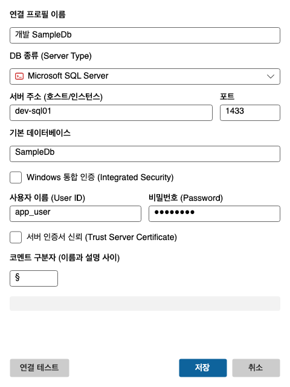

# 1. 시작하기 — DB 연결 만들기

[목차](README.md) · 이전: [1. 화면 구성](getting-started-screen.md) · 다음: [1. DB 탐색기](getting-started-explorer.md)

- **설치** ([getting-started.md](getting-started.md))
  - [1.1 설치](getting-started.md#11-설치)
- **화면 구성** ([getting-started-screen.md](getting-started-screen.md))
  - [1.2 화면 구성](getting-started-screen.md#12-화면-구성)
- **DB 연결 만들기**
  - [1.3 DB 연결 만들기](#13-db-연결-만들기)
- **DB 탐색기** ([getting-started-explorer.md](getting-started-explorer.md))
  - [1.4 DB 탐색기 쓰기](getting-started-explorer.md#14-db-탐색기-쓰기)
- **연결 정리와 검색** ([getting-started-search.md](getting-started-search.md))
  - [1.5 연결 정리와 검색](getting-started-search.md#15-연결-정리와-검색)
- **MariaDB·MySQL 연결** ([getting-started-dbms.md](getting-started-dbms.md))
  - [1.6 MariaDB 연결](getting-started-dbms.md#16-mariadb-연결)
  - [1.7 MySQL 연결](getting-started-dbms.md#17-mysql-연결)
- **PostgreSQL·Oracle 연결** ([getting-started-postgresql-oracle.md](getting-started-postgresql-oracle.md))
  - [1.8 PostgreSQL 연결](getting-started-postgresql-oracle.md#18-postgresql-연결)
  - [1.9 Oracle 연결](getting-started-postgresql-oracle.md#19-oracle-연결)

## 1.3 DB 연결 만들기

앱을 처음 켜면 시작 페이지가 뜬다. **새 DB 연결**을 누른다. 시작 페이지를 닫았으면 툴바의
**새 DB 연결** 또는 `Ctrl+Shift+N`(macOS `Cmd+Shift+N`)을 쓴다.

| 칸 | 적을 것 |
|---|---|
| 연결 프로필 이름 | 트리에 보일 이름. 예: `개발 SalesDB` (필수) |
| DB 종류 | `Microsoft SQL Server`·`MariaDB`·`MySQL`·`PostgreSQL`·`Oracle`. 고르면 포트와 칸이 바뀐다([1.6](getting-started-dbms.md#16-mariadb-연결)~[1.9](getting-started-postgresql-oracle.md#19-oracle-연결)). 저장한 연결의 종류는 바꿀 수 없다 |
| 서버 주소 · 포트 | 예: `dev-sql01`, `1433` (서버 주소 필수) |
| 기본 데이터베이스 | 주로 쓸 DB 이름. 트리에서 이 DB가 맨 위에 펼쳐진 채로 놓인다. 비워 두면 `master`다. 같은 서버의 다른 DB도 이 연결 하나로 볼 수 있다([1.4](getting-started-explorer.md#14-db-탐색기-쓰기)) |
| Windows 통합 인증 | 켜면 지금 로그인한 Windows 계정으로 접속한다. 끄면 아래 두 칸이 나온다 |
| 사용자 이름 · 비밀번호 | SQL Server 인증 계정 (통합 인증을 끈 경우 사용자 이름 필수) |
| 서버 인증서 신뢰 | 서버가 자체 서명 인증서를 쓸 때 켠다 |
| 코멘트 구분자 | 이름과 설명을 가르는 글자. 기본은 `§`다. 이 DB가 다른 구분자(`\|` 등)로 코멘트를 관리해 왔으면 그것으로 바꾼다([2.1](comments.md#21-코멘트는-어디에-저장되나)) |

**연결 테스트**로 접속되는지 먼저 확인한 뒤 **저장**을 누른다. 필수 칸이 비어 있거나 코멘트 구분자를 쓸 수 없으면 **저장**이
꺼지고 그 이유가 버튼 위에 적힌다.

접속 계정에는 코멘트를 고칠 권한이 있어야 저장할 수 있다. MS SQL Server는 확장 속성을 추가·수정·삭제할 권한이고,
MariaDB·MySQL은 `ALTER`(테이블·컬럼)·`ALTER ROUTINE`(프로시저·함수) 권한이고, PostgreSQL은 그 개체의 소유자, Oracle은 개체 소유자이거나
`COMMENT ANY TABLE` 권한이다. 읽기 권한만 있으면
보기와 정의서 내보내기까지만 된다.

비밀번호는 이 PC에 암호화해 저장한다. 보호 수준은 [6.6 데이터 저장 위치](troubleshooting-info.md#66-데이터-저장-위치)를 본다.

### 연결 고치기와 지우기

- **고치기** — 트리에서 연결이나 그 아래 DB를 오른쪽 클릭하고 **DB 연결 수정...**을 고른다. 탐색기 툴바와 **연결** 메뉴의
  **DB 연결 수정**은 연결 아래 어느 노드를 골라 두어도 그 연결을 고친다. 창에서 **취소**·`Esc`로 닫으면 아무것도 바뀌지 않는다.
- **지우기** — 연결 노드를 오른쪽 클릭하고 **DB 연결 제거...**를 고른다. 툴바와 **연결** 메뉴의 제거는 연결 노드를 골랐을 때만
  켜진다. 제거하면 저장한 비밀번호도 함께 지워져 되돌릴 수 없으므로 어느 연결인지 보여 주고 한 번 더 묻는다.
