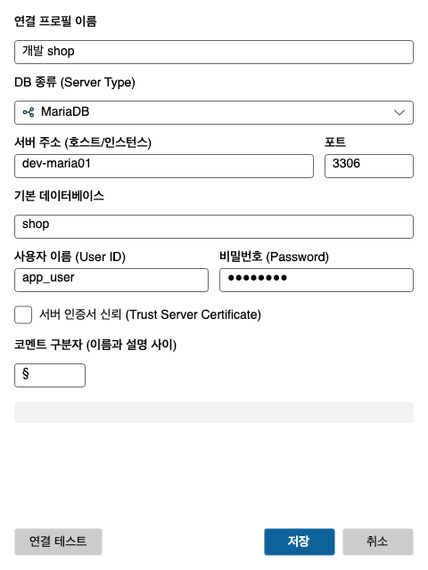

# 1. 시작하기 — MariaDB 연결

[목차](README.md) · 이전: [1. 연결 정리와 검색](getting-started-search.md) · 다음: [1. MySQL 연결](getting-started-mysql.md)

- **설치** ([getting-started.md](getting-started.md))
  - [1.1 설치](getting-started.md#11-설치)
- **화면 구성** ([getting-started-screen.md](getting-started-screen.md))
  - [1.2 화면 구성](getting-started-screen.md#12-화면-구성)
- **DB 연결 만들기** ([getting-started-connect.md](getting-started-connect.md))
  - [1.3 DB 연결 만들기](getting-started-connect.md#13-db-연결-만들기)
- **DB 탐색기** ([getting-started-explorer.md](getting-started-explorer.md))
  - [1.4 DB 탐색기 쓰기](getting-started-explorer.md#14-db-탐색기-쓰기)
- **연결 정리와 검색** ([getting-started-search.md](getting-started-search.md))
  - [1.5 연결 정리와 검색](getting-started-search.md#15-연결-정리와-검색)
- **MariaDB 연결**
  - [1.6 MariaDB 연결](#16-mariadb-연결)
- **MySQL 연결** ([getting-started-mysql.md](getting-started-mysql.md))
  - [1.7 MySQL 연결](getting-started-mysql.md#17-mysql-연결)
- **PostgreSQL 연결** ([getting-started-postgresql-oracle.md](getting-started-postgresql-oracle.md))
  - [1.8 PostgreSQL 연결](getting-started-postgresql-oracle.md#18-postgresql-연결)
- **Oracle 연결** ([getting-started-oracle.md](getting-started-oracle.md))
  - [1.9 Oracle 연결](getting-started-oracle.md#19-oracle-연결)

## 1.6 MariaDB 연결

MariaDB 12.0 이상에 연결한다. 코멘트는 SQL Server와 같은 `이름§설명` 형식으로 개체의 `COMMENT`에 저장한다.
여기 적지 않은 것은 SQL Server 연결과 같다.

### 연결 만들기

연결 대화상자의 **DB 종류**에서 `MariaDB`를 고르면 다음이 바뀐다.

| 칸 | MariaDB에서 |
|---|---|
| 연결 프로필 이름 | 기본 이름 그대로면 `New MariaDB`가 된다. 직접 적은 이름은 그대로다 |
| 포트 | 비었거나 1433이면 `3306`이 된다 |
| 기본 데이터베이스 | **필수다.** MariaDB에는 비웠을 때 대신 붙을 `master` 같은 DB가 없다 |
| Windows 통합 인증 | 숨는다. 사용자 이름·비밀번호로 접속한다 |
| 서버 인증서 신뢰 | 끄면 서버 인증서와 호스트 이름을 검증하고, 켜면 검증하지 않는다 |

- 연결은 늘 TLS로 암호화한다. 서버에 TLS가 켜져 있어야 붙는다.
- 코멘트를 읽으려면 그 DB의 `SELECT`·`EXECUTE` 권한이 있어야 한다. `SELECT`만 있으면 저장 프로시저·함수가 보이지 않는다.
- 코멘트를 저장하려면 `ALTER`(테이블·컬럼)·`ALTER ROUTINE`(프로시저·함수) 권한도 있어야 한다.

### DB 탐색기

- 연결 라벨의 서버 표기는 `서버:포트`다. 포트가 3306이면 적지 않는다.
- 시스템 DB(`information_schema`·`mysql`·`performance_schema`·`sys`)는 보이지 않는다.
- DB 아래 폴더는 `테이블`·`뷰`·`저장 프로시저`·`함수` 넷이다. 트리거는 코멘트를 붙일 자리가 없어 나오지 않는다.
- 뷰도 코멘트를 붙일 자리가 없어 읽기만 한다. 뷰 노드에는 `코멘트 관리` 대신 `컬럼 보기`가 있고, `정의 열기`·`코드 복사`·`새 쿼리`·`상위 1000개 행 선택`·
  `개체명 복사`를 쓴다. 테이블 컬럼을 그대로 가져온 뷰 컬럼에는 그 컬럼의 이름이 함께 보인다.
- MariaDB는 DB가 곧 스키마라 개체는 개체명만 보인다(`orders`). 그리드의 `스키마` 칸과 문서 머리글의 `스키마`도 숨는다.
- SQL 편집기는 기본으로 조회만 하고 탭에서 `쓰기 허용`을 켜야 쓴다([4.11](sql-editor-dbms.md#411-mariadb-연결)). `상위 1000개 행 선택`은 `LIMIT 1000`으로,
  `실행문 만들기`는 `CALL` 문으로 채운다. `정의 열기`는 `SHOW CREATE` 결과를 읽기 전용 문서로 연다. 정의서는 같은 양식에서 스키마 칸만 빠진다.
  `코드 복사`는 테이블과 뷰에만 있다. `다른 DB 코멘트와 비교...`는 MariaDB 연결끼리만 비교한다([2.13절](comments-compare.md#213-다른-db와-비교해-맞추기)).

### 저장할 수 있는 것

| 문서 | MariaDB에서 |
|---|---|
| 폴더 `코멘트 관리`(테이블·저장 프로시저·함수) | 모두 쓴다 |
| 테이블 문서 | 머리글과 컬럼을 쓴다. 인덱스 칸은 읽기만 한다. `트리거`·`제약조건` 탭은 없다 |
| 루틴 문서 | 머리글(루틴 자신)만 쓴다. 파라미터 칸은 읽기만 한다 |
| 같은 컬럼명 문서 | 쓴다 |
| 비교 문서 | 테이블·컬럼·프로시저·함수를 비교하고 대상 DB에 쓴다. `STORED` 계산 컬럼 행은 읽기만 한다 |

- 인덱스 코멘트는 인덱스를 지우고 다시 만들어야 바뀌므로 읽기만 한다. 테이블 문서 툴바 아래에 그 안내가 보인다.
- `STORED` 계산 컬럼은 코멘트 하나에도 테이블을 다시 만들어야 해서 그 행만 막는다. 행에 마우스를 올리면 이유가 나온다. 같은 컬럼명 문서에
  섞여 있으면 툴바 아래에 `STORED 계산 컬럼은 읽기만 합니다.`가 보인다.
- 읽기만 하는 칸은 더블클릭·`F2`·입력·붙여넣기 어떤 방법으로도 바뀌지 않는다. 붙여넣기·찾아 바꾸기·같은 컬럼명 문서의 `적용`은 그 행을 건너뛰고 건너뛴 수를 알린다.
- MariaDB 코멘트에는 이모지처럼 4바이트인 글자를 넣을 수 없다. 서버가 오류 없이 `?`로 바꿔 저장하므로 저장 전에 막고 어느 항목인지 알린다.
- 가져오기는 쓸 수 있는 항목에만 값을 넣는다. 인덱스 행은 `MariaDB에서 쓸 수 없는 개체(인덱스)`, `STORED` 계산 컬럼 행은 `STORED 계산 컬럼`으로 따로 보인다.
- 변경분 스크립트는 MariaDB 문법으로 나온다. 컬럼 문장은 그 테이블 정의를 읽어 만들고 정의를 읽지 못하면 스크립트를 만들지 않는다. 스크립트 첫 줄에서
  `NO_BACKSLASH_ESCAPES`를 끄므로 그 모드를 켠 도구로 돌려도 결과가 같다.
- 길이 한도는 글자 수로 센다 — 테이블 2,048자, 컬럼 1,024자, 프로시저·함수 21,845자. 넘으면 저장을 시작하지 않는다.

### MariaDB 저장

MariaDB는 코멘트를 바꾸는 즉시 반영되어 여러 건을 한꺼번에 되돌릴 수 없다. 그래서 **차례로 저장하고 실패한 곳에서 멈춘다.**
테이블 자신과 그 컬럼은 테이블마다 `ALTER` 하나로 묶어 보낸다. 한 테이블의 묶음은 통째로 반영되거나 하나도 반영되지 않는다. 프로시저·함수는 하나씩 보낸다.

- 저장하는 동안 상태 문구에 순번이 나온다(`3개 중 2번째 저장 중...`).
- 모두 반영되면 SQL Server와 같이 `성공적으로 N개 코멘트가 저장되었습니다.`가 보인다.
- 도중에 실패하면 상태 문구가 빨간 글자로 `저장 결과: 반영 2건 · 실패 1건 · 실행 안 함 3건 — 실패: …` 모양이 된다. 좁아서 잘리면 마우스를 올려 전문을 본다.
  - 반영된 항목은 변경 표시가 꺼지고 저장 이력에 남는다.
  - 실패한 항목과 실행하지 않은 항목은 변경 표시가 남는다. `변경만`을 켜면 남은 것만 보인다.
  - 원인을 고친 뒤 다시 **저장**하면 남은 항목만 저장한다.
- 쓰기 권한이 없는 계정이면 첫 문장에서 멈추고 `이 계정에는 코멘트를 바꿀 권한이 없습니다.`가 함께 보인다.
- 다른 작업이 테이블을 잡고 있으면 10초 기다렸다가 그 테이블에서 멈추고 `다른 작업이 테이블을 쓰고 있어 기다리다 멈췄습니다`가 보인다.
- 컬럼은 정의를 통째로 다시 쓴다. 저장 직전에 정의를 읽어 코멘트만 바꿔 보내고 저장 직후 다시 읽어 맞춰 본다. 다른 곳이 바뀌었으면 그 테이블에서
  멈추고 저장 전후 정의를 보여 준다. 이미 반영되어 되돌리지 못하니 DB 관리자에게 알려 정의를 확인한다.
