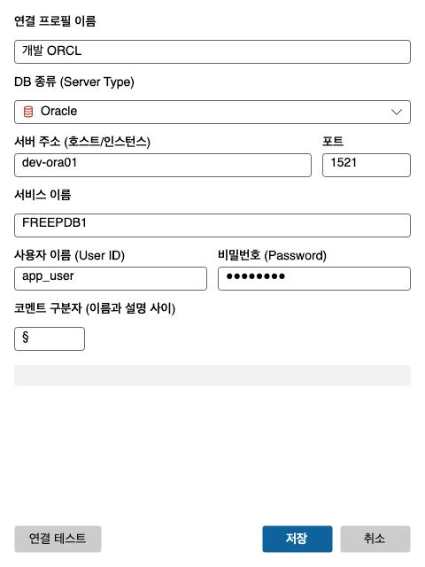

# 1. 시작하기 — Oracle 연결

[목차](README.md) · 이전: [1. PostgreSQL 연결](getting-started-postgresql-oracle.md) · 다음: [2. 코멘트 달기](comments.md)

- **설치** ([getting-started.md](getting-started.md))
  - [1.1 설치](getting-started.md#11-설치)
- **화면 구성** ([getting-started-screen.md](getting-started-screen.md))
  - [1.2 화면 구성](getting-started-screen.md#12-화면-구성)
- **DB 연결 만들기** ([getting-started-connect.md](getting-started-connect.md))
  - [1.3 DB 연결 만들기](getting-started-connect.md#13-db-연결-만들기)
- **DB 탐색기** ([getting-started-explorer.md](getting-started-explorer.md))
  - [1.4 DB 탐색기 쓰기](getting-started-explorer.md#14-db-탐색기-쓰기)
- **연결 정리와 검색** ([getting-started-search.md](getting-started-search.md))
  - [1.5 연결 정리와 검색](getting-started-search.md#15-연결-정리와-검색)
- **MariaDB 연결** ([getting-started-dbms.md](getting-started-dbms.md))
  - [1.6 MariaDB 연결](getting-started-dbms.md#16-mariadb-연결)
- **MySQL 연결** ([getting-started-mysql.md](getting-started-mysql.md))
  - [1.7 MySQL 연결](getting-started-mysql.md#17-mysql-연결)
- **PostgreSQL 연결** ([getting-started-postgresql-oracle.md](getting-started-postgresql-oracle.md))
  - [1.8 PostgreSQL 연결](getting-started-postgresql-oracle.md#18-postgresql-연결)
- **Oracle 연결**
  - [1.9 Oracle 연결](#19-oracle-연결)

## 1.9 Oracle 연결

Oracle 23ai에 서비스 이름(PDB)으로 연결한다. 코멘트는 같은 `이름§설명` 형식으로 `COMMENT ON`에 저장한다.

### 연결 만들기

**DB 종류**에서 `Oracle`을 고르면 다음이 바뀐다.

| 칸 | Oracle에서 |
|---|---|
| 포트 | `1521`이 된다 |
| 서비스 이름 | **필수다.** 기본 데이터베이스 칸 대신 나온다. 붙을 서비스(PDB) 이름을 적는다(예: `FREEPDB1`) |
| Windows 통합 인증 | 숨는다 |
| 서버 인증서 신뢰 | 숨는다(아래 암호화) |

- 연결은 늘 Oracle 네이티브 암호화(AES)를 요구한다. 서버가 암호화를 거부하면 붙지 못한다. 이 방식은 서버 인증서를 검증하지 않는다.
- 읽기만 할 때는 그 스키마의 개체를 조회할 권한(`SELECT`)이면 된다. 다른 스키마의 프로시저·함수를 보려면 `EXECUTE` 권한도 있어야 한다.
- 코멘트를 저장하려면 개체 소유자이거나 `COMMENT ANY TABLE` 권한이 있어야 한다.

### DB 탐색기

- 연결 아래에 서비스 노드 하나가 있고 개체는 `스키마.이름`으로 보인다. Oracle이 관리하는 스키마(`SYS`·`SYSTEM` 등)의 개체는 보이지 않는다.
- 폴더는 `테이블`·`뷰`·`저장 프로시저`·`함수` 넷이다. 구체화 뷰는 `뷰` 폴더에만 보인다.
- **프로시저·함수는 코멘트 자리가 없어 읽기용 폴더다.** 이름이 없어도 흐리게 보이지 않고, 오른쪽 클릭 메뉴는 `파라미터 보기`·`정의 열기`·`실행문 만들기`·
  `새 쿼리`·`개체명 복사`다. 더블클릭하면 파라미터의 이름·타입·입출력을 읽기 전용으로 보인다. 패키지 안의 프로시저·함수는 보이지 않는다.
- `정의 열기`는 뷰·구체화 뷰·프로시저·함수의 본문을 읽기 전용 문서로 연다. 테이블의 `CREATE` 문은 열지 않는다.
- `실행문 만들기`는 프로시저를 `BEGIN … END;` 블록으로 채우고 OUT 인자는 `DECLARE`한 변수로 넘긴다. 함수는 `SELECT "스키마"."이름"(인자 => NULL) FROM DUAL;`이다.
- 정의서 내보내기는 `테이블`·`뷰`·`저장 프로시저`·`함수` 탭을 연다. 루틴 파라미터의 이름·설명 칸은 빈다. `코드 복사`는 테이블과 뷰에 있다.
- `다른 DB 코멘트와 비교...`는 Oracle 연결끼리만 비교한다.

### 저장

| 문서 | Oracle에서 |
|---|---|
| 테이블 문서 | 머리글과 컬럼을 쓴다. 인덱스 칸은 읽기만 한다. `트리거`·`제약조건` 탭은 없다 |
| 뷰 문서 | 머리글과 컬럼을 쓴다 |
| 루틴 문서 | 읽기만 한다 |

- Oracle은 `COMMENT`를 실행하는 순간 반영해 여러 건을 한꺼번에 되돌릴 수 없다. 그래서 **한 건씩 저장하고 실패한 건에서 멈춘다.**
  결과는 [1.6의 MariaDB 저장](getting-started-dbms.md#mariadb-저장)과 같이 `반영 · 실패 · 실행 안 함`으로 나뉘어 보인다.
- 쓰기 권한이 없으면 첫 건에서 멈추고 `이 계정에는 코멘트를 바꿀 권한이 없습니다.`가 함께 보인다.
- 길이 한도는 이름과 설명을 합쳐 4,000바이트(DB 문자셋 기준, 한글 약 1,333자)다. 넘으면 저장을 시작하지 않는다.
