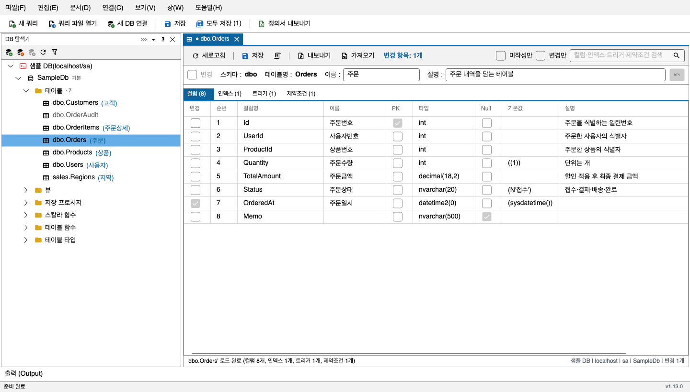

# 1. 시작하기 — 화면 구성

[목차](README.md) · 이전: [1. 시작하기](getting-started.md) · 다음: [1. DB 연결 만들기](getting-started-connect.md)

- **설치** ([getting-started.md](getting-started.md))
  - [1.1 설치](getting-started.md#11-설치)
- **화면 구성**
  - [1.2 화면 구성](#12-화면-구성)
- **DB 연결 만들기** ([getting-started-connect.md](getting-started-connect.md))
  - [1.3 DB 연결 만들기](getting-started-connect.md#13-db-연결-만들기)
- **DB 탐색기** ([getting-started-explorer.md](getting-started-explorer.md))
  - [1.4 DB 탐색기 쓰기](getting-started-explorer.md#14-db-탐색기-쓰기)
- **연결 정리와 검색** ([getting-started-search.md](getting-started-search.md))
  - [1.5 연결 정리와 검색](getting-started-search.md#15-연결-정리와-검색)
- **MariaDB·MySQL 연결** ([getting-started-dbms.md](getting-started-dbms.md))
  - [1.6 MariaDB 연결](getting-started-dbms.md#16-mariadb-연결)
  - [1.7 MySQL 연결](getting-started-dbms.md#17-mysql-연결)
- **PostgreSQL·Oracle 연결** ([getting-started-postgresql-oracle.md](getting-started-postgresql-oracle.md))
  - [1.8 PostgreSQL 연결](getting-started-postgresql-oracle.md#18-postgresql-연결)
  - [1.9 Oracle 연결](getting-started-postgresql-oracle.md#19-oracle-연결)

## 1.2 화면 구성

| 영역 | 하는 일 |
|---|---|
| 메뉴 | 파일 · 편집 · 문서 · 연결 · 보기 · 창 · 도움말 |
| 툴바 | 자주 쓰는 버튼: `새 쿼리` · `쿼리 파일 열기` · `새 DB 연결` / `저장` · `모두 저장` / `정의서 내보내기` |
| DB 탐색기 (왼쪽) | 등록한 연결과 그 안의 DB·개체를 트리로 본다 |
| 문서 영역 (가운데) | 코멘트 문서, SQL 편집기, 작성률·저장 이력 문서가 탭으로 열린다 |
| 출력 (아래) | 저장·SQL 실행 기록과 오류가 남는다. 오류는 빨강, 경고는 주황이다 |
| 문서 하단 줄 | 왼쪽은 그 탭에서 방금 한 일의 결과, 오른쪽은 그 탭이 붙은 연결(아래 설명) |
| 상태바 (맨 아래) | 방금 한 일의 결과. 새 버전이 있으면 여기에 링크가 나타난다. 오른쪽 끝의 앱 버전(`v1.11.0`)을 누르면 정보 창이 열린다 |

**정보 창** — `도움말 > SchemaForge 정보`나 상태바의 버전을 누르면 열린다. 버전과 실행 중인 .NET·Avalonia·Dock 버전, 저장 방식(`구분자 기본 §(연결마다 지정)`), 지원 개체가 보인다. 문의할 때 이 버전을 함께 알려 주면 원인을 찾기 쉽다.

**문서 하단의 연결 정보** — 코멘트 문서와 SQL 편집기는 하단 줄 오른쪽에 그 탭이 어느 서버·계정·DB에 붙어 있는지 늘 보인다.

| 문서 | 표시 예 |
|---|---|
| 코멘트 문서 | `개발 \| devsql (16.0 RTM) \| sa \| SalesDb \| 변경 3개` (프로필 \| 서버,포트 (SQL Server 버전) \| 사용자 \| DB \| 저장하지 않은 변경 수) |
| SQL 편집기 | `devsql (16.0 RTM) \| sa \| SalesDb \| 1,000개 행` (보고 있는 결과 탭의 행 수) |

- 포트가 1433이면 적지 않는다. Windows 인증이면 사용자 자리에 `Windows 인증`이 보인다.
- 마우스를 올리면 전체 버전 번호·에디션과 암호화 여부가 보인다.
- 변경이 없거나 결과가 없으면 그 칸은 빠진다. 서버 버전을 읽지 못하면 버전만 빠진다.
- 왼쪽 상태 문구가 길면 말줄임되고 마우스를 올리면 전체 문구가 보인다.

메뉴마다 하는 일:

| 메뉴 | 들어 있는 것 |
|---|---|
| 파일 | 새 쿼리 · 쿼리 파일 열기 · 최근 쿼리 파일 / 저장 · 다른 이름으로 저장 · 모두 저장 / 정의서 내보내기 / 설정 / 종료 |
| 편집 | 실행 취소·다시 실행, 잘라내기·복사·붙여넣기, 찾기, 주석·대소문자·줄 편집. **SQL 편집기 탭에서만 켜진다** |
| 문서 | 활성 탭에 대한 명령. 코멘트 문서면 새로고침 · 가져오기 · 내보내기 · 다음/이전 미작성 항목, SQL 편집기면 실행 · 실행 중단 · 결과 저장 등 |
| 연결 | 새 DB 연결 · DB 연결 수정 · DB 연결 제거 / DB 탐색기 새로고침. 대상은 DB 탐색기에서 고른 연결이다 |
| 보기 | DB 탐색기 · 출력 · 레이아웃 초기화 / 테마(시스템 설정 따르기 · 라이트 · 다크) |
| 창 | 다음/이전 문서, 탭 닫기, 열린 문서 목록 |
| 도움말 | 시작 · 사용 설명서 / 단축키 목록 · 오류 로그 폴더 열기 / 업데이트 확인 / 정보 |

- `모두 저장` 버튼에는 변경이 남은 문서 수가 붙는다. 예: `모두 저장 (2)`. 변경이 없으면 꺼진다.
- `새 쿼리`·`정의서 내보내기`·`쿼리 파일 열기`는 DB 탐색기에서 연결(또는 그 아래 노드)을 먼저 골라야 켜진다.

패널을 닫았거나 배치가 흐트러졌으면 **보기 > 레이아웃 초기화**로 되돌린다. DB 탐색기와 출력 창은
**보기** 메뉴에서 다시 연다. 닫은 시작 페이지는 **도움말 > 시작**으로 다시 연다.
