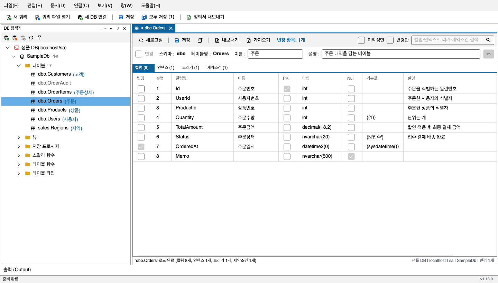
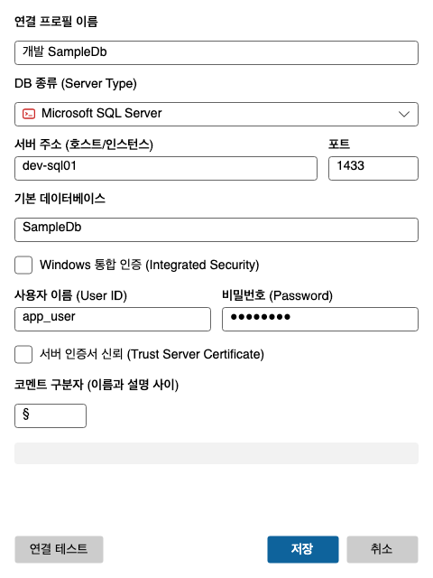

# 1. 시작하기

[목차](README.md) · 다음: [1. DB 탐색기](getting-started-explorer.md)

- **설치와 연결**
  - [1.1 설치](#11-설치)
  - [1.2 화면 구성](#12-화면-구성)
  - [1.3 DB 연결 만들기](#13-db-연결-만들기)
- **DB 탐색기** ([getting-started-explorer.md](getting-started-explorer.md))
  - [1.4 DB 탐색기 쓰기](getting-started-explorer.md#14-db-탐색기-쓰기)
- **연결 정리와 검색** ([getting-started-search.md](getting-started-search.md))
  - [1.5 연결 정리와 검색](getting-started-search.md#15-연결-정리와-검색)
- **MariaDB·MySQL 연결** ([getting-started-dbms.md](getting-started-dbms.md))
  - [1.6 MariaDB 연결](getting-started-dbms.md#16-mariadb-연결)
  - [1.7 MySQL 연결](getting-started-dbms.md#17-mysql-연결)
- **PostgreSQL·Oracle 연결** ([getting-started-postgresql-oracle.md](getting-started-postgresql-oracle.md))
  - [1.8 PostgreSQL 연결](getting-started-postgresql-oracle.md#18-postgresql-연결)
  - [1.9 Oracle 연결](getting-started-postgresql-oracle.md#19-oracle-연결)

## 1.1 설치

[최신 릴리스](https://github.com/almyeonseo/SchemaForge-releases/releases/latest)의 **Assets**에서 OS에 맞는
파일을 받는다. .NET 런타임이 들어 있어 따로 설치할 것이 없다.

| OS | 받을 파일 | 설치 |
|---|---|---|
| Windows (x64) | `SchemaForge-<버전>-win-x64-setup.exe` | 실행하면 관리자 권한 없이 설치되고 시작 메뉴에 등록된다. 제거는 설정 > 앱 |
| macOS (Apple Silicon) | `SchemaForge-<버전>-osx-arm64.dmg` | dmg를 열어 앱을 Applications로 끌어 넣는다 |
| macOS (Intel) | `SchemaForge-<버전>-osx-x64.dmg` | 위와 같다 |
| Linux (x64) | `SchemaForge-<버전>-x86_64.AppImage` | 실행 권한을 주고(`chmod +x`) 실행한다 |

설치 없이 쓰려면 같은 버전의 zip을 받는다.

- **Windows zip** — 압축을 풀고 `SchemaForge.UI.exe`를 실행한다.
- **macOS zip** — Finder에서 더블클릭해 푼다. 터미널 `unzip`으로 풀면 앱 서명이 깨져 실행이 막힌다.
- **Linux zip** — 압축을 푼 자리에서 처음 한 번 `sh install.sh`를 실행한다. 실행 권한이 붙고 앱 메뉴에 등록된다.

macOS에서 처음 실행이 막히면 시스템 설정 > 개인정보 보호 및 보안에서 **그래도 열기**를 누른다.
서명·공증을 하지 않은 앱이라 한 번은 이 단계를 거친다.

## 1.2 화면 구성

| 영역 | 하는 일 |
|---|---|
| 메뉴 | 파일 · 편집 · 문서 · 연결 · 보기 · 창 · 도움말 |
| 툴바 | 자주 쓰는 버튼: `새 쿼리` · `쿼리 파일 열기` · `새 DB 연결` / `저장` · `모두 저장` / `정의서 내보내기` |
| DB 탐색기 (왼쪽) | 등록한 연결과 그 안의 DB·개체를 트리로 본다 |
| 문서 영역 (가운데) | 코멘트 문서, SQL 편집기, 작성률·저장 이력 문서가 탭으로 열린다 |
| 출력 (아래) | 저장·SQL 실행 기록과 오류가 남는다. 오류는 빨강, 경고는 주황이다 |
| 문서 하단 줄 | 왼쪽은 그 탭에서 방금 한 일의 결과, 오른쪽은 그 탭이 붙은 연결(아래 설명) |
| 상태바 (맨 아래) | 방금 한 일의 결과. 새 버전이 있으면 여기에 링크가 나타난다. 오른쪽 끝의 앱 버전(`v1.11.0`)을 누르면 정보 창이 열린다 |

**정보 창** — `도움말 > SchemaForge 정보`나 상태바의 버전을 누르면 열린다. 버전과 실행 중인 .NET·Avalonia·Dock 버전, 저장 방식(`구분자 기본 §(연결마다 지정)`), 지원 개체가 보인다. 문의할 때 이 버전을 함께 알려 주면 원인을 찾기 쉽다.

**문서 하단의 연결 정보** — 코멘트 문서와 SQL 편집기는 하단 줄 오른쪽에 그 탭이 어느 서버·계정·DB에 붙어 있는지 늘 보인다.

| 문서 | 표시 예 |
|---|---|
| 코멘트 문서 | `개발 \| devsql (16.0 RTM) \| sa \| SalesDb \| 변경 3개` (프로필 \| 서버,포트 (SQL Server 버전) \| 사용자 \| DB \| 저장하지 않은 변경 수) |
| SQL 편집기 | `devsql (16.0 RTM) \| sa \| SalesDb \| 1,000개 행` (보고 있는 결과 탭의 행 수) |

- 포트가 1433이면 적지 않는다. Windows 인증이면 사용자 자리에 `Windows 인증`이 보인다.
- 마우스를 올리면 전체 버전 번호·에디션과 암호화 여부가 보인다.
- 변경이 없거나 결과가 없으면 그 칸은 빠진다. 서버 버전을 읽지 못하면 버전만 빠진다.
- 왼쪽 상태 문구가 길면 말줄임되고 마우스를 올리면 전체 문구가 보인다.

메뉴마다 하는 일:

| 메뉴 | 들어 있는 것 |
|---|---|
| 파일 | 새 쿼리 · 쿼리 파일 열기 · 최근 쿼리 파일 / 저장 · 다른 이름으로 저장 · 모두 저장 / 정의서 내보내기 / 설정 / 종료 |
| 편집 | 실행 취소·다시 실행, 잘라내기·복사·붙여넣기, 찾기, 주석·대소문자·줄 편집. **SQL 편집기 탭에서만 켜진다** |
| 문서 | 활성 탭에 대한 명령. 코멘트 문서면 새로고침 · 가져오기 · 내보내기 · 다음/이전 미작성 항목, SQL 편집기면 실행 · 실행 중단 · 결과 저장 등 |
| 연결 | 새 DB 연결 · DB 연결 수정 · DB 연결 제거 / DB 탐색기 새로고침. 대상은 DB 탐색기에서 고른 연결이다 |
| 보기 | DB 탐색기 · 출력 · 레이아웃 초기화 / 테마(시스템 설정 따르기 · 라이트 · 다크) |
| 창 | 다음/이전 문서, 탭 닫기, 열린 문서 목록 |
| 도움말 | 시작 · 사용 설명서 / 단축키 목록 · 오류 로그 폴더 열기 / 업데이트 확인 / 정보 |

- `모두 저장` 버튼에는 변경이 남은 문서 수가 붙는다. 예: `모두 저장 (2)`. 변경이 없으면 꺼진다.
- `새 쿼리`·`정의서 내보내기`·`쿼리 파일 열기`는 DB 탐색기에서 연결(또는 그 아래 노드)을 먼저 골라야 켜진다.

패널을 닫았거나 배치가 흐트러졌으면 **보기 > 레이아웃 초기화**로 되돌린다. DB 탐색기와 출력 창은
**보기** 메뉴에서 다시 연다. 닫은 시작 페이지는 **도움말 > 시작**으로 다시 연다.

## 1.3 DB 연결 만들기

앱을 처음 켜면 시작 페이지가 뜬다. **새 DB 연결**을 누른다. 시작 페이지를 닫았으면 툴바의
**새 DB 연결** 또는 `Ctrl+Shift+N`(macOS `Cmd+Shift+N`)을 쓴다.

| 칸 | 적을 것 |
|---|---|
| 연결 프로필 이름 | 트리에 보일 이름. 예: `개발 SalesDB` (필수) |
| DB 종류 | `Microsoft SQL Server`·`MariaDB`·`MySQL`·`PostgreSQL`·`Oracle`. 고르면 포트와 칸이 바뀐다([1.6](getting-started-dbms.md#16-mariadb-연결)~[1.9](getting-started-postgresql-oracle.md#19-oracle-연결)). 저장한 연결의 종류는 바꿀 수 없다 |
| 서버 주소 · 포트 | 예: `dev-sql01`, `1433` (서버 주소 필수) |
| 기본 데이터베이스 | 주로 쓸 DB 이름. 트리에서 이 DB가 맨 위에 펼쳐진 채로 놓인다. 비워 두면 `master`다. 같은 서버의 다른 DB도 이 연결 하나로 볼 수 있다([1.4](getting-started-explorer.md#14-db-탐색기-쓰기)) |
| Windows 통합 인증 | 켜면 지금 로그인한 Windows 계정으로 접속한다. 끄면 아래 두 칸이 나온다 |
| 사용자 이름 · 비밀번호 | SQL Server 인증 계정 (통합 인증을 끈 경우 사용자 이름 필수) |
| 서버 인증서 신뢰 | 서버가 자체 서명 인증서를 쓸 때 켠다 |
| 코멘트 구분자 | 이름과 설명을 가르는 글자. 기본은 `§`다. 이 DB가 다른 구분자(`\|` 등)로 코멘트를 관리해 왔으면 그것으로 바꾼다([2.1](comments.md#21-코멘트는-어디에-저장되나)) |

**연결 테스트**로 접속되는지 먼저 확인한 뒤 **저장**을 누른다. 필수 칸이 비어 있거나 코멘트 구분자를 쓸 수 없으면 **저장**이
꺼지고 그 이유가 버튼 위에 적힌다.

접속 계정에는 코멘트를 고칠 권한이 있어야 저장할 수 있다. MS SQL Server는 확장 속성을 추가·수정·삭제할 권한이고,
MariaDB·MySQL은 `ALTER`(테이블·컬럼)·`ALTER ROUTINE`(프로시저·함수) 권한이고, PostgreSQL은 그 개체의 소유자, Oracle은 개체 소유자이거나
`COMMENT ANY TABLE` 권한이다. 읽기 권한만 있으면
보기와 정의서 내보내기까지만 된다.

비밀번호는 이 PC에 암호화해 저장한다. 보호 수준은 [6.6 데이터 저장 위치](troubleshooting-info.md#66-데이터-저장-위치)를 본다.

### 연결 고치기와 지우기

- **고치기** — 트리에서 연결이나 그 아래 DB를 오른쪽 클릭하고 **DB 연결 수정...**을 고른다. 탐색기 툴바와 **연결** 메뉴의
  **DB 연결 수정**은 연결 아래 어느 노드를 골라 두어도 그 연결을 고친다. 창에서 **취소**·`Esc`로 닫으면 아무것도 바뀌지 않는다.
- **지우기** — 연결 노드를 오른쪽 클릭하고 **DB 연결 제거...**를 고른다. 툴바와 **연결** 메뉴의 제거는 연결 노드를 골랐을 때만
  켜진다. 제거하면 저장한 비밀번호도 함께 지워져 되돌릴 수 없으므로 어느 연결인지 보여 주고 한 번 더 묻는다.
