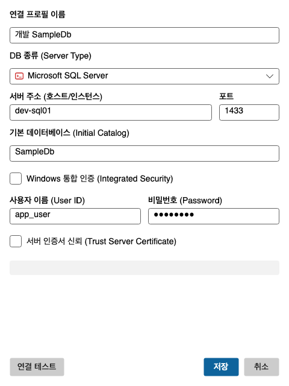
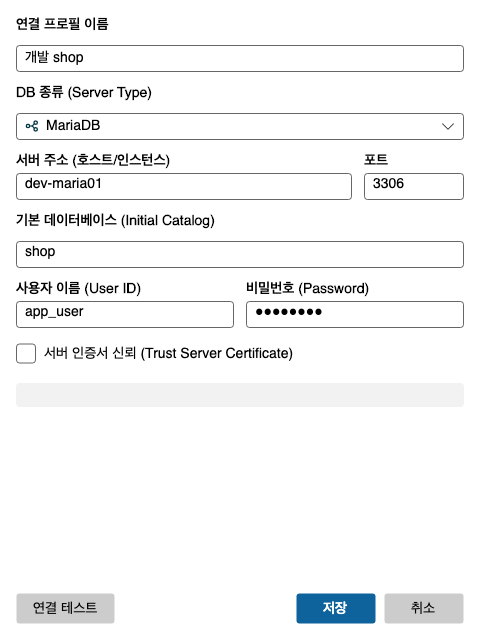

# 1. 시작하기

[목차](README.md) · 다음: [2. 코멘트 달기](comments.md)

## 1.1 설치

[최신 릴리스](https://github.com/almyeonseo/SchemaForge-releases/releases/latest)의 **Assets**에서 OS에 맞는
파일을 받는다. .NET 런타임이 들어 있어 따로 설치할 것이 없다.

| OS | 받을 파일 | 설치 |
|---|---|---|
| Windows (x64) | `SchemaForge-<버전>-win-x64-setup.exe` | 실행하면 관리자 권한 없이 설치되고 시작 메뉴에 등록된다. 제거는 설정 > 앱 |
| macOS (Apple Silicon) | `SchemaForge-<버전>-osx-arm64.dmg` | dmg를 열어 앱을 Applications로 끌어 넣는다 |
| macOS (Intel) | `SchemaForge-<버전>-osx-x64.dmg` | 위와 같다 |
| Linux (x64) | `SchemaForge-<버전>-x86_64.AppImage` | `chmod +x` 후 실행한다 |

설치 없이 쓰려면 같은 버전의 zip을 받는다.

- **Windows zip** — 압축을 풀고 `SchemaForge.UI.exe`를 실행한다.
- **macOS zip** — Finder에서 더블클릭해 푼다. 터미널 `unzip`으로 풀면 앱 서명이 깨져 실행이 막힌다.
- **Linux zip** — 압축을 푼 자리에서 처음 한 번 `sh install.sh`를 실행한다. 실행 권한이 붙고 앱 메뉴에 등록된다.

macOS에서 처음 실행이 막히면 시스템 설정 > 개인정보 보호 및 보안에서 **그래도 열기**를 누른다.
서명·공증을 하지 않은 앱이라 한 번은 이 단계를 거친다.

## 1.2 화면 구성


| 영역 | 하는 일 |
|---|---|
| 메뉴 | 파일 · 편집 · 문서 · 연결 · 보기 · 창 · 도움말 |
| 툴바 | 자주 쓰는 버튼: `새 쿼리` · `쿼리 파일 열기` · `새 DB 연결` / `저장` · `모두 저장` / `정의서 내보내기` |
| DB 탐색기 (왼쪽) | 등록한 연결과 그 안의 DB·개체를 트리로 본다 |
| 문서 영역 (가운데) | 코멘트 문서, SQL 편집기, 작성률·저장 이력 문서가 탭으로 열린다 |
| 출력 (아래) | 저장·SQL 실행 기록과 오류가 남는다. 오류는 빨강, 경고는 주황이다 |
| 문서 하단 줄 | 왼쪽은 그 탭에서 방금 한 일의 결과, 오른쪽은 그 탭이 붙은 연결(아래 설명) |
| 상태바 (맨 아래) | 방금 한 일의 결과. 새 버전이 있으면 여기에 링크가 나타난다. 오른쪽 끝의 앱 버전(`v1.6.0`)을 누르면 정보 창이 열린다 |

**문서 하단의 연결 정보** — 코멘트 문서와 SQL 편집기는 하단 줄 오른쪽에 그 탭이 어느 서버·계정·DB에 붙어 있는지 늘 보인다.

| 문서 | 표시 예 |
|---|---|
| 코멘트 문서 | `개발 \| devsql (16.0 RTM) \| sa \| SalesDb \| 변경 3개` (프로필 \| 서버,포트 (SQL Server 버전) \| 사용자 \| DB \| 저장하지 않은 변경 수) |
| SQL 편집기 | `devsql (16.0 RTM) \| sa \| SalesDb \| 1,000개 행` (보고 있는 결과 탭의 행 수) |

- 포트가 1433이면 적지 않는다. Windows 인증이면 사용자 자리에 `Windows 인증`이 보인다.
- 마우스를 올리면 전체 버전 번호·에디션과 암호화 여부가 보인다.
- 변경이 없거나 결과가 없으면 그 칸은 빠진다. 서버 버전을 읽지 못하면 버전만 빠진다.
- 왼쪽 상태 문구가 길면 말줄임되고 마우스를 올리면 전체 문구가 보인다.

메뉴마다 하는 일은 다음과 같다.

| 메뉴 | 들어 있는 것 |
|---|---|
| 파일 | 새 쿼리 · 쿼리 파일 열기 · 최근 쿼리 파일 / 저장 · 다른 이름으로 저장 · 모두 저장 / 정의서 내보내기 / 설정 / 종료 |
| 편집 | 실행 취소·다시 실행, 잘라내기·복사·붙여넣기, 찾기, 주석·대소문자·줄 편집. **SQL 편집기 탭에서만 켜진다** |
| 문서 | 활성 탭에 대한 명령. 코멘트 문서면 새로고침 · 가져오기 · 내보내기 · 다음/이전 미작성 항목, SQL 편집기면 실행 · 실행 중단 · 결과 저장 등 |
| 연결 | 새 DB 연결 · DB 연결 수정 · DB 연결 제거 / DB 탐색기 새로고침. 대상은 DB 탐색기에서 고른 연결이다 |
| 보기 | DB 탐색기 · 출력 · 레이아웃 초기화 / 테마(시스템 설정 따르기 · 라이트 · 다크) |
| 창 | 다음/이전 문서, 탭 닫기, 열린 문서 목록 |
| 도움말 | 시작 · 사용 설명서 / 단축키 목록 · 오류 로그 폴더 열기 / 업데이트 확인 / 정보 |

- `모두 저장` 버튼에는 변경이 남은 문서 수가 붙는다. 예: `모두 저장 (2)`. 변경이 없으면 꺼진다.
- `새 쿼리`·`정의서 내보내기`·`쿼리 파일 열기`는 DB 탐색기에서 연결(또는 그 아래 노드)을 먼저 골라야 켜진다.

패널을 닫았거나 배치가 흐트러졌으면 **보기 > 레이아웃 초기화**로 되돌린다. DB 탐색기와 출력 창은
**보기** 메뉴에서 다시 연다. 닫은 시작 페이지는 **도움말 > 시작**으로 다시 연다.

## 1.3 DB 연결 만들기

앱을 처음 켜면 시작 페이지가 뜬다. **새 DB 연결**을 누른다. 시작 페이지를 닫았으면 툴바의
**새 DB 연결** 또는 `Ctrl+Shift+N`(macOS `Cmd+Shift+N`)을 쓴다.



| 칸 | 적을 것 |
|---|---|
| 연결 프로필 이름 | 트리에 보일 이름. 예: `개발 SalesDB` (필수) |
| DB 종류 | `Microsoft SQL Server` 또는 `MariaDB`. MariaDB를 고르면 포트와 칸이 바뀐다([1.5](#15-mariadb-연결)). 저장한 연결의 종류는 바꿀 수 없다 |
| 서버 주소 · 포트 | 예: `dev-sql01`, `1433` (서버 주소 필수) |
| 기본 데이터베이스 | 주로 쓸 DB 이름. 트리에서 이 DB가 맨 위에 펼쳐진 채로 놓인다. 비워 두면 `master`다. 같은 서버의 다른 DB도 이 연결 하나로 볼 수 있다([1.4](#14-db-탐색기-쓰기)) |
| Windows 통합 인증 | 켜면 지금 로그인한 Windows 계정으로 접속한다. 끄면 아래 두 칸이 나온다 |
| 사용자 이름 · 비밀번호 | SQL Server 인증 계정 (통합 인증을 끈 경우 사용자 이름 필수) |
| 서버 인증서 신뢰 | 서버가 자체 서명 인증서를 쓸 때 켠다 |

**연결 테스트**로 접속되는지 먼저 확인한 뒤 **저장**을 누른다. 필수 칸이 비어 있으면 **저장**이
꺼지고 무엇이 비었는지 버튼 위에 적힌다.

접속 계정에는 확장 속성을 추가·수정·삭제할 권한이 있어야 저장할 수 있다. 읽기 권한만 있으면
보기와 정의서 내보내기까지만 된다.

비밀번호는 이 PC에 암호화해 저장한다. 보호 수준은 [6.3 데이터 저장 위치](troubleshooting.md#63-데이터-저장-위치)를 볼 것.

### 연결 고치기와 지우기

- **고치기** — 트리에서 연결이나 그 아래 DB를 오른쪽 클릭하고 **DB 연결 수정...**을 고른다. 탐색기 툴바와 **연결** 메뉴의
  **DB 연결 수정**은 연결 아래 어느 노드를 골라 두어도 그 연결을 고친다. 창에서 **취소**·`Esc`로 닫으면 아무것도 바뀌지 않는다.
- **지우기** — 연결 노드를 오른쪽 클릭하고 **DB 연결 제거...**를 고른다. 툴바와 **연결** 메뉴의 제거는 연결 노드를 골랐을 때만
  켜진다. 제거하면 저장한 비밀번호도 함께 지워져 되돌릴 수 없으므로, 어느 연결인지 보여 주고 한 번 더 묻는다.

## 1.4 DB 탐색기 쓰기

### 트리 구조

트리는 `연결 → DB → 분류 폴더 → 개체` 4단이다.

```text
개발 SalesDB(dev-sql01/app_user)        ← 연결
├ SalesDB  기본                         ← DB (기본 DB가 맨 위, 처음부터 펼쳐짐)
│ ├ 테이블 152                          ← 분류 폴더와 개수
│ │ ├ dbo.Orders (주문)                 ← 개체와 한글명
│ │ └ dbo.TB_TMP                        ← 한글명이 없으면 흐리게
│ ├ 뷰 …
│ └ …
├ HrDB                                  ← 같은 서버의 다른 DB (이름순)
└ 시스템 DB                             ← master·tempdb·model·msdb (맨 아래, 접힘)
```

| 노드 | 보이는 것 |
|---|---|
| 연결 | `프로필명(서버주소/계정)`. 포트가 1433이 아니면 서버 주소 뒤에 `,포트`가 붙고, Windows 통합 인증이면 계정 자리에 `Windows 인증`이 적힌다 |
| DB | DB 이름. 연결의 기본 DB에는 흐린 `기본`이 붙는다 |
| 시스템 DB 폴더 | `master`·`tempdb`·`model`·`msdb`를 모아 맨 아래에 접어 둔다 |
| 분류 폴더 | 테이블 · 뷰 · 저장 프로시저 · 스칼라 함수 · 테이블 함수 · 테이블 타입, 그리고 개수 |
| 개체 | `스키마.이름 (한글명)`. **한글명이 없는 개체는 흐리게** 보여, 트리만 훑어도 미작성이 드러난다 |

**DB 목록** — 연결을 처음 펼칠 때 그 계정이 들어갈 수 있는 온라인 DB 목록을 한 번 읽는다. 그전에는 기본 DB 하나만 보인다.

- 기본 DB에 붙지 못하면(오프라인, 복원 중, 권한 없음) `master`로 목록을 다시 묻는다.
- 그래도 읽지 못하면 기본 DB만 남기고 출력 창에 이유를 적는다.
- 그 사이에 새로 만든 DB는 연결의 **새로고침**으로 보인다.

어느 DB 아래에서 연 문서든 그 DB에서 읽고 그 DB에 저장한다. 다른 DB에 같은 이름의 개체가 있어도 탭이 따로 열린다.

### 펼치기와 열기

- **연결·DB·폴더는 앞의 화살표나 더블클릭으로 펼치고 접는다.** 폴더는 처음 펼칠 때 개체 목록을 읽어 온다.
- **개체를 더블클릭하거나 고른 채 `Enter`를 누르면** 그 개체의 코멘트 문서가 열린다([2장](comments.md)).
- 같은 개체를 다시 열면 이미 열린 탭으로 옮겨 갈 뿐, 다시 읽지 않는다. 편집하던 값은 그대로다.
- 마우스로 노드를 눌러도 트리가 스크롤되지 않는다. 보던 위치를 잃지 않게 하려는 것이다.

### 탐색기 툴바

트리 위의 아이콘 버튼 다섯 개다. 버튼 이름은 마우스를 올리면 보인다.

| 버튼 | 하는 일 | 꺼지는 때 |
|---|---|---|
| 새 DB 연결 | 연결 대화상자를 연다 | — |
| DB 연결 수정 | 고른 노드가 속한 연결을 고친다 | 아무것도 고르지 않았다 |
| DB 연결 제거 | 고른 연결을 지운다(확인을 거친다) | 연결 노드를 고르지 않았다 |
| 새로고침 | 연결 목록부터 다시 읽고, 펼쳐 둔 폴더를 다시 읽는다 | — |
| 개체 검색 | 검색 패널을 열고 닫는다(아래 "검색") | — |

### 오른쪽 클릭 메뉴

노드를 오른쪽 클릭하면 그 노드를 먼저 고른 뒤 메뉴가 열린다. 키보드로는 트리에 포커스를 두고 메뉴 키나 `Shift+F10`을 누른다.

| 누른 곳 | 항목 (`/`는 구분선) |
|---|---|
| 연결 | `새 쿼리` · `정의서 내보내기...` / `DB 연결 수정...` · `DB 연결 제거...` / `위로 이동` · `아래로 이동` · `맨 위로` · `맨 아래로` / `새로고침` |
| DB | `새 쿼리` · `정의서 내보내기...` · `작성률 보기` · `저장 이력 보기` · `다른 DB 코멘트와 비교...` / `DB 연결 수정...` / `새로고침` |
| 분류 폴더 | `{분류} 코멘트 관리`(예: `테이블 코멘트 관리`) · `새 쿼리` / `내보내기...` · `가져오기...` · `정의서 내보내기...` / `새로고침` |
| 개체 | `코멘트 관리` · `정의 열기`(뷰·프로시저·함수) · `실행문 만들기`(프로시저·함수) · `새 쿼리` · `상위 1000개 행 선택 ▸`(테이블·뷰) / `내보내기...` · `가져오기...` · `정의서 내보내기...` / `이름 복사` · `한글명 복사` |
| 빈 곳 | `새 DB 연결...` · `새로고침` |

항목별로 알아 둘 것:

- **새 쿼리** — 그 노드의 DB에 붙은 SQL 편집기를 연다. 연결에서 누르면 기본 DB다([4장](sql-editor.md)).
- **정의서 내보내기...** — 연결에서 누르면 기본 DB, DB에서 누르면 그 DB의 정의서 창이 열린다. 폴더는 그 분류 탭으로, 개체는 그 개체를 체크한 채로 연다([3.3](import-export.md#33-정의서-내보내기)).
- **작성률 보기** · **저장 이력 보기** — 그 DB의 한글명 작성률 문서와, 이 PC에서 저장한 코멘트의 이력 문서를 연다. 쓰는 법은 [2장](comments.md)을 볼 것.
- **다른 DB 코멘트와 비교...** — 그 DB를 대상으로, 고른 기준 DB와 값이 다르거나 빈 코멘트를 모은 비교 문서를 연다. 쓰는 법은 [2.14절](comments.md#214-다른-db와-비교해-맞추기)을 볼 것.
- **코멘트 관리** — 폴더는 그 분류 개체 전체의 한글명·설명을 편집하는 문서, 개체는 그 개체 하나의 문서를 연다(개체 더블클릭과 같다).
- **내보내기... · 가져오기...** — 그 노드의 코멘트 문서를 연 뒤 문서 툴바의 내보내기·가져오기와 같은 흐름을 시작한다. 가져오기는 그리드에 채우기만 하고 DB에는 쓰지 않는다([3장](import-export.md)).
- **상위 1000개 행 선택 ▸** — 하위 메뉴에서 조회문 모양을 고른다. 새 SQL 탭에 `TOP (1000)` 조회문을 **채우기만 하고 실행하지 않는다.** `F5`나 `Ctrl+Enter`(macOS `Cmd+Enter`)로 직접 실행한다.

  | 하위 항목 | 채워지는 조회문 |
  |---|---|
  | `한글명 주석` | 컬럼을 한 줄에 하나씩 나열하고 줄마다 `-- 한글명` 주석을 붙인다 |
  | `한글명 별칭` | 컬럼마다 `AS [한글명]`을 붙인다. 실행하면 결과 머리글이 한글명이다 |
  | `모든 컬럼 (*)` | `SELECT TOP (1000) * …` 한 줄 |

  테이블·뷰 뒤에는 `WITH(NOLOCK)`이 붙는다. 다른 작업의 잠금에 막히지 않는 대신 커밋되지 않은 값이 보일 수 있으므로, 결과로 데이터를 판단할 때는 힌트를 지우고 다시 실행할 것. 주석·별칭의 한글명은 DB에 저장된 값이다(저장하지 않은 편집은 들어가지 않는다).
- **정의 열기 · 실행문 만들기** — 서버에 저장된 본문, 또는 파라미터마다 타입·한글명 주석을 단 실행문을 새 SQL 탭에 채운다. 둘 다 실행하지 않는다.
- **이름 복사** — `DB.스키마.이름` 세 부분 이름을 클립보드에 넣는다(예: `SalesDB.dbo.Orders`). 예약어·공백 등이 든 부분만 `[ ]`로 감싼다. **한글명 복사**는 한글명이 없으면 꺼진다.
- **새로고침**은 누른 곳에 따라 범위가 다르다.

  | 누른 곳 | 다시 읽는 것 |
  |---|---|
  | 연결 · 빈 곳 · 탐색기 툴바 · 탐색기 안에서 `F5` | 연결 목록부터 전부. 펼쳐 둔 폴더도 다시 읽고, DB 목록을 읽은 연결은 DB 목록도 다시 읽는다 |
  | DB | 그 DB에서 읽어 둔 폴더만. DB 목록은 다시 묻지 않는다 |
  | 분류 폴더 | 그 폴더 하나만 |

  `F5`는 포커스가 DB 탐색기에 있을 때만 새로고침이다. 메뉴로는 **연결 > DB 탐색기 새로고침**이다.

### 연결 순서 바꾸기

연결은 처음에 만든 순서로 놓이고 새 연결은 맨 아래에 붙는다. 자주 쓰는 연결을 위로 올리려면:

1. 옮길 연결 노드를 오른쪽 클릭한다.
2. `위로 이동`·`아래로 이동`(한 칸) 또는 `맨 위로`·`맨 아래로`(끝까지)를 고른다. 이미 맨 위면 위쪽 항목이, 맨 아래면 아래쪽 항목이 꺼진다.

- 바꾼 순서는 저장되어 앱을 다시 켜도 그대로다.
- 옮겨도 펼쳐 둔 DB·폴더와 선택은 그대로 남고 다시 조회하지 않는다.
- 마우스로 끌어 옮기는 기능은 없다.

### SQL 편집기로 끌어 놓기

개체 노드를 마우스로 눌러 SQL 편집기에 끌어 놓으면, 놓은 자리에 세 부분 이름(`DB.스키마.이름`)이 들어간다.
누른 채 조금 움직여야 끌기가 시작되므로 클릭·더블클릭과 섞이지 않는다. 편집기의 실행 취소(`Ctrl+Z`, macOS `Cmd+Z`)로 되돌린다.
연결·DB·폴더 노드는 끌리지 않는다.

### 검색

탐색기 툴바의 **개체 검색**(깔때기) 버튼을 누르면 트리 위에 검색 패널이 열린다. 위에서부터 다음이 놓인다.

| 칸 | 하는 일 |
|---|---|
| 검색할 DB | 검색 범위. `프로필명 · DB` 중 **하나만** 고른다 |
| `개체` / `컬럼` | 무엇을 찾을지. 기본은 `개체` |
| 검색어 | 이름이나 한글명의 일부. 대소문자를 가리지 않는다 |
| 상태 문구 | 찾은 개수나 `검색 결과 없음` |

**검색 범위** — 패널을 열 때 트리에서 고른 노드의 DB가 범위로 잡힌다(연결을 골랐으면 그 기본 DB). 연 뒤에 트리에서 다른 DB를
눌러도 범위는 따라가지 않으므로, 바꾸려면 콤보에서 고른다. 연결을 펼치기 전에는 콤보에 연결마다 기본 DB만 있다.
여러 DB를 한꺼번에 찾는 기능은 없다 — 쓰지 않는 DB에까지 한꺼번에 접속하게 되기 때문이다.

#### 개체 찾기

1. `개체`가 골라진 채로 검색어를 넣는다. 예: `주문`
2. `Enter`를 누르거나 칸 안의 돋보기를 누른다.
3. 트리가 걸러져, 범위 DB에서 이름이나 한글명에 검색어가 든 개체만 남는다. 상태 문구는 `[SalesDB] '주문' 12개 찾음` 꼴이다.
4. 찾은 개체를 더블클릭해 연다.

범위 DB에서 아직 펼치지 않은 폴더도 검색할 때 함께 읽어 온다. 그래서 그 DB의 첫 검색은 조금 걸린다.

#### 컬럼 찾기

"`CUST_NO` 컬럼이 어느 테이블에 있나", "같은 컬럼의 한글명이 테이블마다 다른가"를 볼 때 쓴다.

1. `컬럼`을 고른다. 검색 칸의 안내 글자가 `컬럼 검색 (이름·한글명)`으로 바뀐다.
2. 컬럼 이름이나 한글명의 일부를 넣고 `Enter`를 누른다. 예: `CUST_NO`
3. 트리는 그대로이고, 검색 패널 아래에 결과 목록이 붙는다. 범위 DB의 **테이블 컬럼과 뷰 컬럼**이 나온다.

   ```text
   [ERP_DEV] 'CUST_NO' 컬럼 3개 찾음
   dbo.TB_ORDER · CUST_NO  고객번호
   dbo.TB_CUST  · CUST_NO  고객 번호
   dbo.TB_CALL  · CUST_NO
   ```

   - 줄마다 `스키마.개체 · 컬럼`과 한글명이다. 뷰의 컬럼은 줄 끝에 `뷰`가 붙는다.
   - 한글명이 없는 컬럼도 나오고 트리처럼 흐리게 보인다.
   - 설명에만 검색어가 든 컬럼은 나오지 않는다.
   - 결과는 500개까지만 보인다. 넘으면 상태 문구가 `… 컬럼 N개 중 500개만 보입니다 — 검색어를 좁히세요`로 알린다.
4. 결과 줄을 **더블클릭하거나 고른 채 `Enter`**를 누르면 그 테이블(뷰)의 코멘트 문서가 열리고 컬럼 탭에서 그 컬럼 행이 골라진다.
   - 이미 열린 문서면 다시 읽지 않고 그 탭으로 가서 행만 고른다. 저장하지 않은 편집은 그대로다.
   - 그 문서의 검색어나 `미작성만` 때문에 행이 가려져 있으면 필터를 풀지 않고 문서 아래 상태 문구로 고르지 못했다고 알린다.
5. 결과 목록에서는 값을 고칠 수 없다. 한글명은 열린 문서에서 고치고 저장한다. 저장하면 결과 목록을 다시 찾아 새 한글명을 보인다.

**같은 이름 컬럼의 한글명을 한 번에 맞추기** — 결과 줄을 오른쪽 클릭하고 `이 이름의 컬럼 한글명 맞추기 (CUST_NO)`를 고르면,
범위 DB에서 이름이 정확히 같은 테이블·뷰 컬럼을 모은 문서가 열린다. 쓰는 법은 [2장](comments.md)을 볼 것.

#### 검색 풀기

- 검색 칸의 `✕` 또는 칸에서 `Esc` — 검색어와 결과(트리 필터, 컬럼 목록)를 지운다. 패널은 열린 채다.
- `개체`/`컬럼`을 바꾸거나 범위 DB를 바꿔도 이전 결과가 지워진다.
- 검색 패널을 닫으면(깔때기 버튼) 필터도 풀린다. 보이지 않는 검색어 때문에 개체가 사라진 것처럼 보이지 않게 하려는 것이다.

## 1.5 MariaDB 연결

MariaDB 12.0 이상에 연결한다. 코멘트는 SQL Server와 같은 `한글명§설명` 형식으로 개체의 `COMMENT`에 저장한다.
여기 적지 않은 것은 SQL Server 연결과 같다.

### 연결 만들기

연결 대화상자의 **DB 종류**에서 `MariaDB`를 고르면 다음이 바뀐다.



| 칸 | MariaDB에서 |
|---|---|
| 연결 프로필 이름 | 기본 이름 그대로면 `New MariaDB`가 된다. 직접 적은 이름은 그대로다 |
| 포트 | 비었거나 1433이면 `3306`이 된다 |
| 기본 데이터베이스 | **필수다.** MariaDB에는 비웠을 때 대신 붙을 `master` 같은 DB가 없다 |
| Windows 통합 인증 | 숨는다. 사용자 이름·비밀번호로 접속한다 |
| 서버 인증서 신뢰 | 끄면 서버 인증서와 호스트 이름을 검증하고, 켜면 검증하지 않는다 |

- 연결은 늘 TLS로 암호화한다. 서버에 TLS가 켜져 있어야 붙는다.
- 코멘트를 읽으려면 그 DB의 `SELECT`·`EXECUTE` 권한이 있어야 한다. `SELECT`만 있으면 저장 프로시저·함수가 보이지 않는다.
- 코멘트를 저장하려면 `ALTER`(테이블·컬럼)·`ALTER ROUTINE`(프로시저·함수) 권한도 있어야 한다.

### DB 탐색기

- 연결 라벨의 서버 표기는 `서버:포트`다. 포트가 3306이면 적지 않는다.
- 시스템 DB(`information_schema`·`mysql`·`performance_schema`·`sys`)는 보이지 않는다.
- DB 아래 폴더는 `테이블`·`저장 프로시저`·`함수` 셋이다. 뷰와 트리거는 코멘트를 붙일 자리가 없어 나오지 않는다.
- MariaDB는 DB가 곧 스키마라 개체는 이름만 보인다(`orders`). 그리드의 `스키마` 칸과 문서 머리글의 `스키마`도 숨는다.
- 오른쪽 클릭 메뉴에 SQL 편집기(`새 쿼리`·`상위 1000개 행 선택`·`실행문 만들기`·`정의 열기`), `정의서 내보내기...`,
  다른 DB와 비교가 없다. 툴바의 `새 쿼리`도 꺼진다.

### 저장할 수 있는 것

| 문서 | MariaDB에서 |
|---|---|
| 폴더 `코멘트 관리`(테이블·저장 프로시저·함수) | 모두 쓴다 |
| 테이블 문서 | 머리글과 컬럼을 쓴다. 인덱스 칸은 읽기만 한다. `트리거` 탭은 없다 |
| 루틴 문서 | 머리글(루틴 자신)만 쓴다. 파라미터 칸은 읽기만 한다 |
| 같은 이름 컬럼 문서 | 쓴다 |

- 인덱스 코멘트는 인덱스를 지우고 다시 만들어야 바뀌므로 읽기만 한다. 테이블 문서 툴바 아래에 그 안내가 보인다.
- `STORED` 계산 컬럼은 코멘트 하나에도 테이블을 다시 만들어야 해서 그 행만 막는다. 행에 마우스를 올리면 이유가 나온다. 같은 이름 컬럼 문서에
  섞여 있으면 툴바 아래에 `STORED 계산 컬럼은 읽기만 합니다.`가 보인다.
- 읽기만 하는 칸은 더블클릭·`F2`·입력·붙여넣기 어떤 방법으로도 바뀌지 않는다. 붙여넣기·찾아 바꾸기는 그 행을 건너뛰고 건너뛴 수를 알린다.
- 가져오기는 쓸 수 있는 항목에만 값을 넣는다. 인덱스 행은 `MariaDB에서 쓸 수 없는 개체(인덱스)`, `STORED` 계산 컬럼 행은 `STORED 계산 컬럼`으로 따로 보인다.
- 변경분 스크립트는 MariaDB 문법으로 나온다. 컬럼 문장은 그 테이블 정의를 읽어 만들고 정의를 읽지 못하면 스크립트를 만들지 않는다. 스크립트 첫 줄에서
  `NO_BACKSLASH_ESCAPES`를 끄므로 그 모드를 켠 도구로 돌려도 결과가 같다.
- 길이 한도는 글자 수로 센다 — 테이블 2,048자, 컬럼 1,024자, 프로시저·함수 21,845자. 넘으면 저장을 시작하지 않는다.

### MariaDB 저장

MariaDB는 코멘트를 바꾸는 즉시 반영되어 여러 건을 한꺼번에 되돌릴 수 없다. 그래서 **한 건씩 저장하고 실패한 건에서 멈춘다.**

- 저장하는 동안 상태 문구에 순번이 나온다(`3개 중 2번째 저장 중...`).
- 모두 반영되면 SQL Server와 같이 `성공적으로 N개 코멘트가 저장되었습니다.`가 보인다.
- 도중에 실패하면 상태 문구가 빨간 글자로 `저장 결과: 반영 2건 · 실패 1건 · 실행 안 함 3건 — 실패: …` 모양이 된다. 좁아서 잘리면 마우스를 올려 전문을 본다.
  - 반영된 항목은 변경 표시가 꺼지고 저장 이력에 남는다.
  - 실패한 항목과 실행하지 않은 항목은 변경 표시가 남는다. `변경만`을 켜면 남은 것만 보인다.
  - 원인을 고친 뒤 다시 **저장**하면 남은 항목만 저장한다.
- 쓰기 권한이 없는 계정이면 첫 건에서 멈추고 `이 계정에는 코멘트를 바꿀 권한이 없습니다.`가 함께 보인다.
- 다른 작업이 테이블을 잡고 있으면 10초 기다렸다가 그 건에서 멈추고 `다른 작업이 테이블을 쓰고 있어 기다리다 멈췄습니다`가 보인다.
- 컬럼은 정의를 통째로 다시 쓴다. 저장 직전에 정의를 읽어 코멘트만 바꿔 보내고 저장 직후 다시 읽어 맞춰 본다. 다른 곳이 바뀌었으면 그 건에서
  멈추고 저장 전후 정의를 보여 준다. 이미 반영되어 되돌리지 못하니 DB 관리자에게 알려 정의를 확인할 것.
