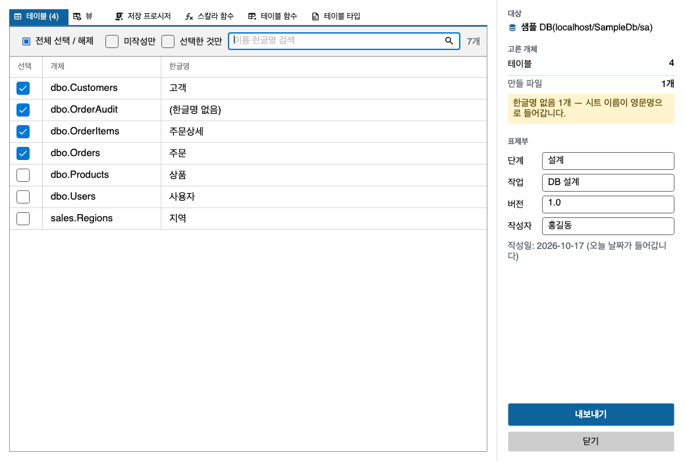

# 3. 파일로 주고받기

[목차](README.md) · 이전: [2. 코멘트 달기](comments.md) · 다음: [4. SQL 편집기](sql-editor.md)

파일로 내보내는 기능은 두 가지다. 용도가 다르다.

| | 내보내기 · 가져오기 | 정의서 내보내기 |
|---|---|---|
| 용도 | 엑셀에서 고친 뒤 다시 가져오기 | 사람이 읽는 제출용 문서 |
| 양식 | 시트 한 장, 6칸 | 개체당 시트 한 장 + 목록 시트, 표제부 포함 |
| 범위 | 지금 문서에 읽어 온 것 | 목록에서 체크한 개체 |
| 다시 가져오기 | 된다 | 안 된다 |

한글명 몇 개를 한 열만 고칠 때는 파일을 오가지 않아도 된다. Excel에서 열을 복사해 코멘트 그리드에 바로 붙여넣는
편이 빠르다([2장](comments.md)의 붙여넣기). 파일 가져오기는 여러 칸·많은 행을 한꺼번에 고쳐 다시 넣을 때 쓴다.

## 3.1 내보내기

내보내기·가져오기는 모든 코멘트 문서에 있다 — 분류 폴더의 `코멘트 관리` 문서, 테이블·뷰·루틴·타입 문서, 같은 이름 컬럼 문서.
작성률 문서와 저장 이력 문서는 읽기 전용이라 이 기능이 없다(작성률 문서의 Excel 보고서는 [2장](comments.md)을 볼 것).

여는 곳은 셋이다. 어느 것이든 같은 흐름이다.

| 여는 곳 | 방법 |
|---|---|
| 문서 툴바 | 코멘트 문서 위쪽의 **내보내기** |
| 메뉴 | 코멘트 문서가 활성 탭일 때 **문서 > 내보내기...** |
| DB 탐색기 | 폴더나 개체를 오른쪽 클릭하고 **내보내기...** — 그 노드의 문서를 열고(이미 열려 있으면 그 탭) 다 읽은 뒤 시작한다 |

1. 저장 창에서 파일 이름과 위치를 고른다.
2. 파일 이름이 `.xlsx`로 끝나면 Excel, 그 밖은 CSV로 저장한다. CSV는 엑셀에서 한글이 깨지지 않게 UTF-8(BOM)로 쓴다.
3. 끝나면 저장한 파일 경로가 출력 창에 남는다.

- 칸은 `개체유형 · 스키마 · 상위개체 · 이름 · 한글명 · 설명`이다. `개체유형`은 `Table`, `Column`, `Procedure` 같은 영문 이름이다.
- 지금 문서에 읽어 온 범위만 내보낸다. 저장하지 않은 편집도 들어간다.
- `미작성만`·`변경만`이나 검색으로 걸러 둔 상태여도 문서의 전체 항목을 내보낸다. 보이는 행만 내보내려면 아래 방법을 쓴다.

### 보이는 행만 내보내기

미작성 행만 걸러 담당자에게 넘길 때 쓴다.

1. 코멘트 그리드를 `미작성만`·`변경만`·검색으로 좁힌다.
2. 그리드를 오른쪽 클릭 > `보이는 행 내보내기...`. 보이는 행이 없으면 꺼져 있다.
3. 저장 창의 기본 이름 뒤에 `_일부`가 붙는다. 형식과 칸은 위 내보내기와 같다.

- 그 그리드에 지금 보이는 행만 담는다. 개체 문서의 머리글(개체 자신)과 다른 탭의 목록은 넣지 않는다.
- 담당자가 채운 파일은 그대로 [가져오기](#32-가져오기)로 받는다.

## 3.2 가져오기

1. 내보낸 파일을 엑셀에서 열어 `한글명`·`설명` 칸을 고친다. `개체유형`·`스키마`·`상위개체`·`이름`은 그대로 둔다. 이 칸으로 행을 찾아 맞추기 때문이다.
2. 같은 문서에서 **가져오기**(툴바, **문서 > 가져오기...**, 또는 트리 오른쪽 클릭 **가져오기...**)를 누르고 파일을 고른다.
3. 값이 그리드에 채워지고, 바뀐 행에 `변경`이 체크되며 `변경 항목: N개`가 늘어난다. **아직 DB에는 아무것도 쓰지 않았다.**
4. 툴바의 `변경만`을 켜면 바뀐 행만 모아 볼 수 있다. 잘못 들어간 행은 오른쪽 클릭 **원래 값으로 되돌리기**로 되돌린다.
5. 확인이 끝나면 **저장**을 누른다. 저장 로그와 저장 이력에 항목마다 이전 값과 새 값이 남는다([2장](comments.md)).

가져오지 못한 행은 이유별로 알려 준다.

| 이유 | 뜻 |
|---|---|
| 매칭 실패 | 문서에 그 개체·항목이 없다. 이름이 바뀌었거나 다른 문서에서 내보낸 파일이다 |
| `§` 포함 | 한글명에 `§`가 들어 있다 |
| 길이 초과 | 한글명과 설명을 합쳐 7,500바이트를 넘는다 |

- **파일의 빈 칸은 있던 값을 지우지 않는다.** 한글명만 채운 행을 가져오면 설명은 그대로다. 값을 지우려면 그리드에서 직접 지운다.
- 한글명만 채운 행이 기존 설명과 합쳐 길이 한도를 넘으면 그 행은 넣지 않고 길이 초과로 알린다.
- `한글명`·`설명` 열 중 하나를 지운 파일을 가져오면, 지운 열의 값은 건드리지 않는다. 둘 다 없으면 `파일에 '한글명'·'설명' 열이 없습니다.`라며 가져오지 않는다.
- 엑셀에서 `CSV (쉼표로 분리)`로 다시 저장한 파일도 한글이 깨지지 않고 읽힌다. 인코딩을 알아서 판별한다.
- 어떤 인코딩으로도 읽을 수 없는 파일은 가져오지 않고 이유를 알려 준다. 그리드는 그대로다.
- 지금 문서에 읽어 온 항목에만 채운다. 다른 문서에서 내보낸 행은 매칭 실패로 나온다. 예를 들어 테이블 문서에서는 그 테이블의 행만 들어간다.
- `미작성만`·검색으로 걸러 둔 상태여도 숨은 행까지 맞춰 채운다.
- 파일을 읽어 곧바로 DB에 쓰는 길은 없다. 늘 그리드에서 확인한 뒤 **저장**을 눌러야 반영된다.

## 3.3 정의서 내보내기

외부에 제출하는 엑셀 정의서를 만든다. Excel이 설치되어 있지 않아도 된다.

**여는 법** — 트리에서 연결·DB·폴더·개체 중 하나를 고르고, 툴바의 **정의서 내보내기**, **파일 > 정의서 내보내기...**,
또는 오른쪽 클릭 메뉴의 **정의서 내보내기...**를 누른다. 대상 DB는 고른 노드의 DB다(연결이면 기본 DB). 아무것도 고르지 않으면 꺼진다.

| 고른 노드 | 처음 모습 |
|---|---|
| 연결 · DB | `테이블` 탭, 체크 없음 |
| 분류 폴더 | 그 분류 탭, 체크 없음 |
| 개체 | 그 분류 탭, 그 개체만 체크 |

### 1단계: 개체 고르기

- 분류마다 탭이 있고, 탭 머리글에 고른 개수가 붙는다. 예: `테이블 (12)`
- 줄의 체크박스를 눌러 고른다. **전체 선택 / 해제**는 지금 보이는 줄에만 적용된다.
- 거르기: 검색 칸(이름·한글명), `미작성만`(한글명이 없는 것), `선택한 것만`(체크한 것만 다시 훑어보기). 걸러도 체크는 그대로 남는다.
- 키보드: 줄을 고르고 `Space`로 체크, `Ctrl+Tab`·`Ctrl+Shift+Tab`으로 분류 탭 이동. macOS에서도 이 두 키는 `Control`이다.
- 오른쪽 패널의 **고른 개체**에 분류별 개수와 **만들 파일 N개**가 보인다.

### 2단계: 표제부

`단계 · 작업 · 버전 · 작성자`를 적는다. 마지막에 쓴 값을 기억하므로 대개 다시 적을 일이 없다.
**작성일**은 오늘 날짜가 자동으로 들어가고 바꿀 수 없다. 페이지 번호도 자동이다.
빈 칸이 있어도 만들 수는 있다. 어느 칸이 비었는지 표제부 아래에 적힌다.

### 3단계: 내보내기

**내보내기**를 누르고 저장할 곳을 고른다. 기본 파일 이름은 `DB명_정의서_YYYYMMDD.xlsx`다.

- **분류를 여러 개 고르면 분류마다 파일을 따로 만든다.** 예: `x_테이블.xlsx`, `x_뷰.xlsx`
- 만들 파일 중 이미 있는 것이 있으면, 실제로 덮어쓸 파일 이름을 모두 보여 주고 묻는다.
- **중단**을 누르면 멈춘다. 만들던 파일은 남기지 않고, 원래 있던 파일도 건드리지 않는다.
- 끝나면 **폴더 열기**로 저장한 폴더를 연다.

### 만들어지는 파일

| 시트 | 내용 |
|---|---|
| 개체마다 한 장 | 표제부, 개체 정보, 컬럼·파라미터 등 하위 항목 표. 시트 이름은 한글명이다 |
| `목록` | 고른 개체의 목록 |

- 한글명이 없는 개체는 시트 이름이 영문 이름이 되고, 목록 시트의 한글명 칸은 비어 있다. 고른 것 중 몇 개가 그런지 오른쪽 패널에 적힌다.
- 한글명이 같은 개체가 여럿이면 시트 이름 뒤에 `_2`, `_3`이 붙는다.
- 200개 이상 고르면 시간이 걸릴 수 있다고 미리 알려 준다. 개체 하나에 시트 하나가 만들어지기 때문이다. 막지는 않는다.
