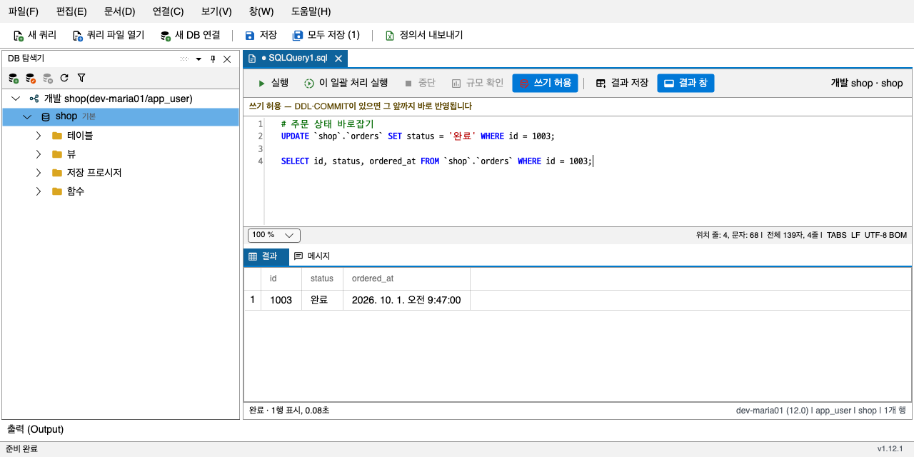

# 4. SQL 편집기 — MariaDB 연결

[목차](README.md) · 이전: [4. 파일로 저장·지난 탭](sql-editor-files.md) · 다음: [4. PostgreSQL 연결](sql-editor-postgresql.md)

이 장의 단축키는 Windows·Linux 기준으로 적고 괄호에 macOS 키를 붙인다. 전체 표는 [5.2 단축키](shortcuts.md#52-단축키)에 있다.

- **열기** ([sql-editor.md](sql-editor.md))
  - [4.1 열기](sql-editor.md#41-열기)
- **실행하기** ([sql-editor-run.md](sql-editor-run.md))
  - [4.2 실행하기](sql-editor-run.md#42-실행하기)
- **예상 규모** ([sql-editor-estimate.md](sql-editor-estimate.md))
  - [4.3 예상 규모 줄](sql-editor-estimate.md#43-예상-규모-줄)
- **결과 보기** ([sql-editor-results.md](sql-editor-results.md))
  - [4.4 결과 보기](sql-editor-results.md#44-결과-보기)
- **결과 다루기** ([sql-editor-handling.md](sql-editor-handling.md))
  - [4.5 결과 다루기](sql-editor-handling.md#45-결과-다루기)
- **정렬·거르기·열 정리** ([sql-editor-arrange.md](sql-editor-arrange.md))
  - [4.6 정렬·거르기·열 정리](sql-editor-arrange.md#46-정렬거르기열-정리)
- **결과 저장** ([sql-editor-save.md](sql-editor-save.md))
  - [4.7 결과 저장](sql-editor-save.md#47-결과-저장)
- **편집 기능** ([sql-editor-editing.md](sql-editor-editing.md))
  - [4.8 편집 기능](sql-editor-editing.md#48-편집-기능)
- **개체와 코멘트 연결** ([sql-editor-objects.md](sql-editor-objects.md))
  - [4.9 개체와 코멘트 연결](sql-editor-objects.md#49-개체와-코멘트-연결)
- **파일로 저장·지난 탭** ([sql-editor-files.md](sql-editor-files.md))
  - [4.10 파일로 저장·지난 탭](sql-editor-files.md#410-파일로-저장지난-탭)
- **MariaDB 연결**
  - [4.11 MariaDB 연결](#411-mariadb-연결)
- **PostgreSQL 연결** ([sql-editor-postgresql.md](sql-editor-postgresql.md))
  - [4.12 PostgreSQL 연결](sql-editor-postgresql.md#412-postgresql-연결)
- **Oracle 연결** ([sql-editor-oracle.md](sql-editor-oracle.md))
  - [4.13 Oracle 연결](sql-editor-oracle.md#413-oracle-연결)

## 4.11 MariaDB 연결

MariaDB 연결에서도 같은 편집기를 쓴다. 다른 점만 적는다.

### 기본은 조회만 한다

실행할 때마다 세션을 읽기 전용으로 걸고 SQL을 그대로 보낸다. `INSERT`·`UPDATE`·`DELETE`, `CREATE`·`ALTER`·`DROP` 같은 쓰기는 서버가 거부하고
메시지 탭에 `조회 전용 연결이라 쓰기·DDL·CALL은 실행하지 않았습니다.`가 보인다. 쓰기가 들어 있는 프로시저를 `CALL`해도 같다. 실행 전 규모 확인은 없다([4.3](sql-editor-estimate.md#43-예상-규모-줄)).

### 쓰기 허용

탭 툴바의 `쓰기 허용`을 켜면 그 탭에서 쓰기와 DDL을 실행한다. 켜 둔 동안 편집기 위에 경고 줄이 보인다.

- 새 탭은 늘 꺼진 채 열린다. 켠 상태는 기억하지 않아 탭을 다시 열면 꺼져 있다. 실행 중에는 바꿀 수 없다.
- 켜면 SQL 전체를 트랜잭션으로 감싸 실행하고, 실패하면 되돌린다.
- **DDL(`CREATE`·`ALTER`·`DROP`·`TRUNCATE`)과 SQL 안의 `COMMIT`은 그 앞의 쓰기까지 바로 반영한다.** 그 뒤에 실패하면 앞부분은 되돌릴 수 없다.
  그런 일이 생기면 메시지 탭에 알린다. 트랜잭션을 쓰지 않는 테이블(Aria 등)의 변경이 되돌려지지 않고 남아도 알린다.
- 다른 세션과 교착이 나면 서버가 이 실행을 통째로 되돌린다. 메시지 탭에 `교착 상태라 서버가 트랜잭션을 롤백했습니다. 다시 실행하세요. …`가 나온다.
- 데이터를 고칠 때는 쓰기 문장과 DDL을 한 번에 섞어 실행하면 안 된다.

### 문법

- 이름은 역따옴표(`` `order` ``)로 감싸고, 큰따옴표(`"…"`)는 문자열이다. 문자열 안의 `\`는 이스케이프다.
- `#`부터 줄 끝까지 주석이다. `--`는 뒤에 공백이나 줄 끝이 올 때만 주석이다(`SELECT 1--1`은 2다).
- 구문 강조, 괄호 짝, 접기, 같은 낱말 강조가 이 규칙을 따른다.
- `DELIMITER`는 필요 없다. 쓰면 `DELIMITER 줄을 지우고 BEGIN … END 본문을 그대로 실행하세요`라고 알린다. 본문 안의 `;`는 서버가 알아본다.
- 구문 오류가 나면 SQL Server처럼 오류가 난 줄을 칠한다. 오류 위치를 SQL에서 한 곳으로 찾지 못하면 칠하지 않는다.
- `SET @x = 1; SELECT @x;`처럼 사용자 변수를 쓸 수 있다.

### 트리에서 채우는 문장

| 메뉴 | 채워지는 모양 |
|---|---|
| `상위 1000개 행 선택 ▸ 모든 컬럼 (*)` | ``SELECT * FROM `DB`.`이름` LIMIT 1000;`` |
| `실행문 만들기`(프로시저) | ``CALL `DB`.`이름`(NULL, @p_cnt);`` 다음에 OUT 값을 보는 `SELECT` |
| `실행문 만들기`(함수) | ``SELECT `DB`.`이름`(NULL);``. 파라미터마다 타입 주석이 붙는다 |

- OUT·INOUT 파라미터는 사용자 변수(`@이름`)로 받는다. INOUT은 넘기기 전에 `SET @이름 = NULL;`로 값을 둔다.
- `정의 열기`는 `SHOW CREATE` 결과를 실행할 수 없는 읽기 전용 문서로 연다. 루틴 본문은 그 루틴을 만든 계정만 볼 수 있고, 뷰 정의는 `SHOW VIEW` 권한이 있어야 보인다.
