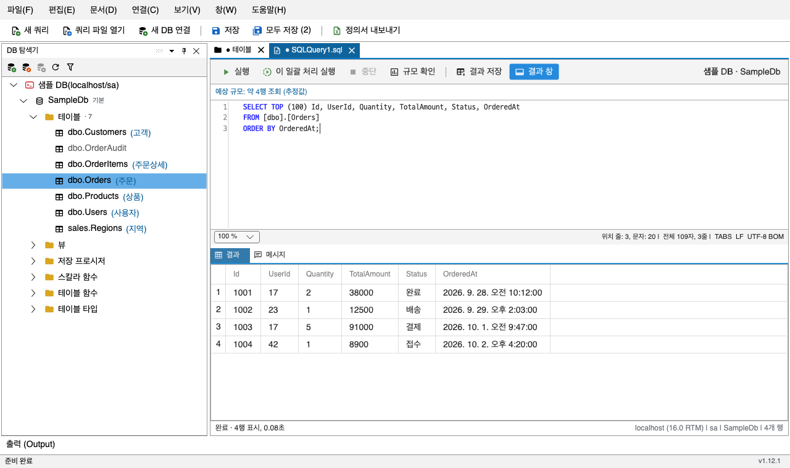

# 4. SQL 편집기

[목차](README.md) · 이전: [3. 정의서 내보내기](definition-export.md) · 다음: [4. 실행하기](sql-editor-run.md)

고른 연결에 SQL을 실행하고 결과를 표로 본다. 데이터를 확인하거나 조금 고칠 때 쓴다.
대량 변경이나 마이그레이션 스크립트에는 그 DBMS의 전용 도구를 쓴다.

4.1~4.10은 MS SQL Server 연결 기준으로 적었다. MariaDB 연결에서 다른 곳에는 그 자리에 표시해 두었고, 조회 전용과 쓰기 허용은 [4.11](sql-editor-dbms.md#411-mariadb-연결)(MySQL도 같다),
[4.12](sql-editor-postgresql.md#412-postgresql-연결)(PostgreSQL), [4.13](sql-editor-oracle.md#413-oracle-연결)(Oracle)에 모았다.

이 장의 단축키는 Windows·Linux 기준으로 적고 괄호에 macOS 키를 붙인다. 전체 표는 [5.2 단축키](shortcuts.md#52-단축키)에 있다.

- **열기**
  - [4.1 열기](#41-열기)
- **실행하기** ([sql-editor-run.md](sql-editor-run.md))
  - [4.2 실행하기](sql-editor-run.md#42-실행하기)
- **예상 규모** ([sql-editor-estimate.md](sql-editor-estimate.md))
  - [4.3 예상 규모 줄](sql-editor-estimate.md#43-예상-규모-줄)
- **결과 보기** ([sql-editor-results.md](sql-editor-results.md))
  - [4.4 결과 보기](sql-editor-results.md#44-결과-보기)
- **결과 다루기** ([sql-editor-handling.md](sql-editor-handling.md))
  - [4.5 결과 다루기](sql-editor-handling.md#45-결과-다루기)
- **정렬·거르기·열 정리** ([sql-editor-arrange.md](sql-editor-arrange.md))
  - [4.6 정렬·거르기·열 정리](sql-editor-arrange.md#46-정렬거르기열-정리)
- **결과 저장** ([sql-editor-save.md](sql-editor-save.md))
  - [4.7 결과 저장](sql-editor-save.md#47-결과-저장)
- **편집 기능** ([sql-editor-editing.md](sql-editor-editing.md))
  - [4.8 편집 기능](sql-editor-editing.md#48-편집-기능)
- **개체와 코멘트 연결** ([sql-editor-objects.md](sql-editor-objects.md))
  - [4.9 개체와 코멘트 연결](sql-editor-objects.md#49-개체와-코멘트-연결)
- **파일로 저장·지난 탭** ([sql-editor-files.md](sql-editor-files.md))
  - [4.10 파일로 저장·지난 탭](sql-editor-files.md#410-파일로-저장지난-탭)
- **MariaDB 연결** ([sql-editor-dbms.md](sql-editor-dbms.md))
  - [4.11 MariaDB 연결](sql-editor-dbms.md#411-mariadb-연결)
- **PostgreSQL 연결** ([sql-editor-postgresql.md](sql-editor-postgresql.md))
  - [4.12 PostgreSQL 연결](sql-editor-postgresql.md#412-postgresql-연결)
- **Oracle 연결** ([sql-editor-oracle.md](sql-editor-oracle.md))
  - [4.13 Oracle 연결](sql-editor-oracle.md#413-oracle-연결)

## 4.1 열기

먼저 **DB 탐색기에서 연결이나 그 안의 노드를 고른다.** 편집기는 고른 노드의 DB(연결이면 기본 DB)를 대상으로 열린다.
탭 하나는 DB 하나에 묶이고, 탭 안에서 대상 DB를 바꾸지 않는다. 다른 DB가 필요하면 DB 탐색기에서 그 DB 노드를 오른쪽 클릭해 `새 쿼리`로 연다.

| 방법 | 동작 |
|---|---|
| **파일 > 새 쿼리** `Ctrl+N`(macOS `Cmd+N`), 툴바, 노드 오른쪽 클릭 `새 쿼리` | 빈 편집기를 연다. 같은 DB에도 여러 개를 동시에 열 수 있다 |
| **파일 > 쿼리 파일 열기...** `Ctrl+O`(macOS `Cmd+O`) | `.sql` 파일을 고른 연결에 붙여 연다. 이미 열린 파일이면 그 탭으로 간다 |
| **파일 > 최근 쿼리 파일** | 최근에 열거나 저장한 파일 |
| 테이블·뷰 오른쪽 클릭 > `상위 1000개 행 선택 ▸` | 조회문을 채운 새 탭을 연다. 아래 표 |
| 테이블·뷰·프로시저·함수 오른쪽 클릭 > `정의 열기` | 개체 본문(테이블은 `CREATE TABLE` 스크립트)을 새 탭에 연다([4.9](sql-editor-objects.md#49-개체와-코멘트-연결)) |
| 프로시저·함수 오른쪽 클릭 > `실행문 만들기` | 파라미터를 채운 실행문을 새 탭에 연다([4.9](sql-editor-objects.md#49-개체와-코멘트-연결)) |

연결을 고르지 않으면 메뉴와 툴바의 `새 쿼리`가 꺼지고, `Ctrl+N`·`Ctrl+O`(macOS `Cmd+N`·`Cmd+O`)를 누르면 상태바에 안내가 뜬다.
새 탭은 편집기에 커서가 놓인 채 열려 바로 입력할 수 있다.

### `상위 1000개 행 선택 ▸`

하위 메뉴에서 조회문의 모양을 고른다. 셋 다 **채우기만 하고 실행하지 않는다.** 내용을 확인하고 `F5`로 실행한다.

| 항목 | 채워지는 내용 |
|---|---|
| `이름 주석` | 칸을 한 줄에 하나씩 나열하고 칸마다 `-- 이름` 주석을 붙인다. 문장 끝에는 테이블 이름이 붙는다 |
| `이름 별칭` | 칸마다 `칸 AS [이름]`을 붙인다. 실행하면 결과 머리글이 이름이고, 결과를 저장한 파일의 머리글도 이름이다 |
| `모든 컬럼 (*)` | `SELECT TOP (1000) * FROM 이름 WITH(NOLOCK);` 한 줄 |

- 개체 이름은 `DB.스키마.이름` 세 부분으로 들어가고 부분마다 대괄호로 감싼다(예: `[SchemaForgeSample].[dbo].[Orders]`). 칸 이름도 `[OrderNo]`처럼 감싼다.
- 테이블·뷰 뒤에는 늘 `WITH(NOLOCK)`이 붙는다. 다른 작업의 잠금에 막히지 않는 대신 커밋되지 않은 값이 보일 수 있다. 이 결과로 데이터를 판단할 때는 힌트를 지우고 다시 실행한다.
- 주석과 별칭의 이름은 DB에 저장된 값이다. 코멘트 문서에서 고치고 아직 저장하지 않은 값은 들어가지 않는다.
- `이름 별칭`에서 이름이 없는 칸은 원래 이름 그대로이고, 한 테이블 안에서 이름이 겹치면 두 번째부터 `_2`, `_3`이 붙는다.
- 채운 탭은 변경 없음 상태로 열리므로 손대지 않고 닫으면 저장할지 묻지 않는다.
- **MariaDB 연결**에서는 이름을 역따옴표로 감싸고(`` `DB`.`이름` ``) `TOP` 대신 문장 끝에 `LIMIT 1000`을 붙인다. `WITH(NOLOCK)`은 붙지 않는다.

### 개체를 끌어다 놓기

DB 탐색기의 개체 노드를 편집기로 끌어다 놓으면 놓은 자리에 `[DB].[스키마].[이름]`이 들어간다(MariaDB 연결은 `` `DB`.`이름` ``). `Ctrl+Z`(macOS `Cmd+Z`)로 되돌린다.

### 화면 구성

위에서 아래로 이렇게 놓인다.

| 영역 | 내용 |
|---|---|
| 툴바 | `실행` · `이 일괄 처리 실행` · `중단` · `결과 저장` · `결과 창`. 오른쪽 끝에 대상 `프로필명 · DB명`. MariaDB 연결에는 `쓰기 허용`이 더 있다 |
| 예상 규모 줄 | 실행하기 전에 무슨 일이 일어날지 알려 준다([4.3](sql-editor-estimate.md#43-예상-규모-줄)). MariaDB 연결에서는 조회 전용인지 쓰기 허용인지를 보인다 |
| 편집기 | 구문 강조(SQL Server 연결은 T-SQL, MariaDB 연결은 MariaDB 문법), 줄 번호. 줄 번호 왼쪽 칸에 책갈피와 오류 표시, 오른쪽 칸에 접기 표시가 있다 |
| 편집기 정보 줄 | 확대 비율, `위치 줄: 10, 문자: 20`, 선택한 글자·줄 수, 전체 글자·줄 수, 들여쓰기(`TABS`/`SPC`), 줄 끝(`CRLF`/`LF`), 인코딩(`UTF-8 BOM`, `CP949` 등). 책갈피나 같은 낱말이 있으면 그 개수도 적힌다 |
| 결과 영역 | 결과 탭과 `메시지` 탭. **처음 실행하기 전에는 없다** |
| 하단 줄 | 왼쪽은 진행 상황과 마지막 실행 결과(실행 시간 포함), 오른쪽은 `서버 (버전) \| 사용자 \| DB \| 보고 있는 결과 탭의 행 수`([1.2절](getting-started.md#12-화면-구성)) |

- 편집기와 결과 영역 사이의 분할선을 끌어 높이를 나눈다.
- **결과 창** `Ctrl+R`(macOS `Cmd+R`)은 결과 영역을 숨기거나 펼친다. 숨기면 편집기가 그 자리를 다 쓰고, 다시 펼치면 숨기기 전 높이로 돌아온다. 숨긴 채 실행하면 저절로 펼쳐진다. 탭마다 따로 기억한다.
- 정보 줄 왼쪽의 확대 비율 칸은 목록(20~400 %)에서 고르거나 숫자를 직접 적는다. 새 탭의 기본 비율은 [설정](settings-shortcuts.md#51-설정)에서 정한다.
- 편집기의 탭 제목은 새 탭이면 `SQLQuery1.sql`, 파일로 연 탭이면 파일 이름이다. 저장하지 않은 변경이 있으면 제목 앞에 `●`가 붙는다.
