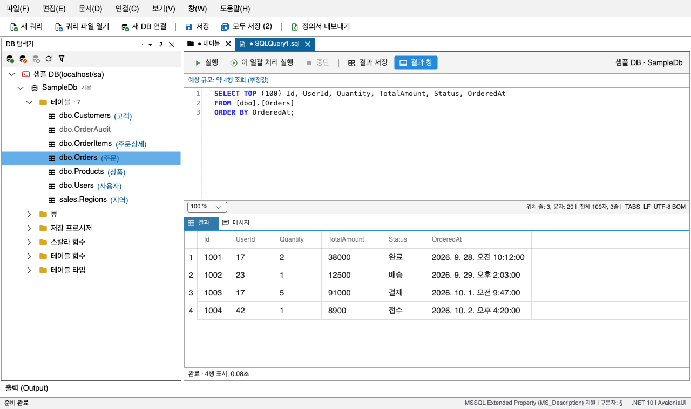

# 4. SQL 편집기

[목차](README.md) · 이전: [3. 파일로 주고받기](import-export.md) · 다음: [5. 설정과 단축키](settings-shortcuts.md)

고른 연결에 SQL을 실행하고 결과를 표로 본다. 데이터를 확인하거나 조금 고칠 때 쓴다.
대량 변경이나 마이그레이션 스크립트에는 SSMS 같은 전용 도구를 쓸 것.

이 장의 단축키는 Windows·Linux 기준으로 적고 괄호에 macOS 키를 붙인다. 전체 표는 [5.2 단축키](settings-shortcuts.md#52-단축키)에 있다.

## 4.1 열기

먼저 **DB 탐색기에서 연결이나 그 안의 노드를 고른다.** 편집기는 고른 노드의 DB(연결이면 기본 DB)를 대상으로 열린다.
탭 하나는 DB 하나에 묶이고, 탭 안에서 대상 DB를 바꾸지 않는다. 다른 DB가 필요하면 DB 탐색기에서 그 DB 노드를 오른쪽 클릭해 `새 쿼리`로 연다.

| 방법 | 동작 |
|---|---|
| **파일 > 새 쿼리** `Ctrl+N`(macOS `Cmd+N`), 툴바, 노드 오른쪽 클릭 `새 쿼리` | 빈 편집기를 연다. 같은 DB에도 여러 개를 동시에 열 수 있다 |
| **파일 > 쿼리 파일 열기...** `Ctrl+O`(macOS `Cmd+O`) | `.sql` 파일을 고른 연결에 붙여 연다. 이미 열린 파일이면 그 탭으로 간다 |
| **파일 > 최근 쿼리 파일** | 최근에 열거나 저장한 파일 |
| 테이블·뷰 오른쪽 클릭 > `상위 1000개 행 선택 ▸` | 조회문을 채운 새 탭을 연다. 아래 표 |
| 뷰·프로시저·함수 오른쪽 클릭 > `정의 열기` | 개체 본문을 새 탭에 연다([4.8](#48-개체와-코멘트-연결)) |
| 프로시저·함수 오른쪽 클릭 > `실행문 만들기` | 파라미터를 채운 실행문을 새 탭에 연다([4.8](#48-개체와-코멘트-연결)) |

연결을 고르지 않으면 메뉴와 툴바의 `새 쿼리`가 꺼지고, `Ctrl+N`·`Ctrl+O`(macOS `Cmd+N`·`Cmd+O`)를 누르면 상태바에 안내가 뜬다.
새 탭은 편집기에 커서가 놓인 채 열려 바로 입력할 수 있다.

### `상위 1000개 행 선택 ▸`

하위 메뉴에서 조회문의 모양을 고른다. 셋 다 **채우기만 하고 실행하지 않는다.** 내용을 확인하고 `F5`로 실행한다.

| 항목 | 채워지는 내용 |
|---|---|
| `한글명 주석` | 칸을 한 줄에 하나씩 나열하고 칸마다 `-- 한글명` 주석을 붙인다. 문장 끝에는 테이블 한글명이 붙는다 |
| `한글명 별칭` | 칸마다 `칸 AS [한글명]`을 붙인다. 실행하면 결과 머리글이 한글명이고, 결과를 저장한 파일의 머리글도 한글명이다 |
| `모든 컬럼 (*)` | `SELECT TOP (1000) * FROM 이름 WITH(NOLOCK);` 한 줄 |

- 개체 이름은 `DB.스키마.이름` 세 부분으로 들어간다(예: `SchemaForgeSample.dbo.Orders`). 대괄호는 예약어·공백·하이픈이 든 부분에만 씌운다.
- 테이블·뷰 뒤에는 늘 `WITH(NOLOCK)`이 붙는다. 다른 작업의 잠금에 막히지 않는 대신 커밋되지 않은 값이 보일 수 있다. 이 결과로 데이터를 판단할 때는 힌트를 지우고 다시 실행한다.
- 주석과 별칭의 한글명은 DB에 저장된 값이다. 코멘트 문서에서 고치고 아직 저장하지 않은 값은 들어가지 않는다.
- `한글명 별칭`에서 한글명이 없는 칸은 원래 이름 그대로이고, 한 테이블 안에서 한글명이 겹치면 두 번째부터 `_2`, `_3`이 붙는다.
- 채운 탭은 변경 없음 상태로 열린다. 손대지 않고 닫으면 저장할지 묻지 않는다.

### 개체를 끌어다 놓기

DB 탐색기의 개체 노드를 편집기로 끌어다 놓으면 놓은 자리에 `DB.스키마.이름`이 들어간다. `Ctrl+Z`(macOS `Cmd+Z`)로 되돌린다.

### 화면 구성



위에서 아래로 이렇게 놓인다.

| 영역 | 내용 |
|---|---|
| 툴바 | `실행` · `이 일괄 처리 실행` · `중단` · `결과 저장` · `결과 창`. 오른쪽 끝에 대상 `프로필명 · DB명` |
| 예상 규모 줄 | 실행하기 전에 무슨 일이 일어날지 알려 준다([4.3](#43-예상-규모-줄)) |
| 편집기 | T-SQL 구문 강조, 줄 번호. 줄 번호 왼쪽 칸에 책갈피와 오류 표시, 오른쪽 칸에 접기 표시가 있다 |
| 편집기 정보 줄 | 확대 비율, `위치 줄: 10, 문자: 20`, 선택한 글자·줄 수, 전체 글자·줄 수, 들여쓰기(`TABS`/`SPC`), 줄 끝(`CRLF`/`LF`), 인코딩(`UTF-8 BOM`, `CP949` 등). 책갈피나 같은 낱말이 있으면 그 개수도 적힌다 |
| 결과 영역 | 결과 탭과 `메시지` 탭. **처음 실행하기 전에는 없다** |
| 상태바 | 진행 상황과 마지막 실행 결과 |

- 편집기와 결과 영역 사이의 분할선을 끌어 높이를 나눈다.
- **결과 창** `Ctrl+R`(macOS `Cmd+R`)은 결과 영역을 숨기거나 펼친다. 숨기면 편집기가 그 자리를 다 쓰고, 다시 펼치면 숨기기 전 높이로 돌아온다. 숨긴 채 실행하면 저절로 펼쳐진다. 탭마다 따로 기억한다.
- 정보 줄 왼쪽의 확대 비율 칸은 목록(20~400 %)에서 고르거나 숫자를 직접 적는다. 새 탭의 기본 비율은 [설정](settings-shortcuts.md#51-설정)에서 정한다.
- 편집기의 탭 제목은 새 탭이면 `SQLQuery1.sql`, 파일로 연 탭이면 파일 이름이다. 저장하지 않은 변경이 있으면 제목 앞에 `●`가 붙는다.

## 4.2 실행하기

| 동작 | 키 | 실행 범위 |
|---|---|---|
| **실행** | `F5`, `Ctrl+Enter`(macOS `Cmd+Enter`), 툴바 `실행`, **문서 > 실행** | 선택한 글자가 있으면 그 부분, 없으면 편집기 전체 |
| **이 일괄 처리 실행** | `Ctrl+Shift+Enter`(macOS `Cmd+Shift+Enter`), 툴바, **문서 > 이 일괄 처리 실행** | 커서가 있는 일괄 처리(`GO` 줄 사이) 하나 |
| **중단** | `Ctrl+.`(macOS `Cmd+.`), 툴바 `중단`, **문서 > 실행 중단** | 실행을 멈추고 그때까지의 변경을 되돌린다 |

- 실행하면 그 SQL을 곧바로 서버에 보낸다. 실행 전체를 트랜잭션 하나로 감싸, 끝까지 성공하면 커밋하고 중간에 실패하면 그때까지의 변경을 모두 되돌린다.
- 실행 범위와 예상 규모 줄이 늘 같은 범위를 본다. 선택 영역이 있으면 예상 규모 줄 앞에 `선택 영역 ·`이 붙는다.
- `F5`는 DB 탐색기에 포커스가 있으면 실행이 아니라 탐색기 새로고침이다. `Ctrl+Enter`(macOS `Cmd+Enter`)는 포커스와 상관없이 실행이다.
- 실행 기록(대상, SQL 본문, 서버 메시지, 영향 행 수, 성공 여부)은 출력 창에 남는다. 연결 문자열과 계정은 남지 않는다.

### 실행 중 표시

- 상태바에 진행바와 `실행 중... 0:42`처럼 경과 시간이 1초마다 보인다. 실행 중에는 `실행`이 꺼지고 `중단`이 켜진다.
- `중단`을 누르면 `중단 요청... 롤백이 끝날 때까지 기다립니다.`가 보이고, 끝나면 `사용자가 중단했습니다. 변경은 반영되지 않았습니다.`와 걸린 시간이 남는다.
- 실행 중인 탭의 이름 앞에도 경과 시간이 붙는다.
- 실행이 **10초 이상** 걸렸고 끝났을 때 다른 탭을 보거나 다른 앱을 쓰고 있었으면 알려 준다.
  - 주 창 오른쪽 아래에 `SQLQuery1.sql 실행 완료`(오류면 `… 실행 오류`)처럼 탭 이름과 결과 요약이 8초 동안 뜬다. 누르면 그 탭으로 간다.
  - 그 탭 이름 앞에 `완료`(초록)나 `오류`(빨강)가 붙고, 그 탭을 보면 사라진다.
  - 직접 중단한 실행은 알리지 않는다.

### 오류가 나면

- `메시지` 탭에 오류마다 편집기 기준 줄 번호와 오류 번호가 붙는다(`줄 12(오류 번호 208): …`). 선택 영역을 실행했어도 편집기의 줄 번호다.
- 오류가 난 줄은 편집기에서 연한 빨강 배경으로 칠해지고 줄 번호 왼쪽에 빨간 ●가 생긴다. 그 줄에 마우스를 올리면 오류 메시지가 툴팁으로 보인다. 오류가 여럿이면 모두 칠한다.
  - 칠한 줄을 고치면 그 줄의 표시는 사라진다. 다시 실행하면 모두 지우고 새로 칠한다.
  - 오류 줄이 접힌 블록 안이면 블록이 펼쳐진다.
- `메시지` 탭 아래 **N줄로 이동**을 누르면 그 줄 전체가 선택된다. 고친 뒤 바로 실행하면 그 줄만 실행된다.
- 실패하기 전까지 받은 메시지(문장별 행 수, `PRINT`)가 오류 앞에 나온다. 어디까지 실행되다 멈췄는지 알 수 있다. 이 행 수는 되돌려진 것이다.
- SQL 안에 `COMMIT`이 있었으면 그 앞 문장은 되돌려지지 않는다. 이때는 오류 문구가 그렇다고 알려 준다.
- `ALTER DATABASE`, `CREATE DATABASE`, `BACKUP`/`RESTORE`처럼 트랜잭션 안에서 쓸 수 없는 문장은 실행할 수 없다. 오류 뒤에 그 이유가 덧붙는다.

### `GO`로 나뉜 스크립트

SSMS처럼 `GO` 줄에서 나눠 같은 연결에서 차례로 실행한다. `CREATE PROCEDURE`처럼 맨 앞에 와야 하는 문장도 쓸 수 있다.

- **스크립트 전체가 트랜잭션 하나다.** 중간 부분이 실패하면 앞 부분까지 모두 되돌린다. SSMS는 부분마다 따로 반영되니 다르다.
- `GO 5`처럼 반복 횟수를 붙인 줄은 지원하지 않는다. 있으면 아무것도 실행하지 않고 그 줄 번호와 함께 알려 준다.
- 문자열이나 `/* */` 주석 안의 `GO` 줄로는 나누지 않는다. `GO;`·`GOTO`는 구분자가 아니다.
- 설정의 실행 시간 제한은 일괄 처리마다가 아니라 실행 전체에 걸린다.

### 일괄 처리 하나만 실행하기

`Ctrl+Shift+Enter`(macOS `Cmd+Shift+Enter`)는 커서가 있는 일괄 처리만 골라 실행한다.

- 줄 번호와 글자 사이의 세로 막대가 지금 그 키로 실행될 범위를 늘 보여 준다. 막대에 마우스를 올리면 `Ctrl+Shift+Enter로 실행할 범위 · 3–5줄`처럼 보인다. `GO`가 없는 문서이거나 선택 영역이 있으면 막대가 없다.
- 실행한 범위는 선택된 채 남는다. 이어서 `F5`를 누르면 같은 범위를 다시 실행한다.
- 선택 영역이 있으면 그 선택을 실행한다. 커서가 `GO` 줄이나 빈 곳에 있으면 실행하지 않고 상태바에 이유를 적는다.
- 실행할 때마다 연결을 새로 연다. 앞 일괄 처리가 만든 `#임시 테이블`, `DECLARE`한 변수, `USE`는 이 일괄 처리만 실행하면 없다.

## 4.3 예상 규모 줄

툴바 바로 아래 줄은 실행하기 전에 무슨 일이 일어날지 알려 준다. 입력을 멈추면 서버에 실행 계획만
물어보고, 실제로 실행하지는 않는다.

| 표시 | 뜻 |
|---|---|
| `규모 확인 중...` | 조사하는 중 |
| `예상 규모: 약 32,000행 변경 · 약 10행 조회 (추정값)` | 실행 계획으로 추정한 행 수. 바꾸는 문장과 조회 문장을 나눠 적는다. 실제와 다를 수 있다 |
| `… · 일부 일괄 처리는 알 수 없음 (추정값)` | `GO`로 나뉜 스크립트에서 앞 부분이 만드는 개체를 쓰는 부분은 미리 알 수 없다 |
| `예상 규모를 알 수 없습니다` | 동적 SQL이거나 계정에 `SHOWPLAN` 권한이 없다. 0행이라는 뜻이 아니다 |
| `구문 오류(줄 3, 오류 번호 102): …` | 실행하기 전에 찾은 오타 |

- 선택 영역이 있으면 문구 앞에 `선택 영역 ·`이 붙고, 선택한 부분만 추정한다. 선택을 바꾸면 다시 조사한다.
- 행 수가 많아도 실행을 막지 않는다.
- 계획 조사를 받지 않는 연결(DB 접근 게이트웨이 등)에서는 한 번 실패한 뒤 앱을 끌 때까지 다시 묻지 않고 조사를 멈췄다고 적는다.

## 4.4 결과 보기

- 결과 집합이 여럿이면 `결과 1`, `결과 2` 탭으로 나뉜다. 실행이 끝나면 결과 탭으로 넘어간다. 결과가 없는 문장(`UPDATE`, `CREATE TABLE`)은 `메시지` 탭만 생긴다.
- 결과 탭에 마우스를 올리면 그 실행의 정보가 보인다 — 행·칸 수, 받은 시각과 걸린 시간, DB(서버), 실행한 SQL 앞부분.
- 왼쪽 행 머리글에 1부터 시작하는 순번이 있다. 순번은 복사와 결과 저장에 들어가지 않는다.
- NULL은 흐린 기울임꼴 `NULL`로 보인다. 빈 문자열(`''`)은 빈칸이다.
- 바이너리는 `0x…` 16진수로 보인다. 화면에는 앞 64바이트만 보이고, 복사·값 보기·결과 저장은 자르지 않는다.
- 숫자 타입 칸(`int`, `decimal`, `money`, `float` 등)은 값이 오른쪽에 붙는다. 글자 타입의 숫자 코드(`00123`)는 왼쪽이다.
- 열 이름에 마우스를 올리면 타입과 NULL 허용 여부(`decimal(18,2) · NULL 허용`), 몇 번째 칸인지가 보인다.
- 기본으로 **모든 행을** 보여 준다. 수백만 행짜리 테이블을 통째로 조회하면 앱이 멈추거나 메모리 부족으로 꺼질 수 있으니, 그럴 때는 **중단**으로 멈춘다.
  [설정](settings-shortcuts.md#51-설정)에서 행 상한을 걸면 그만큼만 보여 주고, 더 있으면 표 아래에 `상위 N행 표시 · 더 있음`이 적힌다.
- 실행 시간 제한도 기본은 없다. 설정에서 걸면 그 시간을 넘긴 실행은 멈추고 되돌린다.

### `메시지` 탭

- 맨 위에 서버 메시지가 온 순서대로 나온다 — 문장마다의 `(N행 영향)`과 `PRINT` 출력이다. 그 아래에 합계·걸린 시간·커밋 여부가 온다.
- 조회 문장의 행 수는 행 상한에 걸려 잘려도 실제 전체 행 수다.
- `SET NOCOUNT ON`이면 행 수 줄은 오지 않는다.
- 메시지가 1,000건을 넘으면 앞뒤 500건씩만 남기고 가운데는 `… 중간 메시지 N건 생략 …` 한 줄로 줄인다.

### 결과 탭 고정

결과 탭을 오른쪽 클릭해 `탭 고정`을 고르면 다음 실행이 그 탭을 바꾸지 않는다. `UPDATE` 전과 후의 결과를 탭을 오가며 견줄 때 쓴다.

- 고정한 탭의 이름은 `고정 · 결과 · 14:03:12`처럼 결과를 받은 시각이 붙는다.
- 다시 실행하면 고정한 탭은 그대로 두고 새 결과를 그 오른쪽에 연다. 실행이 오류로 끝나거나 중단돼도 남는다.
- 고정한 탭만 닫을 수 있다(탭의 ×, 오른쪽 클릭 `닫기`). `고정 해제`를 고르면 다음 실행이 그 탭을 바꾼다.
- `메시지` 탭은 고정하지 않는다. 앱을 다시 켜면 고정한 탭은 남지 않는다.

## 4.5 결과 다루기

결과 표는 읽기 전용이다. 값을 고치지는 않지만, 받은 결과를 다시 실행하지 않고 화면에서 고르고, 늘어놓고, 거르고, 꺼낼 수 있다.

### 셀 고르기

SSMS·엑셀처럼 셀 단위로 고른다.

| 조작 | 고르는 범위 |
|---|---|
| 셀 클릭 | 그 셀 하나 |
| `Ctrl`+클릭(macOS `Cmd`+클릭) | 셀을 더하거나, 이미 고른 셀이면 뺀다 |
| `Shift`+클릭, 끌기 | 기준 셀부터 사각형 |
| 왼쪽 순번 클릭 / 끌기 | 줄 전체 / 여러 줄 |
| 위쪽 열 이름 클릭 | 열 전체 |
| 왼쪽 위 모서리 클릭, `Ctrl+A`(macOS `Cmd+A`) | 전체 |
| 방향키, `Home`·`End`, `PageUp`·`PageDown` | 현재 셀을 옮긴다. `Shift`를 함께 누르면 사각형으로 늘린다 |

- 끌다가 그리드 밖으로 나가면 그 방향으로 굴리며 선택을 늘린다.
- 고른 셀이 걸친 순번과 열 이름도 칠해진다.

### 복사

| 방법 | 복사되는 것 |
|---|---|
| `Ctrl+C`(macOS `Cmd+C`), 오른쪽 클릭 `복사` | 고른 셀을 탭으로 나눈 줄들로 |
| `Ctrl+Shift+C`(macOS `Cmd+Shift+C`), 오른쪽 클릭 `머리글과 함께 복사` | 위와 같고 맨 위에 열 이름 줄을 붙인다 |
| 오른쪽 클릭 `IN 목록으로 복사` | 고른 값을 `(값, 값, …)`로. `WHERE X IN ` 뒤에 그대로 붙인다 |
| 열 이름 오른쪽 클릭 `열 이름 복사` | 열 이름들을 `Id, [Order Date], Status`처럼 쉼표로 이어서 |

- 고른 셀이 떨어져 있으면 그 셀들이 걸친 줄과 열의 사각형으로 복사하고, 고르지 않은 칸은 빈칸이다.
- 값은 화면 표기 그대로이고 NULL은 `NULL`이다. 값에 탭·줄바꿈·큰따옴표가 있을 때만 큰따옴표로 감싸, 엑셀에 붙여 넣어도 칸이 밀리지 않는다.
- `IN 목록으로 복사`는 SQL 리터럴로 바꾼다 — 숫자는 그대로, 문자열은 `N'…'`, 날짜는 `'2024-03-02T13:05:09.120'`, bit는 `1`/`0`. NULL과 중복 값은 빼고, 뺀 개수를 상태바에 알린다.
- `열 이름 복사`는 열을 골라 두고 그 안의 열 이름을 오른쪽 클릭하면 고른 칸만, 아니면 모든 칸이다. 공백·한글·예약어가 든 이름은 `[ ]`로 감싼다.
- 고른 곳을 오른쪽 클릭하면 선택을 그대로 두고, 고르지 않은 곳을 오른쪽 클릭하면 그곳만 고른다.

### 값 보기

셀을 더블클릭하거나 `Shift+Enter`, 오른쪽 클릭 `값 보기`로 그 값을 따로 창에 연다. 칸 폭에서 잘린 긴 문자열이나 여러 줄 정의를 볼 때 쓴다.

- 줄바꿈을 살린 원문을 고정폭 글꼴로 보인다. `줄 바꿈`을 끄면 가로로 스크롤한다.
- 제목에 열 이름과 순번, 그 아래에 글자 수·줄 수가 적힌다.
- 읽기 전용이다. 일부를 골라 복사하거나 `복사`로 전체를 복사한다.

### 행 세로로 보기

셀을 오른쪽 클릭해 `행 세로로 보기`를 고르거나 `Alt+Enter`(macOS `Option+Enter`)를 누르면 그 행을 `열 이름 | 값`으로 펼친 창이 열린다. 칸이 수십 개인 테이블의 한 행을 읽을 때 쓴다.

- `이전 행`·`다음 행` 단추나 `PageUp`·`PageDown`으로 행을 옮긴다. 행 순서는 화면 순서(정렬·거르기 뒤)를 따른다.
- `열 이름 찾기`에 글자를 넣으면 이름에 그 글자가 든 칸만 남는다.
- 값을 더블클릭하면 값 보기 창이 열린다. `Ctrl+C`(macOS `Cmd+C`)는 고른 줄을 `열 이름 ⇥ 값`으로 복사한다.
- 숨긴 열도 여기서는 보인다. `Esc`로 닫는다.

### 결과에서 찾기

결과 그리드에 포커스를 두고 `Ctrl+F`(macOS `Cmd+F`)를 누르면 그리드 위에 `결과에서 찾기` 줄이 열린다. 편집기에서 누르면 편집기 찾기다.

- 치는 대로 찾아 첫 셀을 고른다. `Enter`·`F3`은 다음, `Shift`를 더하면 이전이다. 끝에 닿으면 반대쪽 끝으로 돌아간다.
- `3 / 27개`처럼 몇 번째인지 보인다. `대소문자 구분`·`셀 전체 일치`를 켤 수 있다.
- 화면 표기로 찾는다. NULL은 `NULL`로 찾아진다.
- `Esc`나 `닫기`로 닫는다. 찾은 셀은 골라진 채 남아 바로 복사할 수 있다.

### 정렬

열 이름을 **오른쪽 클릭**해 `오름차순 정렬`·`내림차순 정렬`·`정렬 해제`를 고른다. 왼쪽 클릭은 열 선택이다.

- 받은 행을 화면에서만 다시 늘어놓는다. SQL을 다시 실행하지 않는다.
- 숫자는 크기, 날짜는 시간 순이다. NULL은 오름차순에서 맨 앞이다.
- 정렬한 열 이름에 ▲·▼가 붙고, 그리드 아래에 `정렬: Id 오름차순 · 화면에서만 정렬했습니다`가 적힌다. 행 상한에 걸려 잘린 결과면 받은 행 안에서만 정렬한 것이라고 덧붙인다.
- 문자열 순서는 서버의 정렬 규칙(collation)과 다를 수 있다.
- 정렬하면 고른 셀이 풀린다. 복사·값 보기·결과 저장은 정렬한 순서를 따른다.

### 거르기

셀을 오른쪽 클릭해 `이 값만 보기 (상태 = 완료)`나 `이 값 빼기 (상태 ≠ 완료)`를 고르면 그 조건에 맞는 행만 남는다. SQL은 다시 실행하지 않는다.

- 다른 칸에서 다시 고르면 조건이 더해진다.
- 한 칸에서 여러 셀을 고른 채 오른쪽 클릭하면 `고른 값만 보기 (3개)`로 그 값들로 거른다.
- 거른 열 이름 끝에 `(거름)`이 붙고, 그리드 아래에 조건과 남은 행 수가 적힌다. `거르기 해제` 단추나 오른쪽 클릭 `거르기 해제`로 푼다.
- 글자는 대소문자를 가려 비교한다. 서버의 `WHERE`와 결과가 다를 수 있다.
- 복사·찾기·값 보기·요약·결과 저장은 남은 행만 본다. 결과 저장 완료 문구에 거른 행 수가 밝혀진다.

### 열 숨기기·고정·폭 맞추기

열 이름을 오른쪽 클릭해서 고른다.

| 항목 | 동작 |
|---|---|
| `이 열 숨기기` | 그 칸을 그리드에서 감춘다. 열을 여럿 골라 두고 그 안을 오른쪽 클릭하면 `고른 열 숨기기 (N개)` |
| `숨긴 열 모두 보이기` | 숨긴 칸을 모두 되살린다. 그리드 아래 줄의 `모두 보이기` 단추도 같다 |
| `여기까지 열 고정 (열 이름)` | 맨 왼쪽부터 그 칸까지 고정한다. 가로로 스크롤해도 왼쪽에 남는다 |
| `열 고정 해제` | 고정을 푼다 |
| `열 폭 맞추기` / `모든 열 폭 맞추기` | 그 칸 / 모든 칸을 내용에 맞춘다. 열 이름 오른쪽 경계를 더블클릭해도 같다 |

- 숨긴 칸은 복사·IN 목록·요약·찾기·열 이름 복사·결과 저장에서도 빠진다. 그리드 아래 줄에 `숨긴 열 2개: CreatedBy, UpdatedBy · 복사·결과 저장에도 빠집니다`가 적힌다.
- 마지막 남은 칸은 숨길 수 없다.
- 폭을 맞춰도 한 칸은 일정 폭을 넘지 않는다. 더 긴 값은 값 보기로 본다.
- 정렬·거르기·숨기기·고정은 결과 탭마다 기억해 탭을 오가도 남는다. 다시 실행하면 새 결과라 모두 풀린다.

### 고른 셀 요약

셀을 둘 이상 고르면 그리드 아래 줄 오른쪽에 요약이 보인다.

```
셀 4개 · NULL 1 · 합계 41,500 · 평균 13,833.33 · 최소 8,500 · 최대 21,000
```

- 숫자 칸은 NULL을 빼고 합계·평균·최소·최대를 센다. 날짜 칸만 고르면 최소·최대만, 글자만이면 셀 수만 보인다.
- 글자와 숫자를 함께 고르면 숫자만 세고 `숫자 N개`로 밝힌다.
- 행 상한에 걸려 잘린 결과면 받은 행 안에서만 센 값이라고 덧붙인다.

## 4.6 결과 저장

툴바의 **결과 저장**이나 **문서 > 결과 저장...**은 지금 보고 있는 결과 탭 하나를 파일로 저장한다. 파일 이름이 `.xlsx`로 끝나면 Excel, 그 밖은 CSV다.

- 다른 결과 탭은 함께 저장되지 않는다. 여러 개가 필요하면 탭을 옮겨 다시 저장한다.
- 엑셀 파일에서는 숫자·날짜가 글자가 아니라 숫자·날짜로 들어간다.
- NULL은 파일에서 빈 칸이다.
- 화면에서 거르거나 숨긴 것은 파일에서도 빠지고, 정렬한 순서로 저장된다. 완료 문구에 거른 행 수와 숨긴 열 수가 밝혀진다.
- 결과가 행 상한에 걸려 잘렸으면 파일을 고르기 전에 한 번 묻는다. 파일에는 잘렸다는 표시가 남지 않기 때문이다.
- 실행 전이거나 `메시지` 탭을 보고 있으면 꺼진다.

## 4.7 편집 기능

**편집** 메뉴(SQL 편집기 탭에서만 켜진다)에 아래 기능이 모두 있다. 편집기를 오른쪽 클릭하면 잘라내기·복사·붙여넣기·모두 선택이 있다.

### 찾기·바꾸기

| 동작 | 키 |
|---|---|
| 찾기 | `Ctrl+F`(macOS `Cmd+F`), **편집 > 찾기...** |
| 바꾸기 | `Ctrl+H`(macOS `Cmd+Option+F`), **편집 > 바꾸기...** |
| 다음 / 이전 찾기 | `F3` / `Shift+F3` |
| 다음 바꾸기 / 모두 바꾸기 | 바꾸기 칸에서 `Alt+R` / `Alt+A` |
| 찾기 칸 닫기 | `Esc` |

- 모두 바꾸기는 실행 취소 한 번으로 통째로 되돌아간다.
- 찾기 칸 단추의 툴팁은 영어로 보인다.

### 세로(사각형) 선택

`Alt`를 누른 채 끌면(macOS는 `Control`을 누른 채 끌기) 여러 줄에 걸쳐 같은 열 범위를 고른다.

### 줄로 이동

`Ctrl+G`(macOS `Cmd+G`)나 **편집 > 줄로 이동...**을 누르면 편집기 위에 입력 줄이 열린다. 줄 번호를 넣고 `Enter`나 `이동`을 누른다.

- `128:5`처럼 넣으면 그 줄의 5번째 글자로 간다.
- 커서만 옮기고 줄을 고르지 않는다. 접힌 블록 안이면 펼쳐진다.
- 범위 밖이면 옮기지 않고 입력 줄에 범위를 알려 준다. `Esc`로 닫는다.

### 주석 처리·해제

SSMS와 같은 두 번 누르기다.

| 동작 | 키 |
|---|---|
| 주석 처리 | `Ctrl+K` 다음 `Ctrl+C`(macOS `Cmd+K`, `Cmd+C`) |
| 주석 해제 | `Ctrl+K` 다음 `Ctrl+U`(macOS `Cmd+K`, `Cmd+U`) |

- 고른 줄들(고른 것이 없으면 커서가 있는 줄)에 `--`를 붙이거나 뗀다. `--`는 고른 줄 중 가장 얕은 들여쓰기 자리에 붙어 들여쓰기가 흐트러지지 않는다. 빈 줄은 건드리지 않는다.
- `Ctrl+K`를 누르면 편집기 정보 줄에 `Ctrl+K 눌림 — 두 번째 키 대기 중`이 보인다(macOS는 `Cmd` 표기). 마우스를 누르거나 다른 곳을 누르면 대기가 풀린다. 두 번째 키가 다른 키면 그 키는 평소대로 동작한다.
- 처리한 줄은 선택된 채 남고, 실행 취소 한 번으로 되돌아간다.

### 대소문자 바꾸기

| 동작 | 키 |
|---|---|
| 대문자로 | `Ctrl+Shift+U`(macOS `Cmd+Shift+U`), **편집 > 대문자로** |
| 소문자로 | `Ctrl+Shift+L`(macOS `Cmd+Shift+L`), **편집 > 소문자로** |

- 고른 글자를 그대로 바꾼다. 문자열과 주석 안도 바뀐다.
- 고른 것이 없으면 커서가 있는 단어를 바꾼다.

### 줄 편집

커서 줄이나 고른 줄들에 적용한다. 모두 실행 취소 한 번으로 되돌아간다.

| 동작 | 키 |
|---|---|
| 줄 복제 — 바로 아래에 복사해 넣는다 | `Ctrl+D`(macOS `Cmd+D`) |
| 줄 위로 / 아래로 이동 | `Alt+↑` / `Alt+↓`(macOS `Option+↑` / `Option+↓`) |
| 줄 삭제 — 클립보드는 건드리지 않는다 | `Ctrl+Shift+K`(macOS `Cmd+Shift+K`) |

### 책갈피

긴 스크립트에서 자주 오가는 줄에 단다.

| 동작 | 키 |
|---|---|
| 커서 줄에 넣기·빼기 | `Ctrl+K` 다음 `Ctrl+K`, 또는 줄 번호 왼쪽 칸 클릭 |
| 다음 / 이전 책갈피 | `Ctrl+K` 다음 `Ctrl+N` / `Ctrl+K` 다음 `Ctrl+P` |
| 모두 지우기 | `Ctrl+K` 다음 `Ctrl+L` |

macOS는 `Ctrl`을 `Cmd`로 누른다. **편집** 메뉴에도 `책갈피 넣기/빼기`·`다음 책갈피`·`이전 책갈피`·`책갈피 모두 지우기`가 있다.

- 줄 번호 왼쪽에 파란 리본으로 보이고, 편집기 정보 줄에 `책갈피 N개`가 적힌다.
- 위에 줄을 넣거나 지워도 책갈피가 그 줄을 따라간다.
- 탭을 오가도 남지만 앱을 다시 켜면 남지 않는다.

### 코드 접기

줄 번호 오른쪽의 `−`·`+`를 누르면 블록을 첫 줄만 남기고 접는다. 접힌 자리에는 `N줄 접힘`이 보인다.

| 동작 | 키 |
|---|---|
| 모두 접기 — 가장 바깥 블록만 | `Ctrl+M` 다음 `Ctrl+O`(macOS `Cmd+M`, `Cmd+O`) |
| 모두 펴기 | `Ctrl+M` 다음 `Ctrl+L`(macOS `Cmd+M`, `Cmd+L`) |

- 접는 블록은 `BEGIN … END`(`TRY`·`CATCH` 포함), 여러 줄 블록 주석, `GO`로 나뉜 일괄 처리다.
- **접기는 보이는 것만 바꾼다.** 접힌 줄도 실행·찾기·복사에 그대로 들어간다.
- 탭을 오가도 접힌 채 남지만, 앱을 다시 켜면 모두 펼친 채 열린다.

### 괄호 짝과 같은 낱말 강조

- 커서 바로 앞이나 뒤에 `(`·`)`가 있으면 그 괄호와 짝이 칠해진다. 짝이 없으면 그 괄호만 빨강으로 칠해진다. 문자열·주석 안의 괄호는 세지 않는다.
- `Ctrl+]`(macOS `Cmd+]`)는 짝 괄호로 간다.
- 커서가 놓인 낱말(별칭 `o`, 변수 `@id`, 임시 테이블 `#t`)이 다른 곳에도 나오면 모두 연한 노랑으로 칠해지고, 편집기 정보 줄에 `같은 낱말 N곳`이 적힌다.
  - 대소문자를 가리지 않는다. 키워드·숫자·문자열·주석 안은 칠하지 않는다.
  - 선택 영역이 있으면 칠하지 않는다.

## 4.8 개체와 코멘트 연결

편집기에서 개체 이름을 읽어 그 개체의 한글명을 보이고 코멘트 문서로 이어 준다. 이름은 `Orders`, `dbo.Orders`, `[sales].[Customer]`, `DB.dbo.Orders`를 읽는다. 스키마를 생략하면 접속 계정의 기본 스키마로 찾는다.

### 한글명 툴팁

테이블·뷰·프로시저·함수·테이블 타입 이름에 마우스를 잠깐 멈추면 툴팁이 뜬다.

- `주문 · dbo.Orders (테이블)`, 설명 앞부분, `F12: 코멘트 관리`가 보인다.
- 한글명이 없으면 `한글명 없음 — F12로 작성`이 보인다.
- 별칭(`o`), 컬럼 이름, 없는 이름, 다른 DB의 이름에는 아무것도 뜨지 않는다.
- 코멘트 문서에서 저장하면 툴팁도 새 한글명으로 바뀐다.

### 코멘트 문서 열기 — `F12`

개체 이름 위에서 `F12`를 누르거나, 오른쪽 클릭해 맨 위의 `코멘트 관리 (dbo.Orders)`를 고르면 그 개체의 코멘트 문서가 열린다. DB 탐색기에서 그 개체를 더블클릭한 것과 같은 문서다. 이미 열려 있으면 그 탭으로만 간다.

- 열지 못하면 상태바에 이유가 적힌다 — 별칭이나 없는 이름은 찾지 못했다고, 다른 DB의 이름은 그 DB의 연결로 열라고 알린다.
- 키워드·변수·숫자·문자열·주석 위에서는 메뉴에 나오지 않는다.

### 정의 열기

뷰·프로시저·함수의 본문을 새 SQL 탭에 연다. 편집기에서는 개체 이름을 오른쪽 클릭해 `정의 열기 (dbo.usp_X)`, DB 탐색기에서는 그 노드를 오른쪽 클릭해 `정의 열기`를 고른다.

- 본문은 서버에 저장된 그대로이고, 앞에 개체 이름과 읽은 시각을 적은 주석 두 줄이 붙는다. 탭 이름은 `dbo.usp_X (정의)`다.
- `CREATE`를 `ALTER`로 바꾸지 않는다. 그대로 실행하면 이미 있는 개체라 오류로 끝난다. 고쳐 반영하려면 직접 `ALTER`로 바꾼다.
- 채우기만 하고 실행하지 않는다. 같은 개체의 정의 탭이 열려 있으면 그 탭으로 간다.
- 테이블·테이블 타입, 암호화된 개체, `VIEW DEFINITION` 권한이 없는 개체는 열리지 않고 상태바에 이유가 적힌다.

### 실행문 만들기

DB 탐색기에서 프로시저·함수를 오른쪽 클릭해 `실행문 만들기`를 고르면, 파라미터마다 한 줄씩 타입·한글명 주석을 단 실행문이 새 탭에 채워진다.

| 개체 | 채워지는 모양 |
|---|---|
| 프로시저 | `EXEC 이름 @p = NULL`(이름 지정) |
| 스칼라 함수 | `SELECT 함수(NULL, …)` |
| 테이블 반환 함수 | `SELECT TOP (1000) * FROM 함수(…)` |

- 값 자리는 모두 `NULL`이다. 필요한 값으로 바꿔 실행한다.
- `OUTPUT` 파라미터는 받을 변수를 선언하고 실행 뒤 그 값을 `SELECT`로 보인다. 테이블 반환 파라미터도 그 타입의 변수를 선언해 넘긴다.
- 채우기만 하고 실행하지 않는다.

한글명 주석을 단 `SELECT`는 [4.1](#41-열기)의 `상위 1000개 행 선택 ▸ 한글명 주석`이다.

## 4.9 파일로 저장·지난 탭

- SQL 편집기 탭에서 `Ctrl+S`(macOS `Cmd+S`)는 DB가 아니라 **`.sql` 파일로 저장**한다. 파일로 연 탭은 그 파일에 덮어쓰고, 새 탭은 처음 저장할 때 저장할 곳을 묻는다(기본 이름 `SQLQuery1.sql`).
- 다른 이름으로 저장하려면 **파일 > 다른 이름으로 저장...**을 쓴다. 저장하면 탭이 새 파일을 가리킨다.
- 예전 SSMS가 저장한 한글 ANSI(CP949) 파일도 깨지지 않고 열리고, 연 인코딩 그대로 저장한다. 새 파일은 UTF-8(BOM 포함)로 저장한다. 저장될 형식은 편집기 정보 줄 오른쪽에 보인다.
- 저장하지 않은 채 탭이나 앱을 닫으면 저장할지 묻는다.
- 실행 중인 탭을 닫으려 하면 `중단하고 닫기 / 취소`를 묻는다. 중단하면 그 실행은 되돌려진다.

### 지난 탭 다시 열기

앱을 다시 켜면 지난번에 열려 있던 SQL 편집기 탭을 다시 연다. [설정](settings-shortcuts.md#51-설정)의 `앱을 켤 때 지난번 SQL 편집기 탭 다시 열기`로 끄고 켠다(기본은 켬).

- **파일로 저장한 탭만** 다시 연다. 본문은 파일에서 다시 읽고, 연결·커서 위치·탭 순서·마지막으로 보던 탭을 되살린다.
- 저장하지 않은 새 탭은 다시 열리지 않는다.
- 다시 열어도 실행하지 않고 결과도 되살리지 않는다.
- 연결 프로필이 지워졌거나 파일을 읽지 못하면 그 탭은 열지 않고 출력 창에 `[탭 복원]`으로 이유를 남긴다.
- 코멘트 문서 탭은 다시 열지 않는다.
